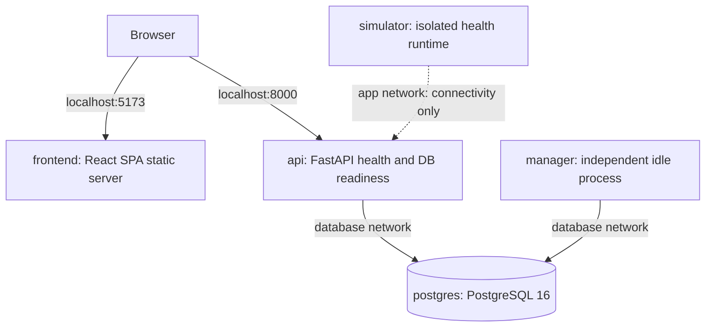

# Phase 1 — Project Foundation & Runtime Infrastructure

> **GPU Resource Marketplace — tài liệu kiến trúc theo phiên bản**<br>
> **Implementation:** `IMPLEMENTED` · **Document:** `DRAFT FOR REVIEW` (chưa commit vào repository)<br>
> **Governance addendum (21/10/2026):** yêu cầu kiểm soát thay đổi liên Phase đã được chủ dự án chấp thuận; **không** thay đổi phạm vi hay kết quả GPU-001 đã merge.

| Thuộc tính | Thông tin |
|---|---|
| Phase / Task | **Phase 1 / GPU-001** |
| Phụ trách | Nhóm trưởng — Foundation & Integration |
| Ngày hoàn thành GPU-001 | **21/10/2026** |
| Source baseline | `main` — [`c90f540b`](https://github.com/SE2026-BC-04/gpu-resource-marketplace/commit/c90f540b385c8d11789f994748e4f5441bcb7e1b) |
| Pull Request | [PR #3 — MERGED](https://github.com/SE2026-BC-04/gpu-resource-marketplace/pull/3) |
| Công nghệ / kiểu kiến trúc | **Modular Monolith; 5-service Docker Compose; CPU-only simulation foundation** |
| Mốc kế tiếp | Phase 1B — Database Schema & Persistence |

## 1. Mục tiêu

**Mục tiêu:** dựng nền tảng chạy được, kiểm thử được và có ranh giới module rõ ràng để phát triển GPU Resource Marketplace theo từng phiên bản, không xây toàn bộ nghiệp vụ trong một lần.

**Tiêu chí của GPU-001:**

1. Chạy được đúng **5 services**: Frontend, API, Manager, Simulator, PostgreSQL.
2. API và Manager chia sẻ backend package; Simulator là process/project độc lập, không có quyền truy cập DB trực tiếp.
3. Cung cấp cấu hình, health checks, Alembic bootstrap, Docker Compose, dependency lockfiles, CI và test smoke.
4. Có sẵn module boundaries để Thành viên 2–5 triển khai Database, Authentication, Listings và Jobs.
5. Không triển khai business logic khi API Contract, database migrations và các nhiệm vụ nghiệp vụ chưa được giao.

**Kết quả:** các mục 1–5 đã thực hiện trong GPU-001 và PR #3 được merge. **Phase 1 ở đây chỉ là mốc Foundation; không đồng nghĩa toàn bộ Phase 1B–1E đã hoàn tất.**

## 2. Thiết kế kiến trúc tổng quan

### 2.1. Sơ đồ runtime hiện tại



**Diễn giải:** Browser tải frontend và gửi API requests trực tiếp đến API loopback. Mũi tên Simulator → API chỉ thể hiện đường kết nối nội bộ đã được smoke test; **chưa có dispatch, callback, signing hoặc xử lý Job**.

### 2.2. Thành phần và quyền hạn

| Service | Công nghệ | Trách nhiệm ở Phase 1 | Kết nối |
|---|---|---|---|
| `frontend` | React 19, TypeScript, Vite, Node 24 | Placeholder UI; Vite production build, static server và SPA fallback | Host `127.0.0.1:5173`; không có DB access |
| `api` | Python 3.12, FastAPI, Pydantic 2 | `/health/live`, `/health/ready`, CORS, config/logging | Host `127.0.0.1:8000`; DB nội bộ |
| `manager` | Python 3.12, shared backend package | DB readiness, idle lifecycle, graceful shutdown | DB nội bộ; không public HTTP port |
| `simulator` | Python project và Docker image riêng | Health endpoints; runtime tách biệt | `app` network; không có DB credentials/driver/port |
| `postgres` | PostgreSQL 16 | Database service + volume lâu dài; chưa có business tables | Nội bộ + host `127.0.0.1:5432` cho local tools |

### 2.3. Network topology và bất biến an toàn

| Network | Kiểu | Services tham gia | Ý nghĩa |
|---|---|---|---|
| `frontend` | Bridge | `frontend` | Phục vụ static UI |
| `app` | **Internal bridge** | `api`, `manager`, `simulator` | Kết nối HTTP nội bộ khi có nghiệp vụ |
| `database` | **Internal bridge** | `api`, `manager`, `postgres` | Kênh PostgreSQL tin cậy |
| `api-host` | Bridge | `api` | Publish API vào host loopback |
| `postgres-host` | Bridge | `postgres` | Publish PostgreSQL vào host loopback |

- Simulator **không** tham gia `database` / `postgres-host`; không nhận `GPU_MARKETPLACE_DATABASE_URL`, password hay oracle.
- Browser chỉ gọi Backend API; không truy cập trực tiếp Manager, Simulator hay PostgreSQL.
- Host ports của Frontend, API và PostgreSQL chỉ bind `127.0.0.1` theo [`compose.yaml`](../../../compose.yaml).
- API/Manager là hai tiến trình riêng nhưng tái sử dụng các `common/domain/repositories` của cùng backend package.
- Không thêm broker, Redis/Celery, Kubernetes hoặc long-lived service thứ sáu ngoài phạm vi kiến trúc đã duyệt.

## 3. Thiết kế source code và module boundaries

```text
backend/
  src/gpu_marketplace/
    api/             # FastAPI app factory, health routes
    manager/         # Manager process, readiness, graceful shutdown
    common/          # Pydantic settings, logging, SQLAlchemy DB probe
    domain/          # SQLAlchemy metadata root; chưa có business models
    repositories/    # Persistence boundary; chưa có business repositories
    identity/        # Dành cho GPU-003
    listings/        # Dành cho GPU-004
    jobs/            # Dành cho GPU-005
  migrations/        # Alembic bootstrap; versions/ chưa có business revisions
  tests/
  pyproject.toml
  uv.lock
simulator/           # Project Python riêng, pyproject.toml/uv.lock/Dockerfile riêng
frontend/            # src/api/, src/ui/, Vite/TS, server.mjs, package-lock.json
compose.yaml
tools/compose_smoke.py
tests/test_compose_topology.py
.github/workflows/foundation.yml
```

**Luồng phụ thuộc áp dụng cho module sau:** HTTP entrypoint → use case/domain → repository/transaction → PostgreSQL. Domain không phụ thuộc FastAPI hay React; Simulator không import backend persistence. Nhóm trưởng tích hợp shared routers và cấu hình, không để các thành viên đồng thời sửa `api/app.py`.

**Phân công ownership:**

| Thành viên | Phạm vi chính |
|---|---|
| Nhóm trưởng | `api/app.py`, `common/`, `manager/`, `simulator/`, Compose, CI, tích hợp Frontend/Backend |
| Thành viên 2 | `domain/`, `repositories/`, `migrations/`, database tests — **GPU-002** |
| Thành viên 3 | `identity/`, Authentication/RBAC tests và Login UI — **GPU-003** |
| Thành viên 4 | `listings/`, Listing API/tests và Listings UI — **GPU-004** |
| Thành viên 5 | `jobs/`, Job API/tests và Jobs UI — **GPU-005** |

## 4. Các thiết kế kỹ thuật đã triển khai

### 4.1. Backend / database readiness

- `GET /health/live` → `200 {"status":"ok"}`.
- `GET /health/ready` → kiểm tra DB với `SELECT 1`; thành công trả `200` và `components.database="ok"`, lỗi trả `503`.
- FastAPI app factory hỗ trợ injected health probe phục vụ unit tests.
- CORS dùng origin allowlist; đã khai báo `GET/POST/PATCH` và các headers cần thiết cho API dự kiến, **nhưng chưa tạo các routes nghiệp vụ**.
- Database engine qua SQLAlchemy 2 + psycopg 3; Alembic đã bootstrap với metadata rỗng, chưa có migration tạo bảng nghiệp vụ.

### 4.2. Manager và Simulator

- Manager chạy process độc lập; không khởi động nếu DB chưa ready; vòng lặp idle và cơ chế dừng an toàn.
- Manager healthcheck dùng DB probe, không cung cấp HTTP route riêng.
- Simulator có lifecycle/health riêng, không có DB driver hoặc secret oracle; chưa thực thi workload.

### 4.3. Frontend và cấu hình chạy

- React SPA build bằng Vite trong Docker multi-stage; Node static server phục vụ `dist/` và hỗ trợ SPA fallback.
- Frontend mới có **placeholder UI + API health client**, chưa có Login/Listings/Jobs UI.
- `VITE_API_BASE_URL` được cấu hình lúc **build** từ `API_HOST_PORT`; đổi host API port thì cần rebuild frontend.
- `.env.example` dành riêng cho local, `.env` không commit; Backend/Simulator có lockfiles độc lập.

### 4.4. Reproducibility và Compose smoke

- `tools/compose_smoke.py` tạo Compose project riêng với port loopback động, kiểm tra các dịch vụ, database, static frontend và network isolation.
- Smoke kiểm tra cleanup chỉ xóa container/network/volume của **smoke project**, không ảnh hưởng project local đang chạy.
- Các service dùng healthcheck và Compose orchestration; PostgreSQL dùng persistent Docker volume.

## 5. Kết quả và bằng chứng nghiệm thu GPU-001

**Baseline:** [`main@c90f540b`](https://github.com/SE2026-BC-04/gpu-resource-marketplace/commit/c90f540b385c8d11789f994748e4f5441bcb7e1b) — merge ngày **21/10/2026**.<br>
**CI:** [GitHub Actions run #39554208291](https://github.com/SE2026-BC-04/gpu-resource-marketplace/actions/runs/39554208291).

| Hạng mục | Kết quả quan sát được |
|---|---|
| `python` CI job | **PASS**; Backend + topology **23 tests**; Simulator **2 tests** |
| `frontend` CI job | **PASS**; Vitest **3 tests**, typecheck và build |
| `compose` CI job | **PASS**; cả **5 services healthy** |
| Host → PostgreSQL | **PASS**; loopback TCP và truy vấn `SELECT 1` |
| API + Manager → PostgreSQL | **PASS**; readiness / healthcheck |
| Host → Frontend / API | **PASS**; production index, JS bundle, SPA fallback, API health |
| Simulator isolation | **PASS**; Simulator gọi được API nội bộ nhưng không resolve/connect trực tiếp PostgreSQL |
| Concurrent Compose stacks | **PASS**; stack local và smoke stack chạy cùng lúc |
| Smoke cleanup isolation | **PASS**; smoke resources bị xóa, container/network/volume IDs của local stack giữ nguyên |

**Giới hạn của bằng chứng:** Docker smoke được xác nhận trên **Linux GitHub Actions**; không có kết quả Docker local độc lập trên Windows. Cảnh báo Starlette/httpx deprecation không làm tests thất bại. Các bài kiểm thử DB nghiệp vụ, Auth, Listings, Jobs, Signed Results, E2E đầy đủ và benchmark 736 VU **chưa chạy**; không được ghi PASS.

### 5.1. Đối chiếu mục tiêu — kết quả

| Mục tiêu §1 | Kết quả | Trạng thái |
|---|---|---|
| 5 services chạy và healthy | Compose runtime smoke | **DONE** |
| Runtime isolation | Simulator không truy cập trực tiếp DB | **DONE** |
| Source/module boundaries | Các package và entrypoints được tạo | **DONE** |
| Build/tests/CI | 3 CI jobs PASS tại merge commit | **DONE** |
| Business API/data thực tế | Cố ý chưa triển khai trong GPU-001 | **DEFERRED** |

**Kết luận kỹ thuật:** **GPU-001 = IMPLEMENTED / MERGED**, không đồng nghĩa Marketplace MVP đã hoàn thành.

## 6. Quyết định đã phê duyệt và ảnh hưởng đến các phase tiếp theo

> Chủ dự án đã xác nhận **phê duyệt DEC-P1-03 và DEC-P1-04 trong trao đổi ngày 21/10/2026**. Đây là cập nhật quyết định cho các phase kế tiếp, **không phải tính năng đã được code trong GPU-001**. Những giá trị nêu dưới đây được phân biệt rõ theo mức độ đặc tả thực tế.

### DEC-P1-03 — Authentication profile (**OWNER APPROVED; implementation pending**)

Ghi nhận việc chấp thuận **phương án kỹ thuật đã đề xuất trong API Contract v0.6 §4.5/§14.3**, với hồ sơ cụ thể:

| Mục | Quy tắc được chốt cho GPU-003 |
|---|---|
| JWT signature | HS256, API secret riêng tối thiểu 256 bits |
| Claims / header | `iss="gpu-marketplace-api"`, `aud="gpu-marketplace-web"`, `typ="JWT"`, `sub` là UUID của user |
| TTL | `exp = iat + 900 giây` theo trusted issuance instant; từ chối khi `now >= exp`, không cho leeway |
| NumericDate | `iat`/`exp` biểu diễn bằng JSON number với **6 chữ số thập phân** (độ chính xác microsecond); so sánh ở cùng độ chính xác, không cắt/round về giây nguyên |
| Login normalization | Chỉ trim ASCII **SP, HT, LF, CR** ở hai đầu; **không** normalize NFC/NFD; **không** case folding; giữ phân biệt hoa/thường và giữ các Unicode whitespace khác |
| Trạng thái account | Mỗi protected request phải kiểm tra lại account `ACTIVE` và role từ DB |
| Session / Logout | JWT chỉ lưu volatile browser memory; không refresh/session table; Logout chỉ xóa token phía client, không revoke tức thời trên server |

**Handoff:** Đồng bộ trạng thái và thông số này vào **API Contract v0.6 §14.3** bằng PR tài liệu theo quy trình change control trước khi triển khai GPU-003. Trạng thái `NEEDS_OWNER_DECISION` còn trong bản tài liệu Git hiện tại là **chưa được đồng bộ**, không phải bằng chứng Authentication đã được code.

### DEC-P1-04 — Deterministic simulation reference (**OWNER APPROVED IN PRINCIPLE; technical specification pending**)

**Phần đã chốt:** Job hợp lệ của GPU-005 phải tạo **đúng một** `simulation_references` bất biến **cùng transaction với Job `QUEUED`**. Reference là *protected ground truth*, không gửi cho Client/Worker/Simulator; chỉ trusted backend/Manager được truy cập phục vụ nghiệp vụ được phê duyệt. Không thêm bảng ngoài thiết kế.

Các trường theo Database Design đã duyệt: `job_id`, `seed_value`, `algorithm_version`, `expected_outcome`, `expected_failure_reason`, `expected_digest`, `created_at`. `expected_digest` theo định dạng `sha256:` + 64 hex chữ thường. Kết quả ký ở phase sau tuân thủ ADR-004 và không thể tự động được coi là ground truth.

**Phần chưa có đặc tả cụ thể để triển khai:** thuật toán sinh seed, phiên bản deterministic generator, hình dạng chính xác của simulated output, cách tính expected outcome/failure/digest và bộ test vectors tương ứng. **Không suy diễn các giá trị này từ câu phê duyệt**, không hardcode placeholder oracle để qua test. Thành viên GPU-005 cần lập specification + fixtures và yêu cầu review thiết kế trước khi hiện thực `TX-SUBMIT` hoàn chỉnh. Trạng thái quyết định **không còn `NEEDS_OWNER_DECISION` về nguyên tắc**, nhưng **`SPEC_REQUIRED`** cho thuật toán.

### Phạm vi Phase 1B–1E được chọn

- **Database rollout:** 10 bảng ở Phase 1B; bổ sung 6 ở Phase 2; 2 ở Phase 3 (tổng thiết kế = **18 bảng**). Đây là **thứ tự triển khai**, không thay đổi cấu trúc logic đã phê duyệt.
- **Frontend rollout:** UI tối thiểu cho Login (1C), Listings (1D), Jobs (1E); GPU-001 mới có placeholder.
- Không thay đổi quyền sở hữu: **API** tạo/cancel Job `QUEUED`; **Manager** mới được cấp quyền allocation/terminal transition tại Phase 2.

## 7. Lộ trình tiến hóa và bàn giao

| Kiến trúc | Task | Deliverable chính | Trạng thái |
|---|---|---|---|
| **Phase 1** | GPU-001 | 5 services, module boundaries, health/readiness, Docker/CI | **IMPLEMENTED** |
| Phase 1B | GPU-002 | 10 business tables, models, Alembic, persistence + DB tests | PLANNED |
| Phase 1C | GPU-003 | Login/Me/Logout, JWT/RBAC, Login UI | PLANNED |
| Phase 1D | GPU-004 | Listings APIs, ownership/Pause/Resume, Listings UI | PLANNED |
| Phase 1E | GPU-005 | Submit/Read/Cancel Jobs, `QUEUED`, atomic reference, Jobs UI | PLANNED; oracle spec needed |
| Phase 2 | Các nhiệm vụ sẽ lập sau | Scheduling, execution, Signed Results, +6 tables | FUTURE |
| Phase 3 | Các nhiệm vụ sẽ lập sau | Dispute/Retention, +2 tables | FUTURE |

**Bộ 10 bảng Phase 1B:** `users`, `roles`, `user_roles`, `workers`, `worker_public_keys`, `gpu_listings`, `jobs`, `simulation_references`, `worker_reputation_aggregates`, `audit_events`.

**6 bảng Phase 2:** `execution_attempts`, `allocations`, `execution_outbox`, `result_inbox`, `signed_results`, `job_reputation_contributions`.

**2 bảng Phase 3:** `disputes`, `retention_exceptions`.

**Thứ tự tích hợp:** Foundation → Database → Auth → Listings → Jobs → E2E Phase 1. Các thành viên có thể làm việc trên branches riêng bằng interfaces/mocks, nhưng không được merge trái dependency, migration hoặc contract.

### 7.1. Kiểm soát thay đổi từ Foundation sang các Phase khác (bổ sung 21/10/2026)

Chủ dự án yêu cầu **cảnh báo và xác nhận giữa 2 người phụ trách** khi một cập nhật thực chất trong Markdown/code của GPU-001 gây ảnh hưởng đến Phase khác. Quy tắc áp dụng cho những thay đổi **sau** quyết định này; không áp dụng hồi tố để thay đổi kết quả PR #3. Chi tiết tại [Inter-Phase Change Control](../../development/interphase-change-control.md).

| Thành phần GPU-001 có thể thay đổi | Phase phải rà soát **khi có tác động thực tế** | Hai phía cần xác nhận |
|---|---|---|
| `compose.yaml`, DB URL/network, Alembic bootstrap | GPU-002, GPU-003/004/005 nếu phụ thuộc | Nhóm trưởng + owner Phase bị ảnh hưởng |
| `api/app.py`, shared `common/`, CORS/error/router | GPU-003/004/005 | Nhóm trưởng + từng owner đang dùng interface |
| Frontend API client, shell, build-time config | GPU-003/004/005 | Nhóm trưởng + owner UI bị ảnh hưởng |
| Simulator boundary hoặc shared domain/repository import | GPU-002/005 và Phase 2 (nếu liên quan) | Nhóm trưởng + owner consumer |

**Gate:** người thay đổi đánh giá diff thành `NO_IMPACT`/`POTENTIAL_IMPACT`/`CONFIRMED_IMPACT`. Nếu có tác động, ghi cảnh báo kèm before/after, ảnh hưởng contract/tests và `ACK` hai phía trong PR/biên bản trước khi merge/tích hợp; thiếu xác nhận → `BLOCKED_INTERPHASE`. Chỉ đổi chính tả/định dạng không đổi nghĩa thì ghi `NO_IMPACT` và không bắt buộc lấy ACK. Quy tắc này **bổ sung**, không thay độc lập reviewer L0/L1 (≥1), L2/L3 (≥2) và change control gốc.

## 8. Tồn đọng và kiểm soát thay đổi

1. **Tài liệu quyết định:** cần sync `DEC-P1-03` vào API Contract và viết đặc tả chi tiết `DEC-P1-04` trước những phần code phụ thuộc; chỉ ghi các trạng thái này là *được duyệt trong trao đổi*, chưa được đồng bộ vào Git.
2. **Review governance:** GitHub chưa ghi nhận human approval của PR #3 và `main` chưa bật branch protection khi kiểm tra. Các PR mới phải tuân thủ quy chế: ≥1 reviewer độc lập cho L0/L1, ≥2 cho L2/L3; không tự merge.
3. **Documentation consistency:** [GPU-001 handoff](../../development/handoffs/GPU-001_foundation_handoff.md) là tài liệu as-built hiện hành; `compose.yaml` tại merge commit vẫn là nguồn topology thực tế.
4. **Không nâng trạng thái test:** giữ `NOT_RUN` / `BLOCKED` cho nghiệp vụ và benchmark chưa có evidence; một CI foundation PASS không chứng minh MVP hay production readiness.
5. **Thay đổi liên Phase từ 21/10/2026:** mọi chỉnh sửa Foundation tác động thực chất sang Phase khác phải có cảnh báo, xác nhận owner nguồn + owner tiêu thụ và ghi nhận kiểm thử theo §7.1; chưa có xác nhận cụ thể nào được suy ra chỉ từ yêu cầu này.

## 9. Reproduce và nguồn tham chiếu

Từ repository root (môi trường local):

```bash
cp .env.example .env
docker compose --env-file .env up --build

uv sync --project backend --locked --group dev
uv run --project backend --locked --group dev pytest backend/tests tests
uv sync --project simulator --locked --group dev
uv run --project simulator --locked --group dev pytest simulator/tests

npm --prefix frontend ci
npm --prefix frontend test
npm --prefix frontend run typecheck
npm --prefix frontend run build

uv run --project backend --locked python tools/compose_smoke.py
```

- [PR #3 — source và merge](https://github.com/SE2026-BC-04/gpu-resource-marketplace/pull/3)
- [GitHub Actions — kết quả tại merge commit](https://github.com/SE2026-BC-04/gpu-resource-marketplace/actions/runs/39554208291)
- [README](../../../README.md) · [GPU-001 Foundation Handoff](../../development/handoffs/GPU-001_foundation_handoff.md)
- [System Architecture](../system-architecture.md) · [ADR-008](../decisions/ADR-008-technology-stack.md)
- [API Contract](../../design/api-contract.md) · [Database Design](../../design/database-design.md)
- [Team Contribution Rules](../../development/team-contribution-rules.md)

---

**Tổng kết:** **GPU-001 hoàn thành, PR #3 đã merge, ba CI jobs PASS.** Đây là *as-built architecture record* của Foundation. **GPU-002–005 chưa triển khai** và tài liệu này **chưa commit/merge**; chỉ trở thành tài liệu kiến trúc chính thức sau khi được review, đồng bộ các quyết định và tạo PR tài liệu hợp lệ.
