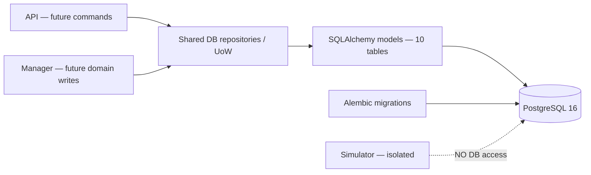

# Phase 1B — Database Schema & Persistence Layer (GPU-002)

> **Dự án:** GPU Resource Marketplace 
> **Tài liệu:** `docs/architecture/phases/phase1b_database_persistence.md` 
> **Ngày lập:** 21/10/2026 
> **Trạng thái tài liệu:** `APPROVED DESIGN` — chủ dự án phê duyệt ngày 21/10/2026; chưa đồng bộ lên Git 
> **Bổ sung governance 21/10/2026:** áp dụng [Inter-Phase Change Control](../../development/interphase-change-control.md); không mở rộng schema hoặc claim implementation.
> **Trạng thái triển khai:** `PLANNED / NOT_IMPLEMENTED` — phê duyệt thiết kế không đồng nghĩa cho phép tự commit/push/merge 
> **Phụ trách:** Thành viên 2 — Database & Persistence 
> **Baseline:** `main@c90f540b385c8d11789f994748e4f5441bcb7e1b` (GPU-001 merged) 
> **Nguồn chuẩn:** [Database Design v0.4](../../design/database-design.md), [Module Design](../../design/module-design.md), [Test Design](../../design/test-design.md), [API Contract v0.6](../../design/api-contract.md), ADR-001/002/008 và Team Contribution Rules.

## 1. Mục tiêu và phạm vi

**Mục tiêu:** biến nền tảng PostgreSQL/Alembic rỗng của GPU-001 thành lớp lưu trữ được kiểm chứng, đủ để GPU-003 (Authentication), GPU-004 (Listings) và GPU-005 (QUEUED Jobs) tiếp tục phát triển, **không** triển khai các luồng nghiệp vụ thay cho các thành viên đó.

**Điều kiện hoàn thành dự kiến:**

1. Có đúng **10 bảng nghiệp vụ** của Phase 1B; kiểu dữ liệu, khóa, constraints và indexes phù hợp Database Design đã duyệt.
2. Có SQLAlchemy 2 ORM mappings, Alembic revision có thể chạy trên PostgreSQL 16 thực và lớp Repository/Unit of Work cần thiết.
3. Seed danh mục ba roles (`CLIENT`, `WORKER`, `ADMIN`) có kiểm soát; dữ liệu account/Worker demo chỉ là fixture tách biệt, không commit password/secret thật.
4. Kiểm thử migration, integrity, FK/UNIQUE/CHECK, transaction rollback và ranh giới truy cập; giữ nguyên 5 services và health checks của GPU-001.
5. Handoff interface và bằng chứng kiểm thử cho GPU-003/004/005.

**Ngoài phạm vi:** Login/JWT/RBAC endpoints, Listings/Jobs HTTP API/UI, Manager allocation/scheduling, Simulator execution, Signed Results/Disputes/Retention worker, 8 bảng Phase 2–3, benchmark 736 VU và thay đổi yêu cầu/ADR/API Contract.

## 2. Kiến trúc kế thừa

GPU-001 cung cấp 5 long-lived services (`frontend`, `api`, `manager`, `simulator`, `postgres`), shared backend package, `domain/base.py` với `Base.metadata` rỗng, `common/database.py`, Alembic bootstrap, Compose/CI và Docker network isolation.

**Bất biến kiến trúc:**

- Chỉ API và Manager dùng backend persistence package; Simulator không import models/repositories, không có DB URL/credentials và không vào database network.
- Các domain policy thuần không phụ thuộc FastAPI, PostgreSQL driver hoặc React. SQLAlchemy mappings/DB adapters không chứa business decisions thuộc Auth, Listings, Jobs hay Manager.
- Repository/transaction layer hỗ trợ đúng quyền ghi theo Module Design; việc cùng dùng package **không** cho phép mọi caller tùy ý cập nhật mọi trạng thái.
- Không thêm service/broker/bảng/role nghiệp vụ ngoài phạm vi.

## 3. Thiết kế dữ liệu Phase 1B

### 3.1. Danh mục 10 bảng được duyệt

| Nhóm | Bảng | Mục đích Phase 1B |
|---|---|---|
| Identity | `users` | UUIDv4, login name, password hash, ACTIVE/DISABLED, thời gian tạo |
| Identity | `roles` | Lookup cố định CLIENT / WORKER / ADMIN |
| Identity | `user_roles` | Tối đa một role/account bằng PK(`user_id`); FK tới users/roles |
| Worker | `workers` | Một profile/WORKER user, composite role FK |
| Worker | `worker_public_keys` | Ed25519 public key 32 bytes, version/retirement; không lưu private key |
| Listings | `gpu_listings` | Worker ownership, GPU model/VRAM, total/allocated, ACTIVE/PAUSED, mock price |
| Jobs | `jobs` | Client/Listing/Worker binding, QUEUED/lifecycle columns, `enqueue_seq`, idempotency |
| Protected oracle | `simulation_references` | Một record tối đa/Job, seed/version/outcome/digest; không truy cập từ Simulator |
| Reputation | `worker_reputation_aggregates` | Lifetime counters, không phụ thuộc TTL Job |
| Audit | `audit_events` | Event đã redacted, độc lập Job FK và có TTL riêng trong phase sau |

**6 bảng Phase 2** và **2 bảng Phase 3** chỉ giữ trong thiết kế tổng thể 18 bảng, không tạo sớm hoặc tạo bảng giả.

### 3.2. Ràng buộc bắt buộc

- **Types:** PostgreSQL `uuid`, `timestamptz(6)`, `bytea`, `numeric(12,2)`, `bigint` đúng §9 Database Design; UUIDv4 cho định danh được chỉ định.
- **Role/ownership:** `user_roles.user_id` là PK; `workers(user_id,role_code)` tham chiếu composite tới `user_roles`; `jobs(client_id,client_role)` và `jobs(listing_id,worker_id)` có composite FK tương ứng. Không chỉ kiểm tra quyền ở UI.
- **Listing:** `total_gpu_count > 0`, `vram_gb > 0`, `0 <= allocated_gpu_count <= total_gpu_count`, status `ACTIVE|PAUSED`; giá mock không âm. Kiểm tra capacity với các Job khác là giao dịch nghiệp vụ của phase tiếp theo.
- **Job:** state `QUEUED|RUNNING|COMPLETED|FAILED|CANCELLED`; CHECK tính nhất quán `terminal_at`/`failure_reason` và idempotency key/hash; `enqueue_seq bigint GENERATED ALWAYS AS IDENTITY` duy nhất; partial unique `(client_id,idempotency_key)` khi có key. Khi submit thật, `enqueue_seq` và `submitted_at` chỉ được cấp **sau Listing lock**.
- **Reference:** PK+FK `simulation_references.job_id -> jobs.id`; `seed_value bigint`, `algorithm_version varchar(32)`, `expected_outcome`, `expected_failure_reason`, `expected_digest` chuẩn `sha256:` + 64 lowercase hex; hạn chế UPDATE/SELECT theo trusted boundary. FK đơn thuần mới bảo đảm *at most one*, không chứng minh *exactly one* reference cho mọi Job.
- **Keys/Aggregate/Audit:** public key đúng 32 bytes, key lịch sử không bị xóa khi cần evidence; aggregate counters không âm, không cascade theo Job; audit không FK vào Job và không chứa seed, token, password hay private key.
- **Indexes:** triển khai các unique/indexes **liên quan 10 bảng** theo Database Design §9.4: FIFO `jobs(listing_id,enqueue_seq)` khi QUEUED, Client history, Listing ownership/status, terminal history, audit created time và khóa tham chiếu. Không tạo index cho bảng chưa tồn tại.

### 3.3. Migration & seed

1. Tái sử dụng `backend/migrations/env.py`, `domain/base.py` và PostgreSQL connection hiện có.
2. Viết **một baseline revision có thể review** tạo 10 bảng theo dependency order: `roles/users → user_roles → workers → worker_public_keys/worker_reputation_aggregates → gpu_listings → jobs → simulation_references`; `audit_events` độc lập.
3. Khai báo rõ composite FK, ON DELETE behavior, CHECK, partial indexes và role seed. Không coi Alembic autogenerate là bằng chứng rằng DDL đã đúng thiết kế.
4. Xây dựng rollback/forward migration test trên **database test riêng**. Không tự downgrade hoặc xóa persistent volume đang sử dụng.
5. Kế hoạch SQL grants, protection triggers và guarded Job deletion phải được review trước khi triển khai: Compose hiện đưa API và Manager cùng một DB URL; không tuyên bố quyền ghi đã được phân tách chỉ nhờ source ownership.

### 3.4. Persistence layer và hợp đồng bàn giao

**Những phần Member 2 sở hữu:**
- SQLAlchemy model/mapping, DB relationships và metadata import cho Alembic.
- Session/transaction context (Unit of Work) và typed repositories cho Account/Role, Worker/Key, Listing, Job/Reference, Reputation read model, Audit append.
- Query an toàn với ownership filters, khóa/constraints và transaction primitives để các owner nghiệp vụ sử dụng về sau.
- Fixtures và integration tests chạy PostgreSQL thật; không dùng SQLite như bằng chứng thay thế.

**Không giao cho Member 2:** JWT issuance, Login UI, quyết định PAUSE/CANCEL/SUBMIT nghiệp vụ, thuật toán deterministic oracle, Manager FIFO allocator, result verification hay terminal transitions. Không để repository tự ý sinh fake ground truth để “làm cho test xanh”.

**Handoff theo phase:** GPU-003 nhận Account/Role queries và provisioning conventions; GPU-004 nhận Worker/Listing repository + ownership constraints; GPU-005 nhận Job/Reference persistence primitives, transaction-scoped Listing lock, `enqueue_seq` và idempotency constraints. `TX-SUBMIT` hoàn chỉnh thuộc GPU-005, không được coi là DONE ở GPU-002.

## 4. Gói công việc đề xuất cho Thành viên 2

| Task | Deliverable | Trạng thái |
|---|---|---|
| `GPU-002-A` | Phân tích 10 bảng và FK/constraint matrix đối chiếu Database Design §9 | PLANNED |
| `GPU-002-B` | SQLAlchemy mappings + Alembic migration + seed 3 roles | PLANNED |
| `GPU-002-C` | Repository/Unit of Work interfaces, transaction lifecycle, scope-safe queries | PLANNED |
| `GPU-002-D` | PostgreSQL integration tests: schema, constraints, concurrency/rollback, protected access | PLANNED |
| `GPU-002-E` | CI/Compose regression, migration runbook, handoff; **inter-phase impact/dual ACK gate** và PR có reviewer độc lập | PLANNED |

**Đề xuất thứ tự:** A → review thiết kế SQL/privileges → B → C → D → E. Không merge schema chưa review hoặc tạo business API đi trước contract/ownership.

## 5. Tiêu chí nghiệm thu và bằng chứng cần thu thập

| Gate | Kiểm chứng bắt buộc | Trạng thái hiện tại |
|---|---|---|
| `P1B-AC-01` | PostgreSQL 16 fresh DB `alembic upgrade head` tạo đúng 10 bảng; upgrade lại không thay đổi schema | NOT_RUN |
| `P1B-AC-02` | Check column types, defaults, constraints, indexes và metadata drift so với Database Design §9 | NOT_RUN |
| `P1B-AC-03` | FK/composite FK từ chối account role, Job/Listing/Worker mapping sai (`DBP-01`, `DBP-02`) | NOT_RUN |
| `P1B-AC-04` | Listing capacity CHECK, status constraints, duplicate/idempotency UNIQUE, digest format và key bytes (`DBP-04`, phần áp dụng được của `DBP-05`) | NOT_RUN |
| `P1B-AC-05` | FIFO acceptance sequence trên cùng Listing kể cả timestamp trùng (`DBP-03` / phần lưu trữ của `DBTX-01`), không nhầm với Manager scheduling | NOT_RUN |
| `P1B-AC-06` | Job/Reference insert cùng transaction trong fixture: rollback không để lại nửa dữ liệu; không dùng oracle generator giả | NOT_RUN |
| `P1B-AC-07` | Kiểm tra không lộ protected reference qua repository không tin cậy; no Simulator DB credentials/access; phương án DB grants/triggers được review | NOT_RUN |
| `P1B-AC-08` | Alembic round-trip trên test DB, full foundation pytest/Vitest/Compose smoke vẫn PASS trên revision mới | NOT_RUN |
| `P1B-AC-09` | Bằng chứng PR: revision IDs, commit SHA, PostgreSQL version, fixtures, commands, kết quả và reviewer độc lập | NOT_RUN |

Các `DBP`, `DBTX`, `DBD` phụ thuộc Phase 2/3 (allocation, signed receipt, Dispute, retention) giữ `NOT_RUN`/`BLOCKED`; không nhận là PASS trong Phase 1B. Benchmark 736 VU cũng `NOT_RUN`.

## 6. Kết quả hiện tại và rủi ro cần review

**Đã có từ GPU-001 (`IMPLEMENTED`):** PostgreSQL service/volume, DB readiness, SQLAlchemy+psycopg package, Alembic env/metadata root, Compose, CI và module stubs. PR #3 đã merge, các foundation CI jobs PASS.

**Phase 1B (`PLANNED`):** chưa có migrations nghiệp vụ, ORM models, repository implementations hoặc PostgreSQL schema acceptance evidence tại baseline đã kiểm tra. Tài liệu này là **bản giao việc để review, không phải nhật ký triển khai**.

**Các điểm cần chốt ở implementation review (không sửa quyết định gốc):**

1. **SQL permissions / immutable data / guarded deletion:** chi tiết role grants, trigger/function và migration tương thích với một DB URL đang dùng chung cho API/Manager; không nới lỏng bảo vệ protected reference hoặc xóa Job.
2. **Job–Reference completeness:** DB PK/FK bảo đảm tối đa một reference, còn invariant “mỗi Job hợp lệ có đúng một reference” phải do `TX-SUBMIT` ở GPU-005 bảo đảm atomically, trừ khi có cơ chế DB bổ sung được review riêng.
3. **`DEC-P1-03`:** owner đã duyệt login Unicode/JWT profile nhưng API Contract §14.3 trên `main` vẫn còn nhãn `NEEDS_OWNER_DECISION`; provisioning test fixtures phải dùng đúng quy tắc đã duyệt, còn tài liệu chuẩn cần sync qua PR change control.
4. **`DEC-P1-04`:** nguyên tắc reference đã duyệt; thuật toán seed/version/output/digest/test vectors chưa được xác nhận bằng specification trong repository; **không cản việc tạo columns/constraints** ở GPU-002 nhưng **chặn GPU-005 hoàn thành `TX-SUBMIT`**.

**Kết quả nghiệm thu GPU-002:** `PENDING`. Chỉ đổi thành `IMPLEMENTED` khi code được triển khai, PostgreSQL tests ghi nhận PASS, PR có human review phù hợp và được merge.

## 7. Phê duyệt và bước kế tiếp

- **Quyết định ngày 21/10/2026:** chủ dự án **APPROVED DESIGN** cho phạm vi 10 bảng, gói GPU-002-A..E, phân quyền ownership và bộ tiêu chí nghiệm thu Phase 1B. Phê duyệt được ghi nhận trong trao đổi; file chưa được commit/merge vào repository.
- **Technical review trước khi code phần nhạy cảm:** duyệt chi tiết SQL grants/immutability/guarded deletion, phạm vi repository, transaction boundary và cách thực thi PostgreSQL integration tests. Không xem phê duyệt bản kiến trúc là phê duyệt sẵn mọi SQL trigger/function chưa được đặc tả.
- **Bàn giao:** Thành viên 2 triển khai trên branch đề xuất `feat/gpu-002-db-persistence` **sau khi có phân công/lệnh coding rõ ràng**; mọi thay đổi vượt approved contract phải qua change control (L2/L3).
- **PR governance:** tối thiểu 1 independent human reviewer cho L0/L1, 2 cho L2/L3; không tự approve hoặc tự merge; không push/commit/PR nếu chưa được yêu cầu.
- **Tiếp nối:** Phase 1C GPU-003 → Phase 1D GPU-004 → Phase 1E GPU-005. Không thêm Manager scheduling hoặc Simulator execution trước Phase 2.

## 8. Inter-Phase Impact & Dual Acknowledgement (bổ sung được chủ dự án chấp thuận)

**Yêu cầu bắt buộc:** mọi thay đổi **thực chất** trong thiết kế/Markdown hoặc code GPU-002 ảnh hưởng tới Phase khác phải được cảnh báo và xác thực giữa **Thành viên 2 (owner dữ liệu)** và **từng owner Phase bị ảnh hưởng**, trước khi merge/tiêu thụ interface mới. Áp dụng [quy trình liên Phase](../../development/interphase-change-control.md); không xem phê duyệt thiết kế Phase 1B là bằng chứng ACK cho một diff phát sinh sau đó.

| Khu vực dễ ảnh hưởng | Cần thông báo và đối chiếu với |
|---|---|
| `users`, `roles`, `user_roles`, login provisioning/normalization | Thành viên 3 (GPU-003), người sở hữu Authentication/RBAC |
| `workers`, `gpu_listings`, listing FK/status/capacity, repository signatures | Thành viên 4 (GPU-004); Thành viên 5 (GPU-005) nếu Job admission phụ thuộc |
| `jobs`, `simulation_references`, `enqueue_seq`, uniqueness, transaction/UoW | Thành viên 5 (GPU-005); Thành viên 4 nếu tương tác Listing, và owner Phase 2 khi được giao |
| DB grants, Alembic, engine/session config, Compose/API/Manager boundaries | Nhóm trưởng (GPU-001/integration) và các owner thực sự dùng contract đó |
| `worker_public_keys`, reputation aggregate, audit fields | Owner Phase 2/3 khi có người được giao; các owner hiện tại nếu API/seed phụ thuộc |

**Handoff trước merge/tích hợp GPU-002:** ghi baseline SHA/migration revision, tác động `NO_IMPACT|POTENTIAL_IMPACT|CONFIRMED_IMPACT`, bản ghi before/after + test IDs, phản hồi `ACK_COMPATIBLE|ACK_WITH_ACTIONS|REJECTED` từ **mỗi** consumer liên quan; thiếu ACK hoặc cần đổi Database Design/API Contract chưa qua CR → `BLOCKED_INTERPHASE`. Xác nhận hai owner **không thay thế** 1–2 independent human GitHub reviewers theo change level. Sau kiểm thử mới đánh dấu gate `CLOSED`.

**Áp dụng cho các Phase kế tiếp:** GPU-003/004/005 phải kiểm tra lại actual migration/repository SHA của GPU-002 trước khi tích hợp; nếu Phase sau đề nghị sửa schema/API dùng chung, Thành viên 2 phải xác nhận theo chiều ngược lại. Chỉnh sửa ngôn từ không đổi nghĩa chỉ cần ghi `NO_IMPACT`.
