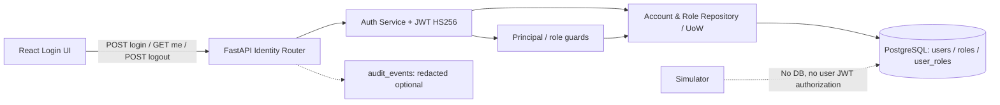

# Phase 1C — Authentication & RBAC (GPU-003)

> **Dự án:** GPU Resource Marketplace<br>
> **Đường dẫn:** `docs/architecture/phases/phase1c_authentication_rbac.md`<br>
> **Ngày lập:** 21/10/2026<br>
> **Chủ sở hữu công việc:** Thành viên 3 — Identity/Auth và Login UI<br>
> **Trạng thái tài liệu:** `APPROVED DESIGN` — Chủ dự án phê duyệt ngày 21/10/2026; tài liệu đã có trong repository (PR #4), trạng thái triển khai ghi riêng bên dưới<br>
> **Bổ sung governance 21/10/2026:** áp dụng [Inter-Phase Change Control](../../development/interphase-change-control.md); nội dung Auth đã duyệt và trạng thái implementation không thay đổi.
> **Trạng thái triển khai:** `PLANNED / NOT_IMPLEMENTED` — phê duyệt thiết kế, chưa cho phép tự động code/commit/push/PR<br>
> **Baseline thiết kế ban đầu:** `main@c90f540b385c8d11789f994748e4f5441bcb7e1b` (GPU-001 đã merge)<br>
> **Rà soát đồng bộ ngày 24/10/2026:** `main@f2db64e` (PR #9 đã merge); chỉ rà soát tài liệu, đối chiếu với [schema matrix GPU-002-A](phase1b_gpu002a_schema_matrix.md) revision 3 (commit `b923b9e`; nội dung trong tài liệu đó vẫn ghi `PROPOSED`); không xác nhận dependency đã sẵn sàng hay test ứng dụng đã chạy.<br>
> **Phụ thuộc:** GPU-002 (Phase 1B) đã được chủ dự án duyệt **thiết kế**, chưa có migration nghiệp vụ trên `main` tại thời điểm kiểm tra. Các đề xuất về DB role, grants, trigger, cách chạy migration và cô lập test DB trong schema matrix GPU-002-A **chưa được nhóm trưởng quyết định** (D1–D12); mục nào của tài liệu này dựa trên chúng đều ghi rõ là đề xuất.<br>
> **Nguồn chuẩn:** [API Contract v0.6](../../design/api-contract.md) §§3–6,14; [Database Design v0.4](../../design/database-design.md) §9.2; [Module Design](../../design/module-design.md) §§2–5; [Test Design](../../design/test-design.md); ADR-001/002/008 và [Team Contribution Rules](../../development/team-contribution-rules.md).

## 1. MỤC TIÊU

**Mục đích:** thay thế UI placeholder/Auth skeleton của GPU-001 bằng cơ chế xác thực thật qua PostgreSQL và giao diện Login tối thiểu; cung cấp `AuthenticatedPrincipal` và các role guards để GPU-004/005 tích hợp mà không viết lại quy tắc xác thực.

### 1.1. Phạm vi phải làm

1. **Backend Identity:** `POST /api/v1/auth/login`, `GET /api/v1/auth/me`, `POST /api/v1/auth/logout` đúng API Contract; kiểm tra login/password hash, trạng thái account và đúng một role được cấp trong DB.
2. **JWT:** phát hành/kiểm tra JWT HS256 theo `DEC-P1-03`; xác thực `iss`, `aud`, `typ`, `sub`, `iat`, `exp`, strict 900 giây; không dựa vào role từ token thay cho PostgreSQL.
3. **RBAC:** reusable authorization dependency/policy cho ba role `CLIENT`, `WORKER`, `ADMIN`; bảo vệ server-side, làm rõ khác biệt giữa xác thực, role và resource ownership.
4. **Frontend:** React Login form, current-user state, hiển thị role, Logout; dùng API thật, lưu token **chỉ trong bộ nhớ tạm thời**; handle loading/errors/expiry.
5. **Tests:** thực thi các phần `API-AUTH-01..14` có thể kiểm chứng ngay ở Phase 1C, Vitest UI và một luồng Login → Me → Logout bằng DB test thật; không ghi PASS cho các route chưa có ở Phase 1D/1E/Phase 2.
6. **Integration:** bảo toàn health checks, network boundaries, CI và dependency locks của GPU-001.

### 1.2. Không làm

- Không có public `register/signup`, reset/change password, change-role, tạo Admin, OAuth/SSO, refresh token, DB session table hoặc revoke JWT tức thời.
- Không triển khai Listings/Jobs API, Dashboard nghiệp vụ, Manager scheduler, Simulator workload, Signed Results/Disputes.
- Không thêm bảng/cột/constraint mới ngoài 10 bảng Phase 1B của GPU-002, service thứ sáu, cookie session, localStorage/IndexedDB token hoặc rate-limit behavior chưa được chấp thuận.
- Không tự sửa Requirements, ADR hoặc hợp thức hóa API Contract khác biệt ngoài quy trình change control.

### 1.3. Definition of Done dự kiến

- API auth có thật và chạy qua **GPU-002 PostgreSQL persistence**, không trả user giả/hardcode credentials.
- JWT đúng profile owner-approved, role/account kiểm tra lại từ DB trên **mỗi protected request**.
- Login UI chạy end-to-end với ít nhất Client/Worker/Admin fixture; Logout xóa token khỏi browser volatile state; reload trang không tự phục hồi session.
- Test bắt buộc trong phạm vi Phase 1C PASS và có bằng chứng; test chưa thể chạy được đánh dấu `BLOCKED`/`NOT_RUN`.
- Code được review độc lập và merge theo Team Contribution Rules trước khi gọi `IMPLEMENTED`.

## 2. THIẾT KẾ

### 2.1. Kế thừa và thay đổi

| Thành phần | Đã có từ GPU-001 / phụ thuộc | GPU-003 bổ sung |
|---|---|---|
| `api` FastAPI | App factory, health, CORS, logging, DB readiness | Identity router, HTTP DTO/validation, auth guards, standard errors |
| `identity/` | Package skeleton | Auth use cases, credential verifier, JWT codec, principal/policy |
| `repositories/`, `domain/` | Skeleton; GPU-002 được duyệt thiết kế | Dùng Account/Role query + SQLAlchemy UoW do GPU-002 bàn giao |
| PostgreSQL | PostgreSQL 16 service, no business migration trên `main` | **Không tạo bảng**; chỉ **đọc** `users`, `roles`, `user_roles` (không có quyền ghi trong thiết kế GPU-002); audit append (`INSERT` vào `audit_events`) khi phù hợp |
| `frontend` | React/TS/Vite SPA, API health client, placeholder | Login form, Auth API client, session memory, logout và role readout |
| `manager`, `simulator` | Independent processes, simulator không được nối DB | Không thay đổi; internal service tokens **khác** end-user JWT |



**Ranh giới gọi:** HTTP handler → identity use case / auth policy → Account/Role repository (GPU-002) → PostgreSQL. Domain policy không import FastAPI hay React. Role guard ở backend là nguồn quyền; UI chỉ hỗ trợ hiển thị và điều hướng.

**Điều kiện từ GPU-002 mà Auth phải tuân thủ** (theo Database Design §9.2 và schema matrix GPU-002-A):

| Chủ đề | Nội dung | Nhãn |
|---|---|---|
| Cột dùng cho Auth | `users(id, login_name varchar(128) UNIQUE, password_hash text, status ACTIVE\|DISABLED)`, `user_roles(user_id PK, role_code)`, `roles(code)`. `PK(user_id)` bảo đảm tối đa một role/account; account không có dòng `user_roles` vẫn có thể tồn tại và phải bị từ chối (fail closed) | `SPEC` |
| Không có cột ghi cho Auth | Auth không `INSERT/UPDATE/DELETE` `users`, `user_roles`, `roles`; tài khoản chỉ được provisioning ngoài migration, bằng role có quyền owner (matrix mục 5 và 6.2), không bao giờ bằng DSN runtime của API/Manager. **Contract credential cho provisioning (tên biến, cách cấp, công cụ chạy) chưa được định nghĩa:** `GPU_MARKETPLACE_MIGRATION_DATABASE_URL` ở matrix mục 9.1 là biến dành cho migration, GPU-003 **không** mặc định coi đó là giao diện provisioning. Chờ Thành viên 2 và nhóm trưởng chốt (§5.3 mục 10) | `SPEC` + `PROPOSAL` (mục 5, 6.2 của matrix); credential provisioning `PENDING` |
| Tên constraint là contract | Repository ánh xạ lỗi DB theo tên (`uq_users_login_name`, `ck_users_status`, `fk_user_roles_*`); Auth không được phụ thuộc vào thông điệp lỗi của driver | `IMPL` (đề xuất đặt tên của matrix) |
| Quyền DB của API | Nếu D1 được duyệt, một script bootstrap chạy **trước** migration tạo group `gpm_api_rw` và login role `gpm_api_app` (`NOSUPERUSER`, `NOCREATEDB`, `NOCREATEROLE`, ...). API runtime kết nối bằng `gpm_api_app`, chỉ có `SELECT` trên `users`, `user_roles`, `roles` và `INSERT` (không gồm `id`, `created_at`) trên `audit_events`; không service runtime nào nhận owner DSN. Test Auth gọi API bằng role này, còn fixture dựng dữ liệu bằng owner | `PROPOSAL` (D1, chờ nhóm trưởng) |
| `audit_events.actor_kind` | CHECK chỉ cho `USER` hoặc `SERVICE`; không có giá trị cho người chưa xác thực. Cách ghi sự kiện login thất bại (và việc có ghi hay không) phải được chốt trước khi code; `actor_ref` không được chứa `login_name` thô hay bất kỳ giá trị người dùng nhập | Cần quyết định (xem §5.3) |

### 2.2. API Contract giữ nguyên

| Method | Path | Quyền / kết quả | Quy tắc then chốt |
|---|---|---|---|
| `POST` | `/api/v1/auth/login` | Public; `200` + JWT + user | `login_name`, `password`; `401 INVALID_CREDENTIALS` cho sai tên/mật khẩu/disabled; fail-closed khi role không hợp lệ |
| `GET` | `/api/v1/auth/me` | User JWT; `200` current identity | Đọc `ACTIVE` và role hiện tại từ DB; `401` nếu token/account không hợp lệ |
| `POST` | `/api/v1/auth/logout` | User JWT; `204`, no body | Không revoke JWT trên server; không đổi dữ liệu Job, Listing hay Role |

**Login success DTO đã được API Contract mô tả:**

```json
{
  "access_token": "<opaque-user-jwt>",
  "token_type": "Bearer",
  "expires_in": 900,
  "user": {
    "id": "e98d4b53-dca0-4a50-8ea0-51647b60b254",
    "login_name": "demo_client",
    "role": "CLIENT"
  }
}
```

`GET /auth/me` chỉ trả `id`, `login_name`, `role`. **Không** trả `password_hash`, internal Bearer tokens, protected reference hay account người khác. Auth/private responses phải có `Cache-Control: no-store`; controlled errors theo dạng `{"error":{"code","message","request_id"}}` và `X-Request-ID` theo API Contract §3.

**HTTP validation:** JSON lạ/malformed → `400`; thiếu/sai kiểu/rỗng fields → `422`; wrong account/password/disabled → cùng generic `401`; thiếu/sai JWT → `401`; user hợp lệ nhưng sai role → `403`. Owner mismatch của private resource thuộc API Listing/Jobs và phải thực thi ở server-side query (không chỉ RBAC).

### 2.3. DEC-P1-03 — JWT profile đã được chủ dự án duyệt

| Nội dung | Ràng buộc triển khai |
|---|---|
| JWT signing | Chỉ `HS256`; API signing secret riêng có entropy ít nhất 256 bit; tuyệt đối không nhúng frontend bundle hoặc commit Git |
| Token header/claims | Header `typ="JWT"`; `iss="gpu-marketplace-api"`; `aud="gpu-marketplace-web"`; `sub` là UUID user |
| Trusted clock | `iat` = thời điểm cấp trên trusted server clock; `exp = iat + 900 giây` |
| Precision | `iat`, `exp` là JSON NumericDate numbers, 6 chữ số phần thập phân; so sánh ở microsecond precision, không ép integer-second/float rounding gây sai boundary |
| Validity | `T0+899.999999s` còn hợp lệ; `T0+900.000000s` hết hạn; không leeway |
| Authorization freshness | Protected request phải xác thực chữ ký/header/claims/expiry **và** DB `status='ACTIVE'`, đúng một authoritative role |
| Storage | JWT chỉ giữ trong volatile React/browser memory; reload mất session; không Web Storage, IndexedDB, cookies, URL hoặc SW cache |
| Logout | Gọi endpoint rồi xóa token phía browser; token cũ vẫn có thể dùng trên server trước khi hết hạn nếu user còn ACTIVE |

**Đồng bộ trạng thái:** owner đã phê duyệt `DEC-P1-03` trong trao đổi 21/10/2026, nhưng bản `docs/design/api-contract.md` trên `main` vẫn ghi `NEEDS_OWNER_DECISION` cho §4.5/§14.3. Trước coding Auth phải cập nhật **đúng trạng thái phê duyệt** qua PR tài liệu hợp lệ (và các oracle Unicode/NumericDate liên quan); không coi tài liệu cũ là bằng chứng quyết định chưa được chấp thuận.

**Lưu ý triển khai:** dùng representation/verification bảo toàn microseconds và kiểm thử byte serialization; không dựa mù quáng vào JWT library nếu thư viện tự cast `iat`/`exp` sang integer hoặc tự cho expiry leeway. Chọn thư viện/thuật toán serialization cụ thể trong implementation review, không đổi JWT contract.

### 2.4. Login normalization và mật khẩu

Hàm normalization **duy nhất** phải được dùng đồng nhất trong account provisioning (GPU-002 fixtures) và Login (GPU-003):

- Chỉ trim 4 ASCII code points ở hai đầu: SP `U+0020`, HT `U+0009`, LF `U+000A`, CR `U+000D`.
- **Case-sensitive** (`Demo` và `demo` khác nhau), **không** `lower()` hoặc `casefold()`.
- **Không NFC/NFD normalization**; precomposed và decomposed Unicode phân biệt.
- Không trim `U+00A0` hoặc các Unicode whitespace khác.
- Validate `login_name` có độ dài `1..128` **sau** normalization; login toàn ASCII spaces → `422`.
- **Không trim/normalize password**; kiểm tra password bằng hash lưu ở `users.password_hash`, không dùng plain-text comparison/logging.

**Chủ sở hữu hàm dùng chung (đề xuất, chờ ACK của Thành viên 2):** hàm chuẩn hóa `login_name` và hàm băm/kiểm tra mật khẩu do Thành viên 3 sở hữu dưới dạng hàm thuần (không import FastAPI, SQLAlchemy hay PostgreSQL driver). Công cụ provisioning của Thành viên 2 chỉ **import lại** hàm này, không tự cài đặt quy tắc thứ hai. Database Design không có CHECK chuẩn hóa cho `login_name`, nên tính nhất quán provisioning/login chỉ được bảo đảm bằng việc dùng chung hàm và bằng test.

**Đặc tính của cột `login_name` ở phía DB:** `UNIQUE(login_name)` và phép so sánh bằng chỉ phân biệt hoa/thường và NFC/NFD nếu cột dùng collation xác định (deterministic, mặc định của PostgreSQL). Test `P1C-AC-04` phải có kiểm tra ở mức DB (`Demo` khác `demo`, `café` NFC khác NFD) và kiểm tra collation của cột.

**Chưa được đặc tả trong nguồn:** password hashing/verification algorithm cụ thể và quy trình provisioning tài khoản demo an toàn. Phải đưa ra đề xuất kỹ thuật để nhóm trưởng review cùng GPU-002/GPU-003 trước code phụ thuộc; không tuyên bố một thuật toán đã được duyệt khi repository chỉ quy định lưu `password_hash`.

### 2.5. RBAC & principal

`AuthenticatedPrincipal` (conceptual): `user_id: UUID`, `role: CLIENT|WORKER|ADMIN`, `status=ACTIVE`, xác lập **từ token hợp lệ và DB hiện hành**.

**Request flow cho protected API:** parse `Authorization: Bearer` → verify HS256 + typ/iss/aud/sub/iat/exp → query DB account/role → require ACTIVE & exactly one role → role guard → resource ownership guard (do owner module cung cấp) → authorized use case.

- `CLIENT`: được gọi client-owned commands/reads khi các route Job được GPU-005 triển khai.
- `WORKER`: được gọi Worker-owned Listing commands/reads khi GPU-004 triển khai.
- `ADMIN`: **read-only monitoring**, không trở thành Manager service hoặc có quyền sửa Listing/Job.
- Missing/invalid end-user auth `401`; authenticated but wrong-role `403`; private resources của người khác được che bằng `404` theo route contract.
- Hai internal service Bearer tokens (Manager→Simulator, Simulator→API) không thay thế được user JWT và ngược lại.

**Phase 1C chỉ triển khai reusable guards và Auth endpoints**. Việc gắn guards thật vào Listings/Jobs route và ownership query là responsibility của GPU-004/005.

### 2.6. Frontend tối thiểu

**Màn hình/khả năng:** Login form (`login_name`, `password`), loading/error (generic, không lộ username existence), authenticated view thể hiện login name + role + Logout. React Auth context/state dùng bộ nhớ tạm; API client gửi Bearer cho các protected requests và xóa state khi unauthorized/expired; không lưu vào persistent storage.

**Luồng:** Open SPA → Login → API trả JWT + user → frontend gọi `/auth/me` để xác nhận identity hiện hành → hiển thị role → Logout → gọi API và xóa token memory → trở lại Login. Khi refresh tab, phải Login lại. Không xây Dashboard business cho Admin hoặc giao diện Listings/Jobs trong GPU-003.

**Integration ownership:** Thành viên 3 sở hữu `identity/`, Auth UI/client/tests. Nhóm trưởng sở hữu `api/app.py`/router integration và shared config; tránh chỉnh đồng thời; mọi thay đổi common HTTP error/request-ID và Compose config cần leader review.

### 2.7. Dự kiến tổ chức source

```text
backend/src/gpu_marketplace/
  identity/
    normalization.py       # shared provisioning/login normalization policy
    authentication.py      # verify credentials, issue/verify JWT, read principal
    authorization.py       # reusable role/principal guards
    router.py              # 3 approved Auth routes, DTO and errors
  repositories/            # GPU-002's actual account/role queries/UoW, reused
  common/config.py         # JWT secret injection if authorized
  api/app.py               # router inclusion by integrator (team leader)
backend/tests/
  test_identity_*.py       # JWT, normalization, authorization unit and API tests

frontend/src/
  api/                     # auth client + type-safe DTOs
  ui/                      # Login UI, authenticated summary, Logout
  ...                      # volatile session state and Vitest tests
```

**Tên file chi tiết là gợi ý triển khai, không phải thay đổi module boundary đã phê duyệt.** Tránh tạo ORM models hoặc schema mới trong GPU-003 nếu GPU-002 đã sở hữu chúng.

## 3. NHIỆM VỤ TRIỂN KHAI ĐÃ DUYỆT VỀ PHẠM VI

| ID | Người thực hiện | Deliverable | Dependency |
|---|---|---|---|
| `GPU-003-A` | TV3 + trưởng nhóm review | Sync `DEC-P1-03` vào API Contract §4.5/§14.3 và test oracles liên quan bằng PR tài liệu riêng/đúng change control | Owner approval 21/10 |
| `GPU-003-B` | TV3 | Auth normalization, password verification, JWT codec + frozen-clock tests | Hash/provisioning review |
| `GPU-003-C` | TV3 | 3 Auth endpoints + fresh DB principal + role guards | GPU-002 Account/Role repository và migration |
| `GPU-003-D` | TV3 + trưởng nhóm tích hợp | React Login/Me/Logout UI, volatile token/client, API router/CORS/error integration | GPU-003-C; shared paths review |
| `GPU-003-E` | TV3 | PostgreSQL-backed integration tests, Vitest và Auth E2E, security checks | GPU-002 integrated |
| `GPU-003-F` | TV3 + independent reviewer | Regression CI, runbook/fixtures, **dual owner ACK cho impact** và PR handoff | B–E PASS |

Có thể phát triển `GPU-003-B` và UI với mocks độc lập trên branch riêng trước khi GPU-002 merge. **Không merge/đánh dấu Auth E2E PASS** trước khi database thật và query/seed đã được kiểm chứng.

## 4. KẾ HOẠCH KIỂM THỬ & NGHIỆM THU

### 4.1. API Contract traceability

| Test ID | Phase 1C dự kiến kiểm chứng | Trạng thái hiện tại |
|---|---|---|
| `API-AUTH-01..08` | Login 3 roles, normalized credentials, generic failures, wrong DTOs, Me, JWT invalid/expiry, disabled account, missing role | NOT_RUN / DB dependent |
| `API-AUTH-09` | Unit tests cho role guards trong GPU-003; thực tế Listings/Jobs writes sẽ test ở GPU-004/005 | PARTIAL PLANNED |
| `API-AUTH-10` | Ownership guard contract thuộc Jobs/private resources khi routes có thật | BLOCKED — GPU-005/Phase 2 |
| `API-AUTH-11` | Unit tests phân biệt user JWT với internal tokens; E2E internal routes phải chờ Phase 2 | PARTIAL PLANNED |
| `API-AUTH-12` | Logout 204, no server revoke, local token clear, token expiry | NOT_RUN |
| `API-AUTH-13` | Redaction/no-store trên Auth API + frontend/CI artifacts; full cross-service scan deferred | PARTIAL PLANNED |
| `API-AUTH-14` | No public signup/change-role; unknown routes return 404 | NOT_RUN |

**Không tính test sau-phase là PASS:** `API-AUTH-09/10/11/13` có những assertions phụ thuộc GPU-004/005 hoặc internal HTTP Phase 2. Ghi evidence riêng cho portion thực thi; giữ phần còn lại là `BLOCKED/NOT_RUN`, không thay đổi approved test IDs.

### 4.2. Acceptance gates riêng GPU-003

| Gate | Điều kiện PASS (chỉ khi có evidence) |
|---|---|
| `P1C-AC-01` | DB fixture C1/W1/A1 login đúng role; missing/wrong/disabled đều generic 401; 0 secrets trong JSON/log |
| `P1C-AC-02` | JWT HS256 đúng `iss/aud/typ/sub`; sai chữ ký/claim/algorithm bị 401 |
| `P1C-AC-03` | Microsecond NumericDate test: `T0+899.999999` hợp lệ, `T0+900.000000` hết hạn, `exp-iat=900s`, zero leeway |
| `P1C-AC-04` | Unicode/case/ASCII-trim fixtures theo DEC-P1-03; seeding/Login normalization đồng nhất |
| `P1C-AC-05` | User disabled/role changed after issuance được đánh giá theo DB current state; invalid mapping fail closed. Vì `workers(user_id, role_code)` và `jobs(client_id, client_role)` tham chiếu `user_roles` bằng khóa ghép với `ON DELETE RESTRICT`, tài khoản seed có Worker profile hoặc Job **không** đổi/xóa được role: test phải tạo tài khoản tạm không có phụ thuộc bằng owner DSN |
| `P1C-AC-06` | Login/Me/Logout API status+DTO/error/no-store/request-ID đúng v0.6; 0 public registration endpoints |
| `P1C-AC-07` | React Login→Me→Logout với API thật; browser refresh/mount không phục hồi JWT; protected call gửi đúng Bearer |
| `P1C-AC-08` | Fresh PostgreSQL DB+fixtures, pytest + Vitest + Compose smoke + current foundation regression PASS |
| `P1C-AC-09` | PR có SHA/command/log evidence, reviewer độc lập đúng cấp độ, merge trước khi ghi IMPLEMENTED |

**Môi trường test DB (theo đề xuất GPU-002-A mục 9.2–9.3, D11–D12, chờ quyết định):** integration test Auth dùng **chung fixture DB của GPU-002**, không tự viết fixture tạo/xóa DB hay bootstrap role. Fixture đó chỉ chạy trên một **cluster PostgreSQL tạm riêng** (CI: service postgres mới mỗi job; local: container tạm ngoài Compose project sản phẩm), qua các hàng rào cấp cluster C1–C5 và cấp database G1–G9; cần các biến `GPU_MARKETPLACE_TEST_DATABASE_URL`, `GPU_MARKETPLACE_ALLOW_DESTRUCTIVE_DB_TESTS=1` và `GPU_MARKETPLACE_TEST_CLUSTER_TOKEN`. Thiếu cluster hoặc biến thì test được skip và ghi `NOT_RUN`, không ghi PASS, không bao giờ fallback sang service `postgres` của Compose dev. Mật khẩu của `gpm_api_app` trong test sinh ngẫu nhiên cho từng cluster tạm, không đọc `.env` dev. Seed `users`/`user_roles` bị `BLOCKED` cho đến khi thuật toán băm mật khẩu được duyệt.

**Test evidence phải ghi:** Git SHA, migration revision, env/runtime, fixture/fake clock, command, actual status/body (đã redacted), oracle, PASS/FAIL/BLOCKED/NOT_RUN. Foundation CI PASS của GPU-001 không chứng minh Auth PASS.

## 5. TRẠNG THÁI VÀ BÀN GIAO

### 5.1. Đã triển khai (`IMPLEMENTED`)

- **Kế thừa GPU-001:** FastAPI app/health/CORS, React skeleton/API client, PostgreSQL readiness, 5-service Compose, dependency lockfiles và CI.
- **Chưa có code Auth nghiệp vụ** ở `main` tại baseline kiểm tra; package `identity` hiện chỉ có stub.

### 5.2. Chưa triển khai (`PLANNED / NOT_RUN`)

Toàn bộ `GPU-003-A..F`, Auth endpoints/guards, password hash verifier, JWT issuance, Login UI và Auth runtime/DB tests. Phase 1B được duyệt thiết kế nhưng chưa merge migration, nên integration phụ thuộc persistence còn `BLOCKED`.

### 5.3. Điểm cần review trước coding (không tự thay đổi hợp đồng)

1. **Document sync:** chốt quy trình PR đồng bộ `DEC-P1-03` sang API Contract/test descriptions; đây là ghi nhận phê duyệt cũ, không phải làm lại quyết định.
2. **Password hashing/provisioning:** source quy định hash, chưa có thuật toán/phương án tạo fixture cụ thể được duyệt. Thành viên 2/3 phải thống nhất interface và kiểm thử an toàn.
3. **JWT exact precision:** trình bày lựa chọn thư viện, cách serialize JSON NumericDate ở microsecond và verify không truncate/leeway để tech lead kiểm tra trước code.
4. **API integration:** `api/app.py` do trưởng nhóm sở hữu; phải thỏa error/request-ID contract mà không phá health route/CORS/CI cũ.
5. **External test dependencies:** các phép thử về ownership của Jobs/Listing và internal Bearer routes chưa thể nghiệm thu toàn bộ ở GPU-003, phải handoff đúng chủ sở hữu.
6. **Hàm dùng chung với provisioning:** xác nhận với Thành viên 2 rằng chuẩn hóa `login_name` và băm mật khẩu do `identity/` sở hữu và công cụ provisioning import lại (xem §2.4).
7. **Audit cho người chưa xác thực:** `audit_events.actor_kind` chỉ có `USER|SERVICE`; quyết định có ghi sự kiện login thất bại hay không và dùng `actor_kind`/`actor_ref` nào (không chứa `login_name` thô).
8. **Phụ thuộc vào đề xuất GPU-002-A (D1–D12):** cách cấp DB role cho API, cách chạy migration bằng owner DSN và cluster test tạm còn chờ nhóm trưởng; không viết test hay cấu hình giả định chúng đã được duyệt.
9. **Collation và khóa ghép:** thêm kiểm tra collation của `login_name` và dùng tài khoản tạm cho test đổi/mất role (xem §2.4 và `P1C-AC-05`).
10. **Credential cho provisioning:** Thành viên 2 và nhóm trưởng chốt công cụ provisioning nhận credential quyền owner bằng biến/giao diện nào (dùng chung với migration hay biến riêng), quy tắc không ghi credential ra dòng lệnh/log, và cách dùng trong cluster test tạm. Cho đến khi chốt, GPU-003 không viết tài liệu, test hay cấu hình giả định một tên biến cụ thể.

### 5.4. Handoff

- **GPU-004 (Listings):** `require_role(WORKER)` + trusted principal/Worker mapping; server-side listing ownership query; UI có thể lấy auth state.
- **GPU-005 (Jobs):** `require_role(CLIENT)` + trusted `user_id` để scope/submit/cancel, uniform private-resource 404; dùng chung auth headers/session state.
- **Manager/Simulator (Phase 2):** internal Bearer tokens vẫn hoàn toàn tách biệt; user JWT không cấp quyền thao tác scheduling/callback.
- **Docs:** khi GPU-003 thực sự triển khai, cập nhật tệp này bằng PR/CI/functional test evidence; chỉ sau code review + merge đổi `PLANNED` sang `IMPLEMENTED`.

---

**Ghi nhận phê duyệt (21/10/2026):** Chủ dự án xác nhận **APPROVED DESIGN** cho phạm vi Auth/RBAC, ba endpoint `Login/Me/Logout`, UI tối thiểu, phân công `GPU-003-A..F` và kế hoạch kiểm thử/handoff trong tài liệu này. Việc phê duyệt là quyết định thiết kế được ghi nhận trong trao đổi, **không** xác nhận đã có code, CI hoặc PR của GPU-003.

**Phân biệt quyết định:** `DEC-P1-03` (JWT/Unicode) đã được chủ dự án phê duyệt từ trước; việc đồng bộ API Contract trên Git vẫn phải qua change control. Phương án **password-hashing/provisioning cụ thể, JWT library/serialization, chi tiết tích hợp shared `api/app.py`** cần technical review trước khi triển khai phần phụ thuộc; không được tự nâng các lựa chọn chưa chốt thành `APPROVED`.

**Kết luận hiện tại:** `GPU-003 = APPROVED DESIGN / IMPLEMENTATION NOT STARTED`. Tài liệu này là baseline bàn giao, không phải lệnh tạo branch, code, commit, push, mở PR hoặc merge. Chỉ đánh dấu `IMPLEMENTED` sau khi triển khai, có evidence test thực tế và được review/merge hợp lệ.

## 6. Inter-Phase Impact & Dual Acknowledgement (bổ sung được chủ dự án chấp thuận)

**Yêu cầu bắt buộc:** nếu Thành viên 3 sửa nội dung Markdown/code Phase 1C mà thực sự làm thay đổi giả định của Phase khác (hoặc Phase khác đề nghị thay đổi Auth-owned contract), phải thông báo và ghi nhận **xác nhận hai chiều của owner nguồn và owner tiêu thụ**, theo [Inter-Phase Change Control](../../development/interphase-change-control.md), **trước khi merge hay tích hợp**.

| Auth boundary có thể bị đổi | Owner phải cùng xác thực **khi bị ảnh hưởng** |
|---|---|
| Account/role repository, password provisioning, DB query semantics, tên constraint, DB grants/role của API, credential provisioning (contract chưa định nghĩa, §5.3 mục 10), fixture và cluster test (xem `XPH-GPU-002-01` revision 3, hiện `AWAITING_CROSS_PHASE_ACK`) | Thành viên 2 (GPU-002) + Thành viên 3 |
| `AuthenticatedPrincipal`, role guard, JWT claim/expiry/normalization | Thành viên 4 (GPU-004) và/hoặc Thành viên 5 (GPU-005) + Thành viên 3 |
| Shared frontend Auth state, API client/Bearer convention | Thành viên 4/5 dùng UI; nhóm trưởng nếu shared shell/client chịu tác động |
| `api/app.py`, CORS, config, error/request-ID, router registration | Nhóm trưởng (GPU-001/integration) + Thành viên 3 |
| User JWT vs internal service token boundary | Nhóm trưởng/owner Phase 2 khi phần internal routes thật sự phụ thuộc |

**Đặc biệt:** `DEC-P1-03` đã được owner phê duyệt nhưng API Contract trên Git chưa sync. Khi tạo PR đồng bộ tài liệu, phải ghi rõ **đây là sync quyết định có sẵn**, kiểm tra phạm vi ảnh hưởng tới GPU-002/004/005 và lấy xác nhận nếu thay đổi giả định triển khai của các thành viên. Không coi toàn bộ PR tài liệu là `NO_IMPACT` chỉ vì không có code; cũng không mặc định mọi sửa chính tả cần dual ACK.

**Gate:** thay đổi tác động → impact record (old/new, affected interfaces, test IDs, owners, SHA), thông báo, `ACK_COMPATIBLE` hoặc `ACK_WITH_ACTIONS` từ mỗi owner tiêu thụ; chưa xác nhận/bất đồng → `BLOCKED_INTERPHASE`. Điều kiện này **cộng thêm** độc lập GitHub reviewers theo mức L0–L3. Khi GPU-004/005 bắt đầu, mỗi owner phải xác nhận version Auth contract/principal thực tế đã nhận, không suy diễn thiết kế được duyệt là code đã merge.
