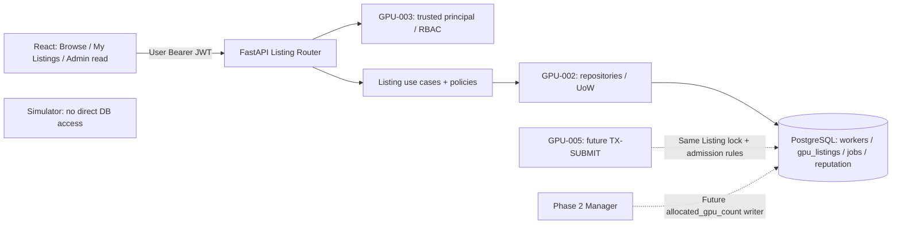

# Phase 1D — GPU Listings Management (GPU-004)

> **Dự án:** GPU Resource Marketplace<br>
> **Đường dẫn:** `docs/architecture/phases/phase1d_gpu_listings.md`<br>
> **Ngày:** 21/10/2026<br>
> **Owner:** Thành viên 4 — Listings / Registry<br>
> **Trạng thái tài liệu:** `APPROVED DESIGN` — chủ dự án phê duyệt ngày 21/10/2026; tài liệu đã có trong repository, trạng thái triển khai ghi riêng bên dưới<br>
> **Trạng thái triển khai:** `PLANNED / NOT_IMPLEMENTED` — phê duyệt kiến trúc không đồng nghĩa tính năng đã có code<br>
> **Baseline thiết kế ban đầu:** `main@c90f540b385c8d11789f994748e4f5441bcb7e1b` — GPU-001 đã merge; GPU-002 và GPU-003 mới được chủ dự án duyệt **thiết kế**, chưa merge code trên `main` tại mốc này.<br>
> **Rà soát đồng bộ ngày 23/10/2026:** `main@538802adebeaeb74dcccd0c025f3a7abc81336c0` và handoff tại `ffb17de39d32956087aca187d490bb03c32ee980`; chỉ rà soát tài liệu, không xác nhận dependency đã sẵn sàng hay test ứng dụng đã chạy.<br>
> **Đối chiếu các Phase trước ngày 24/10/2026:** `main@21071549937888c997b250625607a16a97a20419` (PR #7, #9, #10 đã merge); đã đọc Foundation, Phase 1B, schema matrix GPU-002-A revision 3 và Phase 1C cập nhật. Matrix vẫn `PROPOSED / FOR LEAD REVIEW`; không coi tài liệu đã merge là quyết định duyệt D1–D12 hoặc evidence triển khai.<br>
> **Handoff thực hiện:** [GPU-004 — Thành viên 4](../../development/handoffs/GPU-004_member4_handoff.md) — nhiệm vụ, ownership và checklist PR.<br>
> **Nguồn chuẩn:** [API Contract v0.6](../../design/api-contract.md) §7, [Database Design v0.4](../../design/database-design.md) §§9, 11, [Module Design](../../design/module-design.md) §§2–5, [Test Design](../../design/test-design.md), [Functional Requirements](../../functional-requirements.md) `FR-WR-01..04`, ADR-001/002/008 và [Team Contribution Rules](../../development/team-contribution-rules.md). Quy trình phối hợp: [Inter-Phase Change Control](../../development/interphase-change-control.md).

## 1. MỤC TIÊU

### 1.1. Mục đích và kết quả kỳ vọng

Hiện thực **M1 — Worker Registry & Listings** theo Evolutionary Architecture: Worker đã được cấp tài khoản đăng thông tin GPU **giả lập**, cập nhật hoặc tạm dừng/khôi phục Listing; Client duyệt catalogue; Admin xem tất cả dưới dạng **read-only**. Giao diện React sử dụng **API và PostgreSQL thật**, không dữ liệu hardcode làm kết quả nghiệm thu.

**Tiêu chí hoàn thành Phase 1D:**

1. Đúng **6 endpoint** Listing của API Contract §7 vận hành với JWT + role guard (GPU-003) và dữ liệu PostgreSQL (GPU-002).
2. Quyền Worker owner, trạng thái `ACTIVE`/`PAUSED` và các ràng buộc chỉnh sửa/capacity được bảo vệ trong backend + transaction, không dựa vào UI.
3. DTO read bao gồm thông số GPU giả lập, snapshot khả dụng, giá mock dạng decimal string và read-only reputation projection; tuyệt đối không rò rỉ token/key/oracle.
4. UI tối thiểu cho `CLIENT`, `WORKER`, `ADMIN`; một vòng thao tác tạo → xem → chỉnh sửa → pause → resume được kiểm thử qua API thật.
5. Các kiểm thử áp dụng được của `API-LIST-01..18` có bằng chứng chạy thật; phần cần GPU-005 hoặc Phase 2 giữ `BLOCKED/NOT_RUN`.
6. **Inter-Phase Impact & Dual Acknowledgement** được kiểm tra ở PR/handoff; không còn impact blocker chưa được hai phía xác nhận.

### 1.2. Phạm vi loại trừ

Không triển khai Worker public signup/onboarding/key provisioning, Job submission/cancellation, Manager allocation, FIFO scheduler runtime, Simulator execution, signed receipts, disputes, payment/real pricing, GPU thật, dashboard nghiệp vụ hoặc bảng DB/service mới. `available_gpu_count` **không phải** GPU reservation; Resume **không** tự cấp phát Job.

## 2. THIẾT KẾ

### 2.1. Kế thừa và thay đổi

| Nguồn | Đã có / thiết kế đã duyệt | Phase 1D sử dụng hoặc bổ sung |
|---|---|---|
| GPU-001 — Foundation (`IMPLEMENTED`) | FastAPI app/health, frontend skeleton, PostgreSQL service, shared backend, CI/Compose; 5 services | Tích hợp router/UI vào app hiện hữu; không thay đổi runtime topology |
| GPU-002 — Database (thiết kế đã có trên Git; code `NOT_IMPLEMENTED`) | Thiết kế 10 bảng Phase 1B, gồm `workers`, `gpu_listings`, `jobs`, `worker_reputation_aggregates`; UoW/repositories vẫn cần hiện thực. Matrix GPU-002-A có các đề xuất D1–D12 chưa được quyết định | Dùng migration/repository thực sau khi bàn giao; đọc Job để kiểm tra guard, không tự tạo schema hoặc triển khai nghiệp vụ Job |
| GPU-003 — Authentication (thiết kế đã có trên Git; code `NOT_IMPLEMENTED`) | Thiết kế `AuthenticatedPrincipal`, HS256 JWT, role guard, Login UI và frontend volatile session; còn gate đồng bộ Auth contract và provisioning | Nhận principal/guard và Auth client thực; kiểm tra role/account hiện hành, rồi resolve Worker và kiểm tra Listing ownership trong GPU-004 |
| GPU-004 — **MỚI** (`PLANNED`) | Chưa có nghiệp vụ Listing trên `main`; `listings/` mới có stub | Registry use cases, routes, DTO, Listing UI, tests và handoff GPU-005 |



**Phân quyền ghi:** API tạo Listing với `allocated_gpu_count=0`, sau đó chỉ sửa metadata/status; **Manager là writer duy nhất** cập nhật counter khi cấp phát/giải phóng GPU trong Phase 2. Mọi thay đổi phải bảo toàn `0 <= allocated_gpu_count <= total_gpu_count` theo Database Design `DB-INV-01`. Simulator không có đường truy cập PostgreSQL theo ADR-002, nên sơ đồ không vẽ cạnh Simulator → DB. `users`/`roles` và Worker profiles đã provisioned, không được sửa trong Listing routes. Queries của module không expose `worker_public_keys.public_key_raw`, mật khẩu, internal Bearer, `simulation_references` hoặc execution evidence.

**Đầu vào cần nhận từ các Phase trước:** [Foundation §§2–4,7](phase1_project_foundation.md), [Phase 1B §§3.2–3.4,6](phase1b_database_persistence.md), [schema matrix GPU-002-A revision 3](phase1b_gpu002a_schema_matrix.md) và [Phase 1C §§2.5–2.6,5.3–5.4](phase1c_authentication_rbac.md). Các dòng `PROPOSAL` dưới đây chỉ mô tả ảnh hưởng nếu được duyệt; không chốt thay quyết định của TV2/TV3/nhóm trưởng.

| Đầu vào / chủ sở hữu | Cách GPU-004 sử dụng | Trạng thái cần phân biệt |
|---|---|---|
| Foundation / nhóm trưởng | Giữ 5 services, health/CORS và network isolation; nhóm trưởng tích hợp `api/app.py`/shared UI. Không thêm service migration hoặc tự migrate khi API khởi động | Foundation đã triển khai; thay shared config cần owner review |
| Dữ liệu / TV2 | Dùng `workers.user_id` để resolve owner; giữ `gpu_listings.worker_id` bất biến và composite FK `jobs(listing_id,worker_id)`. Chỉ đọc `jobs` và reputation projection; không ghi Job/reference/reputation từ Listing use case | `SPEC` của Database/Module Design; code/repository chưa bàn giao |
| Listing INSERT/UPDATE / TV2 | Nếu grants ở matrix §6.3 được duyệt: INSERT chỉ `worker_id`, `gpu_model`, `vram_gb`, `total_gpu_count`, `mock_price_per_hour`; `id`, `status=ACTIVE`, `allocated_gpu_count=0`, timestamps lấy từ DB defaults. UPDATE chỉ metadata/status theo endpoint, không gửi toàn bộ ORM row | `PROPOSAL` (D1); khởi tạo counter bằng default không phải quyền API sửa allocation |
| DB clock, trigger và lỗi / TV2 | Nếu D7 được duyệt, `updated_at` do trigger đặt; repository không UPDATE cột này. GPU-004 dùng typed errors theo contract repository đã bàn giao, không parse message của driver; tên constraint/mã lỗi cụ thể phải được TV2 chốt | Tên constraint là `IMPL` đang trình review; D7/D10 vẫn chờ quyết định. Trigger không thay `TX-PAUSE-EDIT` và các guard liên quan Job |
| Principal/Auth client / TV3 | Nhận `AuthenticatedPrincipal(user_id, role, status=ACTIVE)` từ token hợp lệ + DB role/account hiện hành trên mỗi request; sau đó GPU-004 resolve `workers.id` và kiểm tra ownership. Dùng lại volatile session/Bearer client, xóa auth state khi hết hạn/401 theo GPU-003 | Contract khái niệm đã có; chữ ký interface thực cần bàn giao. Không tự viết JWT codec, login normalization hoặc provisioning trong Listings |

**Gate trước tích hợp:** cần revision migration/UoW/repository của GPU-002 và principal/Auth client của GPU-003 có evidence thật. Phase 1C ghi `DEC-P1-03` đã được owner duyệt nhưng API Contract §4.5/§14.3 vẫn còn nhãn `NEEDS_OWNER_DECISION`; GPU-003-A phải đồng bộ qua review trước phần code phụ thuộc. Hash/password provisioning và credential provisioning vẫn cần TV2/TV3/nhóm trưởng chốt; GPU-004 không tự đặt tên biến owner DSN hay tạo account/profile. Có thể soạn policy/DTO/UI với doubles trên branch riêng, nhưng tích hợp PostgreSQL/Auth thật còn `BLOCKED/NOT_RUN` khi các gate này chưa sẵn sàng.

### 2.2. Bộ 6 endpoint cố định

| Method | Path | Caller / kết quả | Bất biến |
|---|---|---|---|
| `GET` | `/api/v1/gpu-listings` | Authenticated `CLIENT`/`WORKER`/`ADMIN`; `200` paginated | `scope=marketplace` (mặc định) chỉ ACTIVE; `mine` Worker-only; `all` Admin-only |
| `GET` | `/api/v1/gpu-listings/{listing_id}` | Ba role; `200` / `404` | PAUSED vẫn xem chi tiết được; `accepting_jobs=false` |
| `POST` | `/api/v1/gpu-listings` | `WORKER`; `201` + `Location` | Worker ID suy từ user đã xác thực; ACTIVE, allocated=0 |
| `PATCH` | `/api/v1/gpu-listings/{listing_id}` | Worker **owner**; `200` | Chỉ 4 field được PATCH; Listing lock trước khi kiểm tra jobs/capacity |
| `POST` | `/api/v1/gpu-listings/{listing_id}/pause` | Worker owner; `200` | `ACTIVE→PAUSED`; lặp PAUSED là no-op thành công |
| `POST` | `/api/v1/gpu-listings/{listing_id}/resume` | Worker owner; `200` | `PAUSED→ACTIVE`; lặp ACTIVE là no-op thành công |

**Không** đưa `worker_id` từ body/query để quyết định quyền. Worker account không có profile → `409 WORKER_PROFILE_MISSING` khi tạo. Client/Admin tạo/sửa/pause/resume → `403`; Worker truy cập Listing của Worker khác để sửa → uniform `404 LISTING_NOT_FOUND`. GET scope trái quyền → `403`, không trả dữ liệu nhạy cảm.

### 2.3. DTO, filter và frontend contract

**Listing response theo API Contract §7.3:**

```json
{
  "id": "22222222-2222-4222-8222-222222222222",
  "worker": {
    "id": "11111111-1111-4111-8111-111111111111",
    "display_name": "Demo Worker",
    "reputation": {
      "successful_jobs": 7,
      "worker_fault_jobs": 3,
      "success_rate": "0.7000"
    }
  },
  "gpu_model": "NVIDIA A100 (simulated)",
  "vram_gb": 80,
  "total_gpu_count": 8,
  "allocated_gpu_count": 3,
  "available_gpu_count": 5,
  "status": "ACTIVE",
  "accepting_jobs": true,
  "mock_price_per_hour": "12.50",
  "created_at": "2026-10-18T08:00:00.000000Z",
  "updated_at": "2026-10-18T08:00:00.000000Z"
}
```

- **Snapshot:** `available_gpu_count = total_gpu_count - allocated_gpu_count`; `accepting_jobs = (status == ACTIVE)`; cả hai chỉ mang tính hiển thị. Admission thật phải được GPU-005 kiểm tra lại dưới Listing lock.
- **Reputation:** đọc từ `worker_reputation_aggregates`, không tự cập nhật theo API; nếu tổng eligible = 0, counts = 0 và `success_rate=null`; còn lại tỷ lệ string **4 chữ số thập phân**. UI hiển thị `N/A` khi null.
- **Giá:** `mock_price_per_hour` là string decimal chính xác 2 chữ số hoặc null, `0..9999999999.99`, PostgreSQL `numeric(12,2)`; **không** chuyển sang float khiến làm tròn sai và không thực hiện thanh toán.
- **Các trường cấm** trong request create/PATCH: `worker_id`, `id`, `allocated_gpu_count`, `status`, `created_at`, `updated_at`, owner/client/role và field ngoài allowlist; trả `400 UNKNOWN_FIELD`.
- **Browse:** `scope=marketplace|mine|all` (default marketplace), `status=ACTIVE|PAUSED` tùy scope; marketplace + PAUSED → `400 INVALID_FILTER`. `limit` default 20, 1..100; opaque cursor bound scope/filter/user; sort `created_at DESC,id DESC`; tampered/mismatched cursor → `400 INVALID_CURSOR`; output `{ "items": [...], "next_cursor": null|string }`. Không hứa có snapshot cố định giữa các trang.
- **Detail:** cả ba role xem metadata an toàn của PAUSED; unknown → `404`, sai định dạng UUID → `422`.

**Create body chỉ gồm** `gpu_model` (trim outer whitespace, 1..160, giữ case), `vram_gb` và `total_gpu_count` (strict positive JSON integers, không nhận bool/float/string; PostgreSQL int32), `mock_price_per_hour` (optional null / decimal string 2 chữ số). Body tạo giống nhau gửi hai lần có thể tạo **hai Listing**; không tự đưa Listing idempotency key chưa được phê duyệt.

**PATCH body:** chỉ `gpu_model`, `vram_gb`, `total_gpu_count`, `mock_price_per_hour`; ít nhất một field. `mock_price_per_hour: null` nghĩa là xóa giá hiển thị. Không cho đổi `status` bằng PATCH; Pause/Resume có endpoint riêng.

### 2.4. Transaction `TX-PAUSE-EDIT`: quy tắc bắt buộc

Dùng PostgreSQL `READ COMMITTED` và row-level locks như Database Design §11. Cho Create dùng repository/UoW hiện có, validate Worker profile/FK; cho PATCH/Pause/Resume:

1. Xác thực account và role từ GPU-003; resolve `workers.id` server-side; xác định Listing, kiểm tra ownership (không leak non-owned).
2. `SELECT gpu_listings[listing_id] FOR UPDATE`; **sau lock** mới recheck status/capacity và truy vấn `jobs` liên quan. Đảm bảo không lấy Job lock trước Listing. Giữ transaction ngắn; không gọi HTTP trong lock.
3. **Hardware edit:** nếu giá trị `gpu_model` hoặc `vram_gb` thực sự thay đổi, từ chối khi bất kỳ Job của Listing còn `QUEUED` hoặc `RUNNING`: `409 LISTING_HARDWARE_LOCKED`; no-op cùng giá trị được chấp nhận.
4. **Giảm capacity:** yêu cầu new total `>= allocated_gpu_count` và `>= MAX(requested_gpu_count)` của mọi Job `QUEUED`. Nếu cả hai fail, ưu tiên `409 LISTING_CAPACITY_BELOW_ALLOCATED`; nếu riêng queued max fail → `409 LISTING_CAPACITY_BELOW_QUEUED_MAX`. Không dùng snapshot UI để phán quyết.
5. **Pause:** đổi ACTIVE sang PAUSED hoặc no-op; Job RUNNING tiếp tục, QUEUED giữ hàng đợi; submit/allocate lấy lock **sau commit pause** phải bị chặn bởi chính use case sở hữu tương ứng. **Resume:** đổi PAUSED sang ACTIVE hoặc no-op; không tự allocate.
6. Commit metadata/status trong một transaction; `updated_at` phản ánh trusted DB time khi có thay đổi, qua cơ chế do GPU-002 bàn giao. Nếu D7 được duyệt thì trigger đặt timestamp, API không UPDATE cột này. No-op pause/resume có thể trả DTO mà không phát UPDATE. Rollback giữ nguyên tất cả cột nếu một điều kiện fail.

**Concurrency boundary:** cả GPU-005 `TX-SUBMIT` và Phase 2 Manager `TX-ALLOCATE` phải dùng **cùng Listing lock trước Job**. Hai PATCH metadata hợp lệ thực hiện nối tiếp; last-committed value wins đối với field cùng tên (không có ETag/version column trong thiết kế duyệt). Không thêm column mới để giải quyết lost-update mà chưa có change control.

### 2.5. Cấu trúc module và UI tối thiểu

```text
backend/src/gpu_marketplace/
  listings/               # Listing policy + use cases + HTTP router + DTO
  repositories/            # Reuse GPU-002 Listing/Worker/Job read + UoW
  identity/                # Reuse GPU-003 AuthenticatedPrincipal / guards
  api/app.py               # Team-lead integration: include approved router
backend/tests/             # Listing API, DB invariants, guarded transaction tests
frontend/src/
  api/                     # Reuse auth-aware client; Listing requests/types
  ui/                      # Browse, detail, Worker manage, Admin read-only
```

Frontend tối thiểu: `CLIENT` duyệt catalogue ACTIVE/chi tiết; `WORKER` duyệt hoặc vào `mine`, tạo/chỉnh sửa/pause/resume Listing của mình; `ADMIN` dùng `all` read-only; loading, empty/error state, pagination. Không bổ sung dashboard nghiệp vụ, thanh toán, nút chạy GPU/Job hay frontend DB access. UI **không** tự quyết định quyền; Backend là authority. Sử dụng JWT volatile-memory từ GPU-003 (không localStorage/cookies/IndexedDB).

Khi đang gửi thao tác, khóa nút tương ứng để tránh bấm lặp. Không tự động gửi lại `POST` tạo Listing khi chưa biết kết quả vì API Contract §7.6 chưa có creation idempotency; cùng body gửi hai lần có thể tạo hai Listing. Hướng dẫn này đồng bộ với GPU-004-D trong handoff.

## 3. NHIỆM VỤ, KIỂM THỬ VÀ KẾT QUẢ

### 3.1. Nhiệm vụ giao Thành viên 4 (đã duyệt về thiết kế)

| Task | Deliverable | Phụ thuộc / gate |
|---|---|---|
| `GPU-004-A` | Đối chiếu API §7, DB/ownership, chốt interfaces với các owner liên quan | GPU-002/003 baseline; Inter-Phase impact review |
| `GPU-004-B` | Listing DTO/router/query; 6 endpoints; validation, scopes, pagination/read projections | GPU-003 JWT/principal; GPU-002 ORM/repos |
| `GPU-004-C` | `TX-PAUSE-EDIT`: guarded update, pause/resume, hardware/queued/allocated checks, rollback | GPU-002 `jobs`/Listing lock + UoW |
| `GPU-004-D` | React minimal Listing UI + auth-aware API client | GPU-003 Login/session; shared UI owner coordination |
| `GPU-004-E` | Pytest real PostgreSQL, Vitest, end-to-end flows/fixtures; regression | GPU-002/003 implemented/integrated |
| `GPU-004-F` | Document evidence, migration/compatibility notes (nếu có), Inter-Phase ACK và PR reviewed | Human reviewer + cross-phase gate |

**Không giao TV4:** thay quyết định JWT/role, sửa physical schema không được review, tạo Job hoặc reference, thay Manager allocation logic, tự nâng `allocated_gpu_count` hoặc tự đổi API Contract.

### 3.2. Acceptance criteria và test traceability

| Gate | Oracle bắt buộc | Trạng thái hiện tại |
|---|---|---|
| `P1D-AC-01` | 6 endpoints đúng method/path/status/DTO; không tạo API ngoài approved scope; error format + `X-Request-ID` | `NOT_RUN` |
| `P1D-AC-02` | Read scopes & paging: ACTIVE-only marketplace, mine gồm PAUSED, Admin all read-only, 403 forbidden scope, detail PAUSED 200 (`API-LIST-01..05,18`) | `NOT_RUN` |
| `P1D-AC-03` | Worker tạo Listing hợp lệ 201, server-owned fields, strict validation, wrong role 403 (`API-LIST-06..08`) | `NOT_RUN` |
| `P1D-AC-04` | PATCH metadata & hardware no-op; block edit khi nonterminal Jobs; capacity bound, không partial update (`API-LIST-09..12`) | `NOT_RUN` |
| `P1D-AC-05` | Pause/resume đúng state, lặp idempotent, owner guard 404, không tự đổi Job/counter (`API-LIST-16..17`) | `NOT_RUN` |
| `P1D-AC-06` | Concurrency Listing-only dưới row lock; fixtures Job QUEUED/RUNNING chứng minh guard. Full race `API-LIST-13..15` cần GPU-005/Phase 2 cho submit/allocate path | **Phần Phase 1D `NOT_RUN`**, full E2E `BLOCKED` |
| `P1D-AC-07` | Reputation, decimal, availability snapshot, no secrets; Auth/JWT protected; UI Client/Worker/Admin chạy với API thật | `NOT_RUN` |
| `P1D-AC-08` | Baseline regression: PostgreSQL migration, pytest/Vitest, React build, Docker Compose 5 services, network isolation | `NOT_RUN` |
| `P1D-AC-09` | Mọi cross-phase impact thực tế có **source owner + affected owner ACK** và evidence; PR có human independent review | `NOT_RUN` |

**Tách test Phase 1D vs Phase sau:** `API-LIST-10..12` có thể sử dụng **test fixtures** có Job `QUEUED/RUNNING` trong 10 bảng Phase 1B để kiểm tra guard, nhưng không có nghĩa Job Submit/Manager đã chạy thật. Theo API Contract §7.10, dependency của race tests được tách như trong handoff:

- `API-LIST-13` nhánh pause-versus-submit và `API-LIST-15` nhánh capacity PATCH-versus-submit chờ GPU-005 (`TX-SUBMIT`).
- `API-LIST-13` nhánh pause-versus-allocation, `API-LIST-14` resume/FIFO và `API-LIST-15` nhánh PATCH-versus-allocation chờ Phase 2 Manager (`TX-ALLOCATE`).
- Ghi kết quả từng nhánh thực sự đã chạy; phần chưa sẵn sàng giữ `BLOCKED`/`NOT_RUN`. Không ghi toàn bộ test `PASS` khi mới chạy một nhánh hoặc dùng mock thay luồng submit/allocation thật.

Dữ liệu reference dùng trong fixture (nếu DB FK yêu cầu) chỉ là test-only compliant values, **không** được mô tả như thuật toán `DEC-P1-04` đã hoàn thành.

**Fixture và quyền DB:** dùng lại fixture/UoW của GPU-002; dữ liệu account/profile, Job `QUEUED/RUNNING`, allocated count hoặc reputation phục vụ test do harness có quyền phù hợp dựng trong môi trường test, không thông qua quyền Listing API và không cần hiện thực scheduler/oracle generator. Seed account bằng mật khẩu vẫn chờ thuật toán hash và provisioning được duyệt. Khi D1 được duyệt, request API cần chạy với role runtime giới hạn (`gpm_api_app` theo đề xuất), không dùng owner DSN để làm test API xanh; kiểm tra riêng Listing lock hoạt động và API không ghi counter/Job/reputation. Ở Phase 1B, Manager chưa có quyền ghi allocation.

**Môi trường test kế thừa — đề xuất chờ D11/D12:** theo matrix GPU-002-A §§9.2–9.3 và Phase 1C §4.2, dùng chung harness PostgreSQL của GPU-002 trên cluster tạm riêng. Các tên `GPU_MARKETPLACE_TEST_DATABASE_URL`, `GPU_MARKETPLACE_ALLOW_DESTRUCTIVE_DB_TESTS=1`, `GPU_MARKETPLACE_TEST_CLUSTER_TOKEN` và hàng rào C1–C5/G1–G9 là đề xuất chưa duyệt; không tạo harness/config song song ở GPU-004 hoặc fallback sang DB/volume Compose dev. Thiếu môi trường đủ điều kiện thì ghi `NOT_RUN/BLOCKED`; có cấu hình nhưng vi phạm hàng rào thì dừng test session theo thiết kế nguồn, không bỏ qua kiểm tra.

### 3.3. Inter-Phase Impact & Dual Acknowledgement — **BẮT BUỘC**

**Quy trình:** theo [Inter-Phase Change Control](../../development/interphase-change-control.md). Áp dụng ngay cả khi sửa file `.md`, không đợi thay code. `NO_IMPACT` cho chỉnh sửa thuần trình bày có lý do; `POTENTIAL_IMPACT` phải cảnh báo và chờ làm rõ; `CONFIRMED_IMPACT` yêu cầu **hai phía xác nhận** và hoàn tất remediation/tests trước merge hoặc dùng baseline. Chưa ACK hay conflict → `BLOCKED_INTERPHASE`. Independent human reviewer/CR L0–L3 vẫn bắt buộc riêng, không được tính một trong các ACK thay cho PR review.

| Phụ thuộc hoặc đầu ra thay đổi | Owner nguồn ↔ owner nhận ảnh hưởng | Cần review / cảnh báo khi nào |
|---|---|---|
| GPU-002 schema, Listing/Job repositories, FK, UoW, migration | TV2 ↔ TV4 | Cột, signature, query semantics, locks, permission thay đổi làm Listing code/test phải sửa |
| GPU-003 JWT, `AuthenticatedPrincipal`, Worker guard, token client | TV3 ↔ TV4 | Token/role/profile mapping hoặc frontend Auth client thay đổi |
| GPU-001 app/router/CORS/config/frontend shell/CI | Trưởng nhóm ↔ TV4 | Thay shared integration khiến module khác bị ảnh hưởng |
| GPU-004 Listing DTO, `ACTIVE/PAUSED`, accepting_jobs, capacity & ownership | TV4 ↔ TV5 (GPU-005) | Thay hợp đồng mà Job Submit phải dùng; thông báo trước khi TV5 dựa vào revision mới |
| GPU-004 semantics cho Manager future allocation | TV4 ↔ owner Phase 2 **khi được giao** | Có diff thực sự tác động scheduler; không tự dựng người xác nhận |

**Trạng thái tại thời điểm lập tài liệu:** `NO_CHANGE_ASSESSED` (chưa có diff implementation/contract Phase 1D nào để hai bên đối chiếu); **chưa có ACK thực tế**. Mọi `XPH-GPU-004-nn` chỉ được mở khi có thay đổi thật; chủ dự án phê duyệt *quy trình* không đồng nghĩa xác nhận một diff cụ thể. Code GPU-002/003 chưa được triển khai tại baseline rà soát, nên không được tự khẳng định compatibility với implementation chưa tồn tại.

**Đối chiếu upstream ngày 24/10/2026:** `XPH-GPU-002-01` revision 3 vẫn `AWAITING_CROSS_PHASE_ACK`, D1–D12 và consumer ACK còn pending trong matrix. Bản cập nhật này chỉ ghi nhận các phụ thuộc và điều kiện chờ, không phải `ACK_COMPATIBLE`, không đóng gate nguồn và không cho phép dùng đề xuất grants/trigger/test harness làm baseline đã duyệt. Không thay đổi public Listing contract hay test oracle của TV5/Phase 2.

**Mẫu record khi có diff ảnh hưởng:**

```text
XPH-GPU-004-01
Source phase/owner: ...; changed file + old SHA -> new SHA: ...
Classification: POTENTIAL_IMPACT | CONFIRMED_IMPACT | NO_IMPACT
Changed contract/assumption: trước -> sau ...
Affected phase/consumer owner(s): ...
Notification / discussion evidence: ...
Source owner ACK (người/ngày/link): ...
Consumer owner ACK_COMPATIBLE | ACK_WITH_ACTIONS | REJECTED (người/ngày/link): ...
Remediation + tests + command + actual verdict: ...
Gate: AWAITING_CROSS_PHASE_ACK | BLOCKED_INTERPHASE | CLOSED
```

**Điều kiện đóng gate Phase 1D:** ghi `NO_OPEN_CROSS_PHASE_IMPACT` chỉ khi đã rà diff/PR và không có việc tồn; với mỗi impact thật phải có nguồn/đích xác nhận **riêng từng Phase nhận ảnh hưởng**, nội dung trước/sau, evidence regression và liên kết PR. Không được tự điền ACK thay thành viên khác.

### 3.4. Kết quả thực tế và handoff

- **`IMPLEMENTED` kế thừa:** GPU-001 foundation, 5-service Compose, empty Listing package, frontend placeholder, API health và CI foundation đã PASS trên PR #3. Đây **không** phải Listing implementation PASS.
- **`APPROVED DESIGN`:** API Contract Listing §7; physical/transaction rules trong Database Design; quy tắc kiểm soát ảnh hưởng liên Phase do chủ dự án xác nhận. Thiết kế Phase 1B/1C đã được chủ dự án duyệt trong trao đổi nhưng code chưa có trên `main` tại baseline đã kiểm tra.
- **`PLANNED`:** toàn bộ GPU-004-A..F, UI thật, Listing API và test evidence; không tuyên bố hoàn thành cho đến khi có SHA/migration revision, command/log PASS, human review, inter-phase ACK và PR merge.
- **Handoff cho GPU-005:** TV4 giao cho TV5 Listing read/ownership contract, DTO, `ACTIVE/PAUSED`, cách check `requested_gpu_count <= total_gpu_count` và Listing-first locking. TV5 triển khai riêng `TX-SUBMIT` và atomic Job+protected reference; không được lấy `available_gpu_count` phía UI làm thẩm quyền cấp phát.
- **Handoff cho Phase 2:** API Listings không ghi `allocated_gpu_count`; Manager sau này chỉ cập nhật count cùng Allocation trong transaction, tôn trọng trạng thái PAUSED và Listing-first locking.

**Review gate:** chủ dự án đã phê duyệt **thiết kế** GPU-004 trong trao đổi ngày 21/10/2026. Trạng thái code và test vẫn là `PLANNED / NOT_RUN`; chỉ đánh dấu `IMPLEMENTED` sau PR có review, test evidence và merge hợp lệ. Chưa có xác nhận hai phía cho bất kỳ diff kỹ thuật cụ thể nào. Không tự tạo branch, code, sửa approved contracts, commit, push, mở PR hoặc merge khi chưa có yêu cầu tương ứng.
