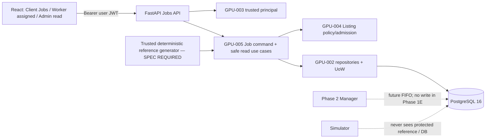

# Phase 1E — Job Submission & Queue Management (GPU-005)

> **Dự án:** GPU Resource Marketplace<br>
> **Đường dẫn dự kiến:** `docs/architecture/phases/phase1e_job_submission_queue.md`<br>
> **Ngày:** 21/10/2026<br>
> **Owner:** Thành viên 5 — Jobs / Queue Commands<br>
> **Trạng thái tài liệu:** `APPROVED DESIGN` (owner-approved 2026-10-21; not committed to repository)<br>
> **Trạng thái triển khai:** `PLANNED / NOT_IMPLEMENTED`<br>
> **Baseline repository kiểm tra:** `main@c90f540b385c8d11789f994748e4f5441bcb7e1b` (GPU-001 merged; `jobs/` mới có skeleton; Alembic chưa có bảng nghiệp vụ trên `main`).<br>
> **Upstream status:** GPU-002, GPU-003 và GPU-004 đã được chủ dự án duyệt **thiết kế**; chưa có bằng chứng code/PR của các Phase này đã merge.<br>
> **Nguồn chuẩn:** [API Contract v0.6](../../design/api-contract.md) §8; [Database Design v0.4](../../design/database-design.md) §§2,4,6,9,11–12; [Module Design](../../design/module-design.md) §§2–5; [Test Design](../../design/test-design.md); [Functional Requirements](../../functional-requirements.md) `FR-JL-01..04`; ADR-001/002/008; [Team Contribution Rules](../../development/team-contribution-rules.md) và [Inter-Phase Change Control](../../development/interphase-change-control.md).

## 1. MỤC TIÊU

### 1.1. Kết quả của Phase 1E

Hoàn tất lát cắt nghiệp vụ tối thiểu theo **Evolutionary Architecture**:

**Worker Login → Tạo GPU Listing → Client Login → Xem GPU → Submit Job → Job `QUEUED` → Xem hoặc Hủy Job.**

GPU-005 chỉ sở hữu **Job commands, role-scoped reads và queue admission**, chưa sở hữu phần thực thi. Mỗi Job được chấp nhận phải có đúng **một protected deterministic simulation reference**, được tạo **atomically** với Job và không lộ qua bất kỳ public response hay Simulator input nào.

**Definition of Done dự kiến:**

1. Đúng **4 Jobs endpoints** của API Contract §8, dùng JWT/RBAC (GPU-003), Listing policy (GPU-004), PostgreSQL/UoW (GPU-002).
2. `TX-SUBMIT` chấp nhận Job `QUEUED` trên Listing ACTIVE; FIFO `enqueue_seq`/`submitted_at` được cấp sau khi lấy Listing lock; một `simulation_references` cùng transaction.
3. Idempotency theo `(client_id, Idempotency-Key)` trong thời gian Job tồn tại: replay cùng body trả Job cũ; key khác body xung đột, không nhân đôi Job/reference.
4. `TX-CANCEL` chuyển đúng `QUEUED → CANCELLED`, đúng Client owner, không tạo/release allocation, không cập nhật reputation.
5. Client/Worker/Admin được đọc Job theo đúng scope và projection, không lộ account riêng tư, seed, expected outcome/digest hoặc internal execution details.
6. React Jobs UI tối thiểu chạy qua API thật; kiểm thử PostgreSQL/HTTP/UI và integration journey có bằng chứng thật.
7. Mọi inter-phase impact thực sự được source/consumer owners xác nhận; blockers về deterministic reference được giải quyết trước khi xác nhận GPU-005 `IMPLEMENTED`.

### 1.2. Ngoài phạm vi

**Không triển khai** Manager scheduling/FIFO allocation runtime, Job `RUNNING` transition, GPU reservation/release, execution attempts/outbox/inbox, Simulator workload/callback, Ed25519 signature verification, Signed Results, Disputes, Reputation writes, 23-day cleanup job, Worker auto-selection, billing/real GPU và 8 bảng Phase 2–3.

**Lưu ý:** `enqueue_seq` được **lưu và kiểm thử** ở Phase 1E, nhưng **Scheduler** tiêu thụ FIFO thuộc Phase 2. Không đánh dấu FIFO execution hoặc cancel-versus-Manager-allocation race đã PASS nếu Manager chưa có thật.

## 2. THIẾT KẾ

### 2.1. Kế thừa và thay đổi

| Phase/owner | Kế thừa hoặc hợp đồng phải xác minh | Phase 1E làm |
|---|---|---|
| GPU-001 / Nhóm trưởng | FastAPI app, frontend skeleton, Compose 5 services, common config, CI | Tích hợp Jobs router, UI và test; không đổi runtime topology |
| GPU-002 / Thành viên 2 | `jobs`, `simulation_references`, `gpu_listings`, `workers`; constraints, UoW, Listing row lock và repositories | Thực hiện command trên DB primitives có thật; không tự tạo ORM/schema thứ hai |
| GPU-003 / Thành viên 3 | `AuthenticatedPrincipal`, `CLIENT/WORKER/ADMIN`, volatile JWT/UI client | Client-only submit/cancel, role-safe Job reads và Bearer request |
| GPU-004 / Thành viên 4 | Listing ID, ACTIVE/PAUSED, Worker ownership/capacity, browse/detail DTO | Đọc/lock Listing và validate admission theo **server state** |
| GPU-005 / Thành viên 5 | `jobs/` stub hiện tại | Job use cases/router/DTO, `TX-SUBMIT`, `TX-CANCEL`, reference-generation boundary, React Jobs UI |
| Phase 2 / Owner chưa phân công | Manager FIFO selection, allocation, receipts/reputation | Handoff stable `enqueue_seq`, Job schema, oracle version/trust boundaries; **chưa triển khai** |



**Write ownership:** Backend API xử lý submit/cancel; `jobs.status=RUNNING/COMPLETED/FAILED`, `gpu_listings.allocated_gpu_count`, allocations và results do Manager ở Phase 2 quản lý. API Job không tự sửa các trạng thái hoặc counters thuộc Manager.

### 2.2. Bốn endpoint cố định

| Method | Endpoint | Caller và success | Thao tác |
|---|---|---|---|
| `POST` | `/api/v1/jobs` | `CLIENT` → `201` mới; `200` replay idempotent cùng body | `TX-SUBMIT` tạo Job QUEUED + reference cùng commit |
| `GET` | `/api/v1/jobs` | `CLIENT`, `WORKER`, `ADMIN` → `200` | Query theo role/scope, pagination, safe projections |
| `GET` | `/api/v1/jobs/{job_id}` | Owner Client, assigned Worker, Admin → `200` | Read-only; non-visible object → `404` |
| `POST` | `/api/v1/jobs/{job_id}/cancel` | Owner `CLIENT` → `200` nếu đang QUEUED | `TX-CANCEL` sang CANCELLED + trusted `terminal_at` |

**Request POST `/jobs`:**

```json
{
  "listing_id": "22222222-2222-4222-8222-222222222222",
  "gpu_count": 2,
  "duration_seconds": 60
}
```

- Bắt buộc `Idempotency-Key`; theo thiết kế HTTP trong API Contract §8, key dùng printable ASCII 8..128 ký tự. Không nhận field ngoài đúng ba field đã duyệt; không chấp nhận `client_id`, `worker_id`, `status`, `enqueue_seq`, `simulation_reference`, timestamps hoặc oracle từ user.
- `gpu_count` và `duration_seconds` là JSON integers dương (**không** bool, float, numeric string); giới hạn khả năng lưu PostgreSQL integer và `requested_gpu_count <= Listing.total_gpu_count`. **Chưa có business maximum duration** được duyệt, không tự đặt giới hạn mới.
- GPU hiện đã allocated hết **không** làm request hợp lệ thất bại: vẫn cho Job `QUEUED` nếu `gpu_count <= total` và Listing ACTIVE. `available_gpu_count` từ UI không quyết định transaction admission.
- `201` trả `Location` và Job public DTO; response field `gpu_count` map từ `jobs.requested_gpu_count`. Không trả `idempotency_key`, `request_sha256`, `enqueue_seq` (nếu không yêu cầu public), seed/expected outcome/digest.

**Ví dụ Job DTO public (Client read):**

```json
{
  "id": "33333333-3333-4333-8333-333333333333",
  "listing_id": "22222222-2222-4222-8222-222222222222",
  "worker_id": "11111111-1111-4111-8111-111111111111",
  "gpu_count": 2,
  "duration_seconds": 60,
  "status": "QUEUED",
  "failure_reason": null,
  "submitted_at": "2026-10-18T08:00:00.000000Z",
  "started_at": null,
  "terminal_at": null
}
```

Dùng `Cache-Control: no-store` cho private responses, HTTP error body + `X-Request-ID` theo API Contract §3. Codes: `400` missing idempotency/invalid JSON/unknown field/cursor; `401` invalid auth; `403` wrong role/scope; `404` hidden/missing Listing/Job; `409` paused/reused key/cannot cancel; `422` typed validation/oversize; `503` DB unavailable. **Không** báo Job được lưu thành công khi commit chưa thành công.

### 2.3. `TX-SUBMIT`: transaction bắt buộc

PostgreSQL `READ COMMITTED`, SQLAlchemy UoW, row lock Listing đầu tiên:

1. Parse/validate body và authenticated `CLIENT`; resolve `client_id` chỉ từ server-side `AuthenticatedPrincipal`.
2. Xác định Listing ID; `SELECT gpu_listings FOR UPDATE` trước khi chấp nhận Job; kiểm tra dưới lock trạng thái `ACTIVE` và `gpu_count <= total_gpu_count`; copy `worker_id` đúng Listing owner.
3. Trong boundary đã lock, xử lý idempotency `(client_id,idempotency_key)` với normalized request fingerprint (đúng **ba trường logical**). Same key+same body giữ **một Job gốc**; same key+changed body → `409 IDEMPOTENCY_KEY_REUSED`, không sửa bản ghi cũ.
4. Lấy trusted DB `submitted_at = clock_timestamp()` **sau khi giữ Listing lock**; INSERT Job với `QUEUED`, `enqueue_seq GENERATED ALWAYS AS IDENTITY`, immutable client/listing/worker identity và correlation data.
5. Tạo protected `simulation_references` **đúng đặc tả generator đã được duyệt**: `seed_value`, `algorithm_version`, `expected_outcome`, `expected_failure_reason`, `expected_digest`; INSERT cùng UoW/transaction với Job.
6. Chỉ COMMIT khi **cả Job và reference** hợp lệ; nếu generator/migration/constraint/DB thao tác lỗi, rollback **cả hai**. Không trả `201` khi reference thiếu hoặc chưa commit.
7. Concurrent duplicate same key trên **khác Listing** có thể gặp UNIQUE collision: rollback transaction lỗi rồi mở transaction mới đọc original key+fingerprint và trả replay hoặc conflict; không tự sinh Job thứ hai.

**FIFO:** `enqueue_seq` toàn cục có thể có gaps nhưng thứ tự Job trên cùng Listing được tuần tự hóa bởi Listing lock. Không dùng `submitted_at`/UUID client làm FIFO ordering chính. `submitted_at` authoritative và clock đáng tin phải do DB cấp sau lock.

**Guard:** DB PK của `simulation_references.job_id` bảo đảm *at most one reference*, còn *exactly one cho mỗi accepted Job* phải được bảo đảm bởi `TX-SUBMIT` cùng commit, authorized writer/DB permissions và tests; không tuyên bố FK một chiều tự bảo đảm existence. Protected reference không có route public, không nhập frontend DTO/Simulator payload/audit.

**Điểm cần review contract trước code:** API Contract §8 mô tả replay cùng key+body trả `200` với Job ban đầu, kể cả khi trạng thái Listing có thể thay đổi. DB Design §11.3 pseudocode lại **check Listing ACTIVE/capacity trước resolve replay**; replay sau khi Listing PAUSED có thể trả `409` thay vì `200`. Đây là **ambiguity thực tế** giữa hai tài liệu đã duyệt. TV4 (Listing owner) ↔ TV5 (Job owner) phải trình nhóm trưởng/owner quyết định thứ tự ưu tiên/replay semantics, cập nhật tài liệu/test oracles theo change control nếu cần, trước khi triển khai. **Không tự âm thầm chọn một cách hiểu.**

### 2.4. `DEC-P1-04` — protected deterministic reference

**Đã được chủ dự án phê duyệt về nguyên tắc:**
- Một record `simulation_references` bất biến cho mỗi Job được chấp nhận; tạo cùng atomic `TX-SUBMIT`.
- Reference deterministic và versioned; `job_id` PK+FK, `seed_value bigint`, `algorithm_version varchar(32)`, `expected_outcome=SUCCESS|FAILED`, `expected_failure_reason` theo thiết kế và `expected_digest="sha256:" + 64 hex lowercase`.
- Chỉ trusted backend/Manager được đọc; Client/Worker/Simulator không được thấy. Signed result ở Phase 2 là một **claim**, không thể coi đương nhiên là ground truth.

**Chưa có đặc tả trong repository: `SPEC_REQUIRED`**, bao gồm:
1. Nguồn và cách derive `seed_value` đúng kiểu bigint, inputs/tính ổn định qua restart/replay.
2. Exact generator/algorithm version và các input/configuration bất biến; các yếu tố làm thay đổi reference.
3. Cách sinh expected simulated output byte-for-byte; mapping `SUCCESS` / `FAILED` và `WORKER_FAULT` / `JOB_FAULT`.
4. Cách hash expected output thành `sha256:<64 lowercase hex>`; test vectors cố định `(input → seed/version/outcome/failure/digest)`.
5. Bảo vệ dữ liệu/salt/secret nếu spec cần, quyền đọc DB/serializer, và tương thích Simulator wire allowlist `{ "workload_profile": "demo-v1" }` + ADR-004 Signed Result/Dispute về sau.

**Gate bắt buộc:** TV5 soạn một **technical specification riêng để chủ dự án review/approve** trước khi implement generator. TV2 xác nhận schema/permission compatibility; nhóm trưởng rà ảnh hưởng Phase 2; nếu khác approved design thì change control L2/L3. **Không hardcode oracle “minh họa” hoặc chọn hash/seed formula mà không có approval.** Có thể code độc lập Jobs DTO/read/guards/UI với mocks trước, nhưng **không thể nghiệm thu full `TX-SUBMIT` hoặc tuyên bố GPU-005 DONE** khi generator spec chưa được duyệt.

**Vấn đề phụ cần chốt trong implementation review:** canonical byte representation của fingerprint `request_sha256` trên ba logical fields; phải tái lập byte-identical qua HTTP retries, không sửa ngữ nghĩa idempotency đã duyệt.

### 2.5. `TX-CANCEL`: QUEUED only

1. Xác thực `CLIENT`; từ `job_id` đọc **unlocked locator** để lấy immutable `listing_id`, sau đó lock **Listing trước Job**.
2. Recheck sau lock: Job còn tồn tại, `client_id` khớp principal và `status == QUEUED`; không lộ sự tồn tại của Job thuộc Client khác (uniform `404 JOB_NOT_FOUND`).
3. Set `status=CANCELLED`, `terminal_at=trusted DB time`, `failure_reason=null`, `started_at=null`; commit atomic. Không chạm `allocated_gpu_count`, không tạo/release allocation, không signed result/reputation.
4. Đã `RUNNING/COMPLETED/FAILED/CANCELLED` → `409 JOB_NOT_CANCELLABLE`, zero further mutation. Cancel lặp **không** trả 200 lần thứ hai. PAUSED Listing không tự cancel Job đang QUEUED.

**Phase 1E chỉ thực thi cancel với Job còn QUEUED;** test chống cancel RUNNING/terminal có thể seed fixture DB hợp lệ, không có nghĩa Manager đã chạy. Full cancel-vs-allocation concurrency thuộc Phase 2.

### 2.6. GET Jobs và role-safe projection

`GET /jobs?scope=<mine|assigned|all>&status=<status>&limit=20&cursor=...`

- `CLIENT`: default `mine`, chỉ Jobs `client_id` của mình.
- `WORKER`: default `assigned`, chỉ Jobs gắn Listing thuộc Worker profile; response **không** có Client private identifiers.
- `ADMIN`: default `all`, read-only Jobs; không submit/cancel/schedule.
- Scope trái role → `403`; guess Job khác owner/assignment → uniform `404`; filter status sai → `400 INVALID_FILTER`. Cursor opaque/tamper-evident, bound to caller/role/scope/filter.
- Keyset pagination `submitted_at DESC,id DESC`; `limit` mặc định 20, phạm vi 1..100; phản hồi collection chỉ chứa `items` và `next_cursor`. Không hứa giữ snapshot giữa nhiều request.
- Không expose password hashes, JWT, `idempotency_key`, internal Job evidence, oracle values hoặc các trường Worker không cần.

### 2.7. React Jobs UI tối thiểu

**Client:** từ Listing detail đã chọn → form Submit (`gpu_count`, `duration_seconds`) → `QUEUED` confirmation → `My Jobs` list/detail → Cancel QUEUED, có loading/error state. UI không hiển thị `RUNNING/COMPLETED` như hoạt động Phase 1E thực nếu Manager chưa có.

**Worker:** `Assigned Jobs` đọc scope assigned ở mức an toàn, không thấy Client private account ID, không có nút Cancel/Submit thay Client. **Admin:** all Jobs read-only.

Frontend tái sử dụng JWT **volatile memory** từ GPU-003, Auth API client, Listing browse/detail từ GPU-004; tự tạo `Idempotency-Key` hợp lệ **một lần cho logical submission** và tái dùng key/body khi retry do lỗi mạng hoặc ACK không rõ, không tạo key mới mỗi lần retry. Giao diện không lưu seed/expected digest hoặc request secrets vào persistent storage.

Không cần WebSocket/real-time scheduler; refresh/poll GET là đủ. Browser refresh mất JWT theo quyết định GPU-003.

### 2.8. Cấu trúc source đề xuất

```text
backend/src/gpu_marketplace/
  jobs/               # Job DTO, router, command/read use cases, safe policies (TV5)
  repositories/       # GPU-002 DB adapters/UoW; API sửa chỉ qua phối hợp TV2
  listings/           # GPU-004 Listing status/ownership/admission contract, reuse
  identity/           # GPU-003 `AuthenticatedPrincipal`/RBAC, reuse
  api/app.py          # Nhóm trưởng tích hợp router/shared errors
backend/tests/        # Job HTTP/DB transactions/fixtures/concurrency tests
frontend/src/
  api/                # Jobs API types/calls; use existing auth-aware client
  ui/                 # Submit, My Jobs, Assigned Jobs, read-only All Jobs
```

Không thêm database migration/table/enum ngoài schema đã duyệt hoặc module Manager/simulator giả để qua E2E.

## 3. NHIỆM VỤ CHO THÀNH VIÊN 5

| ID | Deliverable | Gate/phụ thuộc |
|---|---|---|
| `GPU-005-A` | Đối chiếu `jobs`, reference, auth/listing/repo interfaces; lập impact matrix | TV2/TV3/TV4 + nhóm trưởng; xem conflict replay-on-PAUSED |
| `GPU-005-B` | Viết deterministic reference **spec + approved test vectors** (không tự code trước) | Owner approval, TV2 schema check, Phase 2 compatibility review |
| `GPU-005-C` | Implement Job DTO/router, role-safe query, pagination, typed errors | GPU-002/003/004 đã integrate |
| `GPU-005-D` | Implement `TX-SUBMIT`, idempotency, atomic reference + `TX-CANCEL` | Spec đã duyệt; Listing-first locking; real PostgreSQL |
| `GPU-005-E` | React Jobs UI, integrate Listing detail + Auth | TV3/TV4 frontend contract + shared app shell |
| `GPU-005-F` | Pytest PostgreSQL, HTTP/API tests, Vitest, E2E Phase 1 user journey | TV2/3/4 real integration; no fake green tests |
| `GPU-005-G` | Impact ACK, docs/handoff/CI evidence, independent PR review | No open blockers; nhóm trưởng integration |

## 4. KIỂM THỬ VÀ NGHIỆM THU

### 4.1. API/transaction traceability

| Test design | Có thể nghiệm thu ở 1E? | Ghi chú |
|---|---|---|
| `API-JOB-01..09` | **Đầy đủ khi spec/reference và upstream code sẵn sàng** | Valid submit/replay/conflict/input/paused/oversize/RBAC/read/cancel |
| `API-JOB-10` | **Có thể dùng seeded state fixtures** | Không đồng nghĩa Manager transitions đã implement |
| `API-JOB-11..13` | **BLOCKED phần Manager thực thi** | Cancel-vs-allocation / scheduler FIFO cần Phase 2 |
| `API-JOB-14` | **BLOCKED phần retention cleanup** | 23-day purge thuộc Phase 2–3, không giả runtime retention |
| `API-JOB-15..16` | **Có thể chạy ở 1E** | Pagination/role-safe Worker + Client projections |
| `DBTX-01`, `DBTX-02` | **Có thể chạy phần Submit / PAUSE serialization** | PostgreSQL concurrency barriers, fresh transactions |
| `DBTX-05`, `DBTX-03/04` | **BLOCKED phần Manager allocation** | Không hạ oracle hoặc mock Scheduler và gọi đó là PASS |

### 4.2. Acceptance gates GPU-005

| Gate | Binary PASS oracle | Hiện trạng |
|---|---|---|
| `P1E-AC-01` | 4 endpoints HTTP đúng routes, status/error DTO và `X-Request-ID`, private no-store; JWT verified từ DB | `NOT_RUN` |
| `P1E-AC-02` | Submit ACTIVE + gpu<=total tạo đúng **1 QUEUED + 1 protected reference**, cùng commit; error rollback 0 orphan rows | `BLOCKED: SPEC_REQUIRED` |
| `P1E-AC-03` | Idempotency same key/body (kể cả concurrent) 200 original ID, different body 409, 0 extra Job/reference | `NOT_RUN`; giải quyết replay-vs-PAUSED ambiguity |
| `P1E-AC-04` | `enqueue_seq` cùng Listing theo lock admission, kể cả DB timestamp trùng; không claim Manager FIFO PASS | `NOT_RUN` |
| `P1E-AC-05` | PAUSED/oversized/invalid/unauthorized submit chặn đúng, không mutate DB, không dựa UI available count | `NOT_RUN` |
| `P1E-AC-06` | Owner QUEUED cancel 200 + terminal time; replay 409; wrong owner 404; RUNNING/terminal 409; 0 GPU/reputation effect | `NOT_RUN` |
| `P1E-AC-07` | GET `mine/assigned/all` role-scoped và pagination/cursor; zero protected oracle/Client secrets leakage | `NOT_RUN` |
| `P1E-AC-08` | Frontend real end-to-end **Worker Login → Listing → Client Login → Browse → Submit → QUEUED → View/Cancel** | `BLOCKED: GPU-002/003/004 code chưa merge` |
| `P1E-AC-09` | pytest/real PostgreSQL, fixture + concurrency tests, Vitest, build, Compose/CI regression có SHA và logs | `NOT_RUN` |
| `P1E-AC-10` | Mọi confirmed cross-phase impacts được source + mỗi affected owner ACK; human PR review hợp lệ | `NOT_RUN` |

Mỗi test evidence ghi commit SHA, Alembic head, PostgreSQL 16/runtime, fixture, trusted/fake clock, HTTP request/response đã redact, SQL rows before/after, command, actual result và `PASS|FAIL|BLOCKED|NOT_RUN`. Approval design không tương đương test `PASS`.

## 5. INTER-PHASE IMPACT & DUAL ACKNOWLEDGEMENT — BẮT BUỘC

Theo [Inter-Phase Change Control](../../development/interphase-change-control.md), thay đổi **nội dung Markdown có ảnh hưởng thật** cũng phải cảnh báo hai chiều; không đợi code. Không dùng PR human review thay cho việc source owner + affected owner xác nhận.

| Nguồn ↔ Consumer cần xác nhận | Trigger thực tế |
|---|---|
| TV2 ↔ TV5 | Job/reference schema, `enqueue_seq`, idempotency uniqueness, Listing lock/UoW, DB grants/triggers, seed fixture thay đổi |
| TV3 ↔ TV5 | `CLIENT`/`WORKER` role, authenticated principal, JWT/client headers, scope/responses thay đổi |
| TV4 ↔ TV5 | Listing ACTIVE/PAUSED, owner binding, capacity admission, Listing DTO/URL, pause vs submit behavior thay đổi |
| Nhóm trưởng ↔ TV5 | Shared FastAPI/router/error handling, frontend shell/API client, Compose, CI hoặc phase integration thay đổi |
| TV5 ↔ owner Phase 2 **sau khi phân công** | Job state/FIFO/idempotency/protected oracle/Manager handoff hoặc Signed Result compatibility thay đổi |

**Trạng thái tại thời điểm thiết kế:**
- `POTENTIAL_IMPACT — REVIEW REQUIRED`: mâu thuẫn diễn giải **idempotent replay trên Listing vừa PAUSED** giữa API Contract §8 và DB Design §11.3. Chưa có quyết định hóa giải, cần **TV4 ↔ TV5** đối chiếu cùng nhóm trưởng/owner trước coding.
- `SPEC_REQUIRED`: deterministic reference algorithm/test vectors chưa được phê duyệt; **TV5 và owner** cần review, TV2 xác nhận schema, Phase 2 compatibility phải được ghi nhận khi có owner.
- Các nội dung khác: `NO_CHANGE_ASSESSED` (chưa có source diff mới). **Chưa có ACK của bất kỳ thành viên nào** và không được tự điền.

**Khi có diff:** điền record `XPH-GPU-005-nn` (file/old SHA→new SHA, before→after, impacted contracts, classification `NO_IMPACT|POTENTIAL_IMPACT|CONFIRMED_IMPACT`, owner source ACK, từng owner nhận `ACK_COMPATIBLE|ACK_WITH_ACTIONS|REJECTED`, test evidence, gate). Nếu `POTENTIAL/CONFIRMED` chưa có dual ACK hoặc còn test/contract conflict → `BLOCKED_INTERPHASE`; chưa được merge/dùng baseline. `NO_IMPACT` thuần diễn đạt có lý do thì không buộc hai ACK.

**Git governance:** L0/L1 requires >=1 independent human reviewer, L2/L3 requires >=2; authors cannot self-approve or self-merge. Phase 1E DESIGN was approved 2026-10-21, but this approval does not replace technical specification approval, impact ACKs, tests or PR review.

**Owner approval record (2026-10-21):** APPROVED DESIGN for GPU-005 scope and task decomposition only. No approval of invented oracle algorithm, resolution of replay conflict, cross-phase ACK, or code implementation is implied.

## 6. KẾT QUẢ HIỆN TẠI VÀ BÀN GIAO

**`IMPLEMENTED` từ GPU-001:** 5 runtime services, foundation API/frontend, health checks, DB availability, CI/Compose. Đây không phải Job API/Job UI implementation.

**`APPROVED DESIGN` ở upstream:** GPU-002 Database, GPU-003 Auth, GPU-004 Listings đã được owner duyệt về **thiết kế**; các API/DB/Module/Test baseline v0.6/v0.4 có thiết kế đã duyệt. `DEC-P1-03` được owner duyệt nhưng label trong API Contract còn cần sync qua PR. `DEC-P1-04` được duyệt **về nguyên tắc**, phần generator vẫn `SPEC_REQUIRED`.

**`PLANNED`:** toàn bộ GPU-005-A..G, Jobs API, atomic oracle generator, Jobs UI và mọi runtime verification. Chưa có merge PR code Phase 1B–1E theo `main` đã kiểm tra.

**Bàn giao Phase 2:** Job and Listing bindings, immutable `enqueue_seq`, `QUEUED/CANCELLED` state semantics, protected oracle version/test vectors, Manager-only terminal/allocation ownership, replay/tombstone limitation sau retention; không viết nháp execution scheduler vượt phase.

**Review gate (APPROVED DESIGN, 2026-10-21):** The owner approved GPU-005 architecture, scope, assignments and planned verification. This approval does not approve an unspecified reference generator, resolve the replay-versus-PAUSED conflict, constitute any cross-phase ACK, or imply implemented code/test evidence. Implementation remains NOT_STARTED; do not create branches/commits/pushes/PRs or modify approved normative documents without a separate authorization.
