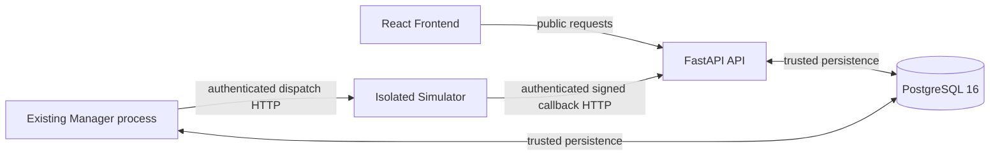
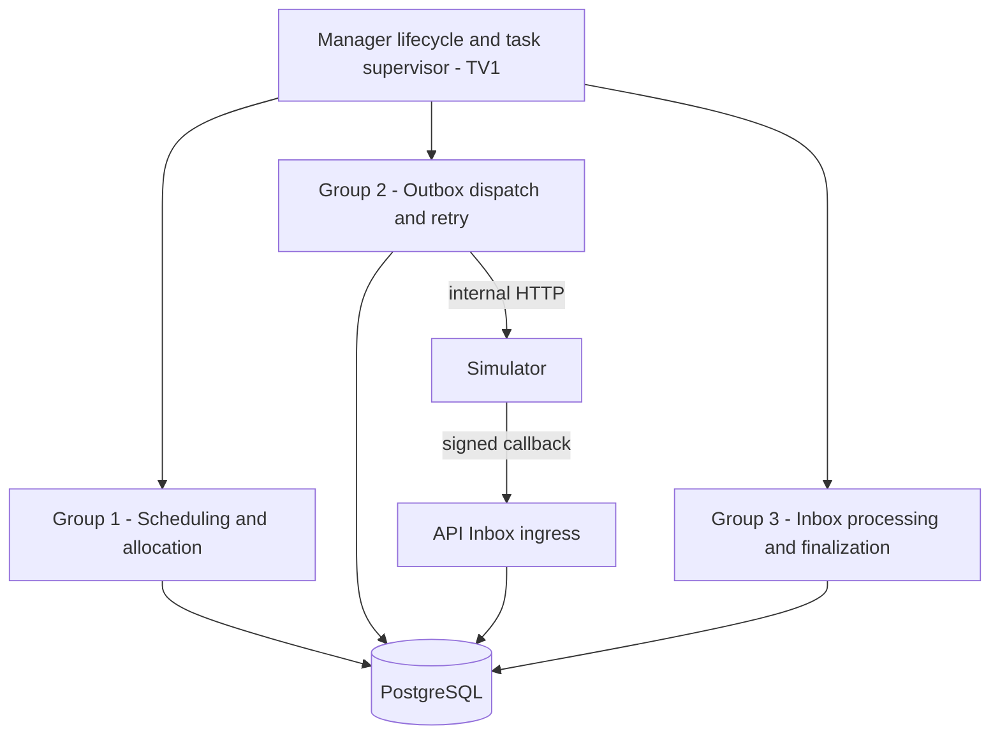

# Phase 2A - Manager Runtime, Orchestration and Integration (TV1)

> **Phase 2A deep-review revision (2026-11-07):** Consolidates already-approved Phase 2D/2E design decisions with the PR #39 baseline, and proposes explicit lock/candidate/lifecycle safeguards. Existing owner approvals remain in force; **new technical clarifications marked `PROPOSED_FOR_ACK` are not automatically approved**. PR #39 HEAD `44579ed84605` was verified open/Draft/unmerged. No Phase 2 coding or GitHub write authorization.

> **Repository:** `SE2026-BC-04/gpu-resource-marketplace`  
> **Target repository path:** `docs/architecture/phases/phase2a_manager_integration.md`  
> **Document version/date:** `v0.9-deep-review-proposal / 2026-11-07`  
> **Document status:** `APPROVED_DESIGN_CONDITIONAL / V0.9_REVIEW_PROPOSED / NOT_APPROVED_FOR_IMPLEMENTATION`  
> **Proposed documentation owner:** TV1 - Team lead (`@thangSy221105`)  
> **Review log:** `P2-OVERALL-01` = direction accepted for continued review; `P2A-DEC-01` = `APPROVE_WITH_REVISIONS`; `P2A-OPEN-01` = supervisor fail-fast **APPROVED**; `P2A-DEC-02` = three independent logical worker groups **APPROVED**; `P2A-OPEN-03` = Async Supervisor + Bounded Executor **APPROVED**; `P2A-OPEN-04` = Option A bounded Graceful Shutdown + PostgreSQL recovery **APPROVED AT DESIGN LEVEL** (exact shutdown budget and external restart configuration remain pending). **`P2A-OPEN-02` has been superseded by approved `P2D-OPEN-03`: configurable 2-second default Scheduler scan; batching/fairness/resource limits remain pending cross-owner sizing.** `P2A-GATE-01` = **Option A, APPROVED_DESIGN_CONDITIONAL** (team-lead review decision): 2A scope, ownership and proposed Manager architecture are accepted **for documentation only**, with specialist parameters/ACKs and Phase 1 baseline still pending. This is NOT a code, merge or implementation authorization.  
> **Runtime verification:** `NOT_RUN`. **Human cross-owner ACKs:** `PENDING`. **GitHub changes made by this revision:** `NONE`.

## 0. Authority, current baseline, and review discipline

This is one of **five documentation work packages** (`2A` through `2E`) for five team members. It plans the integration runtime but does **not** grant TV1 authority to implement another owner's domain module. The approved SRS, ADR-001..008, Database Design, API Contract, Module Design and Test Design are the binding sources. Where this draft introduces a new choice, mark it `PROPOSED` or `OPEN`, never silently revise an accepted contract.

The `main` implementation inspected while preparing this design has an existing `manager` service and the entry points:

- `backend/src/gpu_marketplace/manager/service.py`: `run_manager` probes PostgreSQL and runs a stoppable foundation idle task; no business Scheduler/dispatcher/finalizer is running yet.
- `backend/src/gpu_marketplace/manager/__main__.py`: config, engine construction, OS signal handling and engine disposal.
- `backend/src/gpu_marketplace/manager/healthcheck.py`: checks PostgreSQL only; it does not observe a failed task inside Manager.
- `backend/src/gpu_marketplace/common/config.py` and `common/database.py`: shared configuration and synchronous SQLAlchemy engine.
- `compose.yaml`: **five existing services**, including the one Manager process. No extra process/container is proposed.

**Phase 1 gate:** the integrated Phase 1 baseline must first be accepted on `main` with recorded commit SHA, applicable test evidence, current Alembic head and impacted owner ACKs. At this deep-review check (2026-11-07), PR #39 HEAD `44579ed` was still open/Draft/unmerged; this is a snapshot, **not** a permanent assertion about PR status. The actual baseline must be rechecked before any Phase 2 implementation.

## 1. Goal, scope, and what counts as success

**Goal:** evolve the existing Manager from an idle lifecycle shell into a supervised orchestration runtime that connects Phase 2B database ports, Phase 2C security/verifier ports, Phase 2D FIFO scheduler, and Phase 2E Simulator/finalization/reputation flow. It must preserve durable, at-most-once committed business effects despite at-least-once HTTP delivery, process restarts and competing transactions.

**In-scope design responsibilities for TV1**:

1. Define Manager process lifecycle: configuration validation, readiness, start, supervised tasks, controlled stop and resource cleanup.
2. Describe how three **logical worker groups** are composed, triggered, supervised and wired to the appropriate business owner; define interface expectations, not domain algorithms.
3. Define boundaries between synchronous SQLAlchemy operations and cooperative task scheduling so DB/HTTP I/O cannot indefinitely block all Manager work.
4. Document failure recovery, restart, logging, secret/config boundaries and observability without introducing a new service.
5. Coordinate the Phase 1 -> 2 baseline and Phase 2B..2E handoffs; own cross-module E2E assembly, review and release/rollback *plans*.

**Out of scope for this documentation-only revision:** writing application code, migrations, Compose/CI changes, deployment or GitHub changes. **Later Phase 2A implementation, if separately authorized, DOES include Manager orchestration code** and its focused tests/configuration. Permanent architectural exclusions remain: a new broker/service/table, a second FIFO policy, unapproved SQL contract changes, changing approved retries/deadlines, real GPU execution, manual Admin allocation, Phase 3 Dispute/retention processing, or claims of a finished MVP.

**Target Phase 2A outcome once implemented (not claimed now):** with Phase 2B..2E available, the single Manager process supervises `QUEUED -> RUNNING -> COMPLETED/FAILED`, survives restart without duplicate allocation/release/reputation, and reports actionable failure status. This is an **integration** outcome, not an independent TV1-only feature.

## 2. Existing architecture and non-negotiable boundaries



- **API owns** Login/RBAC, Listing edits, `TX-SUBMIT`, Client `QUEUED`-only `TX-CANCEL`, public read projections and `TX-INBOX-INGRESS` for raw callback bytes. It does **not** run FIFO, verify-and-finalize receipts or write reputation contributions.
- **Manager owns** `TX-ALLOCATE`, durable Outbox claim/ACK/retry, Inbox verification and finalization/deadline fallback, one-time allocation release and contribution/aggregate updates. Its orchestration layer delegates those decisions; it never reimplements separate copies of the business policies.
- **Simulator owns** deterministic mock execution and its private Worker Ed25519 key. It does not access PostgreSQL or protected oracle/reference fields.
- **PostgreSQL** owns durable state, trusted clocks, transaction boundaries and serialization. An HTTP `202` is **not** Job completion. A valid Worker signature is a claim, **not** a comparison with protected ground truth; future Dispute adjudication remains in Phase 3.

### 2.1. Three logical worker groups inside ONE Manager

**Decision `P2A-DEC-02` - APPROVED IN REVIEW:** use three independently supervised logical processing loops (Scheduling/Allocation, Outbox Dispatch/Retry, Inbox/Finalization/Deadline) inside the **existing single Manager process**. Each group can make bounded progress independently; task/worker counts and Scheduler cadence are separate pending implementation choices. Do not create new services, duplicate business logic, or interpret this decision as authorizing code.



| Logical group | Orchestrator action | Business owner(s) | Durable source / authority | Schedule discipline |
|---|---|---|---|---|
| **1. Scheduling/Allocation** | Trigger a bounded scan of eligible Listings and invoke the scheduler port; record completed/blocked/error counts | TV4 FIFO and capacity; TV2 `TX-ALLOCATE` persistence | `gpu_listings`, `jobs`, `allocations`, `execution_attempts`, `execution_outbox` | **APPROVED DESIGN:** configurable default 2 s per `P2D-OPEN-03`; bounded rotating Listing batch and precise pool budget remain `PENDING_ACK`; never `SKIP LOCKED` FIFO head Job |
| **2. Outbox Delivery/Repair** | Find due dispatch work, coordinate fenced claim, HTTP outside DB transaction, ACK/retry and lost-receipt repair | TV1 runtime coordination, TV2 outbox adapter, TV3 directional auth, TV5 dispatch/Simulator contract | `execution_outbox`, `execution_attempts` | ADR-005 approved due scan **2 s**; 30 s fenced lease; persisted retry due times |
| **3. Inbox/Finalization/Deadline** | Find committed Inbox candidates and due deadlines; invoke verifier and atomic finalization/fallback ports; supervise failures | TV3 verification; TV5 finalization/reputation; TV2 transaction adapters | `result_inbox`, `signed_results`, `jobs`, `allocations`, contribution/aggregate | Honor ADR-005 due scan **2 s**; process committed on-time candidates before fallback |

These are **logical responsibilities, not three new services**. **Approved `P2A-OPEN-03`:** use an `asyncio` supervisor and cooperative control loops; run blocking database units through a **bounded executor** with isolated SQLAlchemy Sessions. Exact worker and connection-pool counts remain open to TV2/TV1 verification. No new service or driver migration is authorized. An integration task cannot acquire a competing domain lock while another task holds a Listing/Job lock over HTTP or sleeps.

### 2.2. Owner-to-interface handoff matrix (conceptual contracts, not code signatures)

| Call direction | Input / trigger | Observable output | Mandatory constraints | Responsible design owner |
|---|---|---|---|---|
| TV1 -> TV4 scheduler port | Due scan context, trusted DB access boundary, stop request | Count/IDs of allocated or blocked work; typed retryable/fatal error | Select **actual** FIFO head by `enqueue_seq`; Listing before Job locks; no later Job on blocked head | TV4 policy, TV2 DB, TV1 wiring |
| TV4 policy -> TV2 allocation UoW | Listing ID plus FIFO-head selection policy executed **within the same TV2-owned transaction** | One committed `RUNNING` Job + allocation + attempt + stable Outbox event, or no commit | **Never pass a locked ORM Job or SQLAlchemy Session between executor calls/transactions**; TX itself locks Listing then head Job; no network before COMMIT | TV2 transaction/TV4 policy, TV1 wiring; `PROPOSED_FOR_ACK` |
| TV1 -> TV2 Outbox port | Due events, fence owner/version | Stable `event_id`, `attempt_id`, retry due and state changes | `TX-OUTBOX-CLAIM/ACK/RETRY` locks Outbox only; stale owner cannot ACK | TV2, review TV1 |
| TV1 -> Simulator dispatch adapter | Approved `job_id`/`attempt_id`/stable event + allowed input | Transport status or typed timeout/error | `simulation_input` **exactly** `{"workload_profile":"demo-v1"}`; private oracle never sent; HTTP `202` is not terminal | TV5 wire, TV3 service token, TV1 orchestration |
| Simulator -> API (NOT Manager) | Dedicated authenticated signed callback | Durable Inbox `202`, exact duplicate or rejected response | API controls `TX-INBOX-INGRESS`; trusted DB receive time after Listing/Job locks | TV3 API ingress, TV2 DB, TV5 Simulator |
| TV1 -> TV3 verifier | Durable candidate bytes + persisted context and registered key | Valid/invalid typed verdict and reason, **no DB terminal mutation** | ADR-004 exact 11 fields, RFC 8785 JCS/Ed25519, context/key match | TV3; consumed by TV5 finalizer |
| TV1 -> TV5 finalizer/fallback | Verified eligible candidate or due deadline | Committed terminal/release/contribution outcome, or harmless no-op | DBTX lock order; once-only business effects; on-time candidate precedence | TV5 domain, TV2 transaction, TV1 integration |
| TV1 -> observability | Lifecycle state, per-group result and request/attempt correlation | Redacted logs and readiness/diagnostics evidence | No JWT, Bearer, private key, seed, expected digest, raw signed secret or PII leak | TV1 with TV3 security review |

**Integration contract status:** these rows define expected responsibilities only. Exact Python interfaces, DTOs, exception categories and source-file ownership are `PROPOSED` until the respective owner ACKs. Do not introduce duplicate layers or alter an approved contract merely to match an invented port name.

### 2.3. Candidate locking and handoff safety (`PROPOSED_FOR_ACK`)

- **Transaction-local FIFO selection:** `allocate_one_listing(listing_id)` owns one complete transaction. TV4 policy and TV2 row access are invoked in that same UoW, never via passing a previously locked Job entity or live Session across threads. TV4/TV2 must approve the precise call contract and barrier tests.
- **Inbox locator vs row lock:** a dispatcher/Manager may read an unlocked candidate locator to find `job_id` and `listing_id`. It must not hold an Inbox `FOR UPDATE` lock or an uncommitted Inbox claim while waiting to lock Listing and Job; that inversion can deadlock against `TX-INBOX-INGRESS`/`TX-FINALIZE`. Any durable claim marker must be committed in a short independent operation that has no dependent Job/Listing row locks, then revalidated under `Listing -> Job -> Allocation -> Inbox` in finalization.
- **Verifier proof:** TV3 may produce a typed, non-mutating `VerifiedV1Receipt`, but TV5/TV2 must re-read the durable Inbox evidence identity/hash, bound Job/Attempt, authenticated Worker key and terminal status under the required DB locks. A stale precheck cannot authorize a write. Signature verification and domain finalization must remain separate responsibilities.
- **Bounded Inbox processing:** a bounded scan cannot declare `SYSTEM_FAULT` merely because a batch found no valid candidate; it must prove that **every committed on-time candidate** for the Job has been durably accepted/rejected/inspected, including a later batch. Candidate order is `(received_at, inbox id)` using DB-trusted timestamps, not Worker-supplied `finished_at` or callback arrival in RAM.
- **Cold restart:** two distinct `result_id` values may be created for the same logical Attempt if Simulator loses its RAM cache. They remain separate Inbox candidates; the first eligible *valid* candidate by trusted order may win, but the unique accepted result per Job and one terminal/release/contribution are enforced transactionally. Global conflict detection across Simulator restart is not promised by a RAM-only cache.

These are review clarifications and proposed executable interfaces, **not** evidence that TV2/TV3/TV4/TV5 have ACKed a transaction design or that a working verifier/Manager exists.

## 3. Runtime lifecycle design

### 3.1. Startup (proposed order)

1. Load and validate `Settings`, required service secrets and DB connection configuration using approved sources. Never log secret values. Fail startup on missing/invalid mandatory security configuration.
2. Create the **existing** Manager-side SQLAlchemy engine and check PostgreSQL connectivity. Verify the configured Phase 2 schema/migration compatibility against the **actual accepted** `main` baseline (TV2 owns the check and exact expected Alembic revision). No hardcoded guessed future head.
3. Construct runtime adapters by dependency injection: DB ports, scheduler policy, fenced outbox delivery, verifier, finalization and required transport clients. Only instantiate a component after its owner-approved interface is available.
4. Initialize the three supervised worker groups and register cancellation/failure reporting. **Do not mark Manager ready** until required groups are started and required infrastructure checks pass.
5. Start due-work scans, using database-persisted due timestamps and attempts. Do **not** infer pending work from an in-memory task list or restart a fresh attempt when a stable attempt exists.

**Startup error contract:** missing config/schema, unauthorized DB role or incompatible interface -> fail safely and visibly. Temporary DB unavailability -> a documented retry/degraded-or-exit policy, not a forged successful start. The choice of bounded startup retries and exact status transport remains **OPEN** as `P2A-OPEN-06` (section 10), separate from the approved fail-fast direction.

### 3.2. Scheduling and blocking I/O

**Decision `P2A-OPEN-03` — APPROVED IN REVIEW (Option A: Async Supervisor + Bounded Executor).** This is an architectural decision only, not coding authorization.

- `manager/service.py` uses `asyncio` for lifecycle/control, while `common/database.py` uses **synchronous SQLAlchemy 2** and psycopg3. **Retain both**; do not switch the project's approved DB driver/stack just to make Manager asynchronous.
- The Supervisor and three logical loops coordinate asynchronously. **Each complete blocking DB unit** (`TX-ALLOCATE`, fenced Outbox claim/ACK/retry, `TX-FINALIZE`, `TX-DEADLINE-FALLBACK`, etc.) executes via a **bounded blocking-I/O executor**, not directly on the `asyncio` event loop. Never split one DB transaction across independently scheduled executor calls.
- **Session/UoW ownership:** create, use, commit-or-rollback, and close each SQLAlchemy Session in **one executor execution context**; never share a Session or a partly active transaction across tasks/threads. No DB session/row lock survives a network call, simulator wait or `asyncio.sleep`.
- **Backpressure:** when executor capacity is exhausted, do not launch unbounded executor work or claim additional durable DB items that cannot be processed. A bounded queue/slot policy and explicit retry/degraded reporting are required; worker count, queue bound and connection-pool sizes must be chosen with TV2/TV4 using real-PostgreSQL evidence.
- **Cancellation/shutdown:** cancelling the `asyncio` caller does **not** stop an already executing synchronous DB worker. Preserve ownership/tracking of that in-flight unit; allow it to commit or rollback, then close the Session. Use TV2-reviewed statement/lock timeouts, fencing and idempotency so a crash or ambiguous commit cannot duplicate business effects.
- HTTP dispatch is outside DB transactions and subject to ADR-005's **2-second connect / 5-second total** timeouts. Outbox claims remain short **Outbox-only** transactions; no Listing/Job locks over HTTP or sleeps.
- Each iteration returns a typed completion/block/retry/fatal outcome and emits redacted diagnostics. The three groups must continue making bounded independent progress; no busy-spin or silent task exit.

**Still OPEN, not silently approved by this decision:** exact executor worker/queue limits, SQL connection-pool sizing, DB statement/lock timeout values and the *numeric* shutdown drain budget (a pending parameter under `P2A-OPEN-04`). These require owner ACKs and later verification.

### 3.3. Task supervision and failure containment

The TV1 runtime owns a **supervisor** that tracks each required group as `STARTING`, `RUNNING`, `DEGRADED`, `STOPPING` or `STOPPED` (these are **runtime diagnostics**, never new persisted Job states).

- **Approved `P2A-OPEN-01` (Option A - Supervisor fail-fast):** a required task that exits unexpectedly or hits a detected unrecoverable stall is never silently ignored or repeatedly restarted in memory. Supervisor records redacted evidence, disables new work claims, and initiates controlled Manager process failure/stop. Recoverable transient faults follow their bounded recovery policy and are not incorrectly treated as permanent failures.
- Retryable transient errors (DB unavailable, network timeout) can retry only with bounded, observable policy; **business** retry/deadline behavior still follows ADR-005 and persisted due timestamps.
- Fatal configuration, security or schema incompatibility cannot be disguised as a retryable outage. Stop dependent dispatch/acceptance work and report a failed/degraded Manager.
- A blocked group must not be reported as healthy merely because `manager/healthcheck.py` can still execute `SELECT 1`. **An in-process supervisor/watchdog is required** to detect unexpected task exit and lack of progress; precise per-group stall thresholds and safe restart wiring remain implementation-design details. No new HTTP endpoint or mandatory process-shared health indicator is approved.
- A failed verification candidate is a **business rejection**, not necessarily a process crash: retain/reject its Inbox record per approved transaction and continue assessing other on-time candidates.

### 3.4. Graceful shutdown and restart

**Decision `P2A-OPEN-04` — APPROVED IN REVIEW (Option A: bounded Graceful Shutdown + PostgreSQL recovery):** stop accepting/claiming new work, allow already-started DB units to finish or rollback within a bounded grace period, clean up resources when safe, then recover durable work on restart. This approves the **behavioral design**, not a numeric timeout, a Compose restart policy, or any code. TV1 coordinates; TV2 must review transaction/connection handling, and TV5 the dispatch/finalization handoff.

1. SIGINT/SIGTERM requests shutdown. Set a process-level stop signal and **stop claiming new** Scheduler/Outbox work.
2. Let already-entered short database units commit or rollback consistently. Never assume killing an `asyncio` task instantly cancels an in-flight synchronous SQL transaction.
3. Stop HTTP dispatch at a safe boundary; if ACK persistence is interrupted, leave committed Outbox/Inbox/attempt records recoverable. A 30 s lease expires under fencing; do not invent a second attempt or duplicate business effect on restart.
4. Bound the shutdown/drain interval by a **separately reviewed numeric runtime budget** under `P2A-OPEN-04`; do not hang forever. Cancelling an asyncio caller **cannot guarantee termination of synchronous executor work**. If the budget expires, report a failed/incomplete shutdown, rely on PostgreSQL rollback/transaction recovery and fencing after process termination, and never claim all commits/cleanup succeeded without evidence. Dispose clients/engine when safe and emit `manager_stopped` only when cleanup has actually completed.
5. After restart, reconstruct due scans from `execution_outbox`, `execution_attempts`, `result_inbox` and `jobs`, honoring existing `attempt_id`, `event_id`, `lease_version` and trusted timestamps.

**Not yet approved by `P2A-OPEN-04`:** the numeric drain timeout; executor/SQL statement and lock-timeout coordination; Docker Compose stop-grace budget; the policy for whether/how an exited Manager process is automatically restarted. The **30-second Outbox lease is not a shutdown wait-time default**. Abnormal `SIGKILL`/container termination still requires durable replay/idempotency tests. No change to ADR-005's business deadlines is authorized.

**Time authority:** PostgreSQL trusted timestamps decide Job submission, allocation, Inbox eligibility, finalization and deadlines; process monotonic clocks may be used only for local progress diagnostics and bounded waits, not as an alternative business deadline source.

## 4. Transaction, lock and ownership invariants

| Unit | Authoritative writer | Lock/commit discipline | TV1's permitted role |
|---|---|---|---|
| `TX-SUBMIT`, `TX-CANCEL` | API | Listing then Job; Job + protected Reference atomic on submit; cancel only own `QUEUED` | Consume accepted Job/Listing contract; no second implementation |
| `TX-ALLOCATE` | Manager | Listing -> **actual FIFO-head** Job, then allocation/attempt/outbox in same commit | Schedule/invoke TV4 and TV2 ports |
| `TX-OUTBOX-CLAIM/ACK/RETRY` | Manager | Short fenced Outbox-only transactions; HTTP afterwards | Coordinate retry/claim and transport, not hand-roll SQL |
| `TX-INBOX-INGRESS` | API | Authenticated callback; Listing -> Job; trusted `received_at` after locks | Never redirect callback to Manager or treat `202` as verification |
| `TX-FINALIZE` | Manager | Listing -> Job -> Allocation -> Inbox -> Contribution -> Aggregate; one terminal/release/contribution commit | Invoke TV3 verifier and TV5/TV2 finalizer |
| `TX-DEADLINE-FALLBACK` | Manager | At deadline evaluate all committed on-time Inbox candidates first; fallback only if none valid | Trigger due work; no direct ad hoc Job status write |

**Binding rules (not proposed choices):** FIFO uses `jobs.enqueue_seq`; when the head cannot fit, do not bypass it. `SKIP LOCKED` may be used for eligible Listing/Outbox claims, **not for the FIFO-head queued Job**. The active GPU count matches the sum of active allocations after each committed transaction. API and Manager never race by using different lock orders. Transaction ownership does not change just because TV1 performs integration.

## 5. Required interaction sequences

### 5.1. Happy path: Job -> signed result -> terminal state

```mermaid
sequenceDiagram
    actor Client
    participant API as FastAPI
    participant DB as PostgreSQL
    participant M as Manager supervisor
    participant S as Scheduler/DB ports
    participant D as Outbox dispatcher
    participant SIM as Simulator
    participant V as Verifier/Finalizer
    Client->>API: Submit Job (Phase 1)
    API->>DB: TX-SUBMIT: QUEUED + protected reference
    M->>S: Due scheduling iteration
    S->>DB: TX-ALLOCATE (Listing -> FIFO head Job)
    DB-->>S: COMMIT RUNNING + allocation + attempt + outbox
    M->>D: Dispatch due Outbox
    D->>DB: Fenced claim; COMMIT/UNLOCK
    D->>SIM: Authenticated execute (no DB lock, no oracle)
    SIM-->>D: 202 accepted for simulation, not Job completion
    SIM->>API: Authenticated signed callback
    API->>DB: TX-INBOX-INGRESS (raw bytes, DB receive time)
    DB-->>API: Durable Inbox COMMIT
    API-->>SIM: 202 ingress only
    M->>V: Process committed Inbox candidate
    V->>DB: Check signing context, finalization locks
    V->>DB: TX-FINALIZE terminal + release + contribution
    DB-->>V: COMMIT once
```

### 5.2. Lost ACK, duplicate delivery and Manager restart

- A dispatch request may reach Simulator while its `202` never reaches Manager. Outbox row remains durable; after a fenced retry Manager resends the **same** `attempt_id` and stable event, not a new allocation.
- Simulator's duplicate-dispatch behavior must be idempotent under the 2E contract. The raw callback has a stable result identity; exact replay is harmless, changed raw bytes under the same `result_id` conflict at Inbox ingress.
- Manager restart reads pending due work and accepted/eligible Inbox candidates from PostgreSQL. Neither an in-memory completion flag nor an HTTP ACK is evidence of a terminal transition.
- Missing-receipt repair may begin at `finish_due_at + 10 s`, using existing attempt identity; new dispatch attempts cannot start at/after `hard_deadline_at`.

### 5.3. Deadline/fallback ordering

```mermaid
sequenceDiagram
    participant API as Callback API
    participant DB as PostgreSQL
    participant M as Manager finalizer
    Note over DB: Job RUNNING; hard deadline T
    API->>DB: Lock Listing then Job
    API->>DB: Persist eligible Inbox, received_at = T - 1 microsecond
    DB-->>API: COMMIT on-time candidate
    Note over M: Manager may resume at T + 10 seconds
    M->>DB: Lock Listing then Job; fresh committed Inbox read
    DB-->>M: Earlier on-time pending candidate exists
    M->>DB: Verify and TX-FINALIZE (if valid)
    Note over DB,M: Do NOT write SYSTEM_FAULT over valid on-time evidence
```

At exactly `received_at == hard_deadline_at`, a **new** candidate is late. If Manager's fallback wins the Listing/Job locks first and commits terminal state, the subsequent new callback cannot revive the Job. If an on-time committed candidate is invalid, reject it and check **other** on-time candidates before fallback. Invalid signature alone is not early Worker fault or terminal success.

### 5.4. PAUSED Listing and an already-RUNNING attempt

An approved rule already permits an existing `RUNNING` Job to continue after Listing `PAUSED`; `PAUSED` prevents **new submissions and allocations**. **Approved** `P2D-OPEN-02`: an already-RUNNING Attempt may be retried after PAUSE with the same `attempt_id`, persisted Outbox event and immutable dispatch bytes; no new allocation, no deadline extension. This is distinct from the **approved Phase 1 retained TX-SUBMIT replay** (same Client idempotency key + same request fingerprint returns HTTP 200 after PAUSE); a *new* Client submit still needs ACTIVE Listing. TV4/TV5 interface ACK and runtime tests remain pending.

### 5.5. Two-result-ID and finite-batch race cases (`PROPOSED_FOR_ACK`)

1. Cold Simulator restart may re-execute an Attempt and generate `result_id=R2` after `R1` was committed to Inbox. Both may be valid claims; their separate `result_id` rows are not identical-envelope replay. Manager examines them in persisted `(received_at, inbox id)` order and can commit at most one accepted Signed Result for the Job.
2. If `R1` is invalid and `R2` is valid but in a subsequent bounded batch, a deadline scan must **not** commit `SYSTEM_FAULT` before evaluating `R2`. Persist candidate rejection/progress and continue within bounded transactions as agreed with TV2/TV3/TV5.
3. Inverse order of fallback and callback is serialized by Listing then Job locks, with trusted deadline sampled **after** the Job lock. Newly arriving callbacks at/after hard deadline do not resurrect a terminal Job.
4. A retry after ambiguous finalization COMMIT is a **fresh reconciliation read**, never blind replay of business mutations. A terminal Job, released Allocation, accepted `signed_results` and contribution ledger identify prior committed effects.
5. The cache-only `409 EXECUTION_CONFLICT` rule is limited to when the same Simulator process retains the Attempt identity/fingerprint. After restart, the stable Manager Outbox bytes and DB finalization uniqueness are the approved MVP safety guarantees; a stronger global duplicate-dispatch conflict guarantee would require separate design approval.

## 6. Failure, restart and recovery matrix

| Failure / race | Required Manager behavior | Durable check / test references |
|---|---|---|
| Missing config, required secret, unsupported Alembic head | Fail readiness/startup; do not run business writers; no default secret fallback | `P2A-ACC-01`, `P2A-ACC-05`; TV2 schema gate |
| PostgreSQL unavailable at startup or intermittently | No fabricated result; visible degraded/failed state; retry or restart per reviewed supervisor policy | `P2A-ACC-03/05`; `QA-REL-01` |
| Scheduler crashes or stalls | Supervisor detects missing progress and does not continue claiming full readiness | `P2A-ACC-05`; proposed stall-injection test |
| Two schedulers compete for one Listing | TV2/TV4 transaction serializes; at most one allocation; FIFO head is not skipped | `DBTX-03/04`, `P2A-ACC-04` |
| API cancel vs Manager allocation | Listing-first lock decides winner; `CANCELLED` gets no Allocation or `RUNNING` rejects cancel | `DBTX-05`, `E2E-05` |
| Crash before `TX-ALLOCATE` commit | Nothing partly persisted; Job stays `QUEUED`, capacity unchanged | `DBTX-06` |
| Crash just after `TX-ALLOCATE` commit | Exactly one persisted attempt/allocation/outbox; restart dispatches same work | `DBTX-06`, `P2A-ACC-03` |
| Outbox lease expiry / stale sender ACK | Fencing token rejects stale ACK; retry uses same logical attempt | `DBTX-07` |
| Simulator HTTP timeout or lost `202` | Persist retry due per ADR-005; never hold DB lock across HTTP | `DBTX-07`, `E2E-02` |
| Callback duplicate or same result ID with changed bytes | Exact replay no-op, original trusted received time retained; changed bytes conflict | `DBTX-08` |
| Invalid signature / incorrect Job-Worker-attempt context | Reject candidate, keep Job RUNNING pending other valid candidate or deadline | `DBTX-11`, ADR-004 `WIRE`/`ENUM` |
| Manager restarts after eligible callback but after deadline | Process previously committed valid on-time Inbox before considering fallback | `DBTX-09` |
| Callback exactly at deadline / fallback wins | Reject late/new callback, one `SYSTEM_FAULT` fallback when eligible; zero Worker penalty | `DBTX-10` |
| Replay finalization/reputation after restart | One terminal, one release, one contribution or no contribution for SYSTEM_FAULT | `DBTX-12`, `P2A-ACC-04` |
| SIGTERM during processing | Stop new claims; finish/rollback DB units; preserve durable due work for restart | `P2A-ACC-01/03` |

**No automatic Phase 3 actions:** Manager Phase 2 must retain Phase 3-compatible evidence but does not yet run Dispute adjudication, retention-exception holds or deletion jobs.

## 7. Configuration, trust and observability

### 7.1. Trust / secret matrix

| Item | Holder / access | Allowed for TV1 integration | Never do |
|---|---|---|---|
| PostgreSQL credentials/role | Existing API/Manager runtime, least privilege reviewed by TV2 | Inject the correct Manager DB access configuration | Give DB URL/password to Simulator or browser |
| Manager -> Simulator internal Bearer | Dispatch-side Manager; Simulator validates | Wire per ADR-005; credential >=256 random bits | Reuse callback credential or user JWT |
| Simulator -> API callback Bearer | Simulator; API validates | Ensure callback route is wired by API/TV3 | Route callback to Manager or log raw header |
| Worker Ed25519 private key | Simulator only | No direct Manager access; consume signed claim via API Inbox | Place private key in PostgreSQL, Manager logs or frontend |
| Historical Worker verification public keys | Manager verified DB access, owner-approved grants | Inject verifier's read port | Accept public key from callback as authority |
| Protected `simulation_references` | Trusted API/Manager only as approved | Preserve non-exposure boundary and eventual Phase 3 compatibility | Send seed, expected outcome/digest to Simulator/Worker/Client |

**ADR-005 fixed transport parameters:** due scan 2s; fenced lease 30s; HTTP connect 2s/total 5s; persisted 2/4/8/16/30s backoff; missing-receipt probe at `finish_due_at + 10s`; hard deadline `finish_due_at + 120s`. This document does not change those values. **Scheduler scan:** `P2D-OPEN-03` approved a configurable default **2 seconds**, independently of ADR-005 Outbox/Receipt due-scan 2 seconds. This is a scan cadence, never a 2-second Job-start SLA. Bounded Listing batch/rotation and connection-pool sizing still need TV1/TV2/TV4 ACK.

### 7.2. Minimal diagnostic and readiness contract (proposed)

Record per worker group: `name`, `started/stopped`, last successful scan, last error class, transient/fatal classification, failed/retry counts and redacted correlation. Record Job/attempt/event IDs only where permitted; never log request JWT, private keys, service Bearers, protected reference, raw signed payload or unredacted credential metadata.

- **Liveness** means the process/supervisor is alive, not merely that DB responds.
- **Readiness** should mean required task groups are initialized, there is no fatal dependency mismatch, and the Manager can make progress. A temporary outage is reported honestly as degraded, not `PASS`.
- Existing `manager/healthcheck.py` uses only `SELECT 1`. An internal task can fail even if that probe succeeds. **Approved `P2A-OPEN-01`: supervisor fail-fast with in-process liveness/stall detection**, not an added HTTP endpoint. Do not claim the external DB-only healthcheck proves business-loop readiness.
- **Approved direction:** supervisor fail-fast on unrecoverable required-task failure/stall and controlled process exit; transient faults may enter a bounded degraded/retry state. The process restart arrangement remains an **unapproved implementation/configuration detail** under `P2A-OPEN-04`; the Graceful Shutdown design decision does not approve automatic container restarts. A separate process-shared health signal is **not** part of the approved Option A; an external subprocess cannot inspect another process's in-memory Python state without an explicit channel.
- Metrics and logs are evidence, **not** authority for allocation, deadlines or exactly-once effects; database state remains authoritative.

## 8. Phase 1 -> Phase 2 integration and change-control gates

| Required artifact before Phase 2 code | Source / responsible owner | Evidence TV1 must collect | Status now |
|---|---|---|---|
| Accepted Phase 1 runtime baseline | `main`; Phase 1 lead and owners | Commit SHA, PR #39 status, applied E2E checks, component interface versions | `PENDING` |
| Actual database revision and permissions | TV2; `alembic_version` against disposable/persistent rules | Schema head, reviewed 6-table migration plan, role ACL matrix | `PENDING` |
| Auth and protected API contracts | TV3 | JWT/role scope, internal service token directions, callback boundary ACK | `PENDING` |
| Listing and FIFO/capacity semantics | TV4 | Paused Listing and cancel race contract, scheduler input/output ACK | `PENDING` |
| Job, Simulator and deterministic reference contract | TV5 | Current `TX-SUBMIT`, stable attempt, versioned oracle proposal review, signed claim/output compatibility | `PENDING` |
| Integration test harness | TV1 with TV2-5 | Test case manifest, disposable PostgreSQL + controlled clocks/barriers, Compose runner and CI plan | `PENDING` |

Interphase changes require an explicit `NO_IMPACT` with rationale or a `POTENTIAL_IMPACT` / `CONFIRMED_IMPACT` record with **source owner and each affected consumer owner ACK**. TV1 coordinates; it does not sign for TV2-5 or self-approve its own PR. Changes to approved SRS/ADR/API/schema follow Change Control (review level and independent human reviewer requirements).

**Files that future integration may touch (inventory only, NO authorization):** `backend/src/gpu_marketplace/manager/service.py`, `manager/__main__.py`, `manager/healthcheck.py`, shared `common/config.py`/`database.py`, approved module adapter wiring, `compose.yaml`, tests and CI. Shared-file changes require owner coordination; this draft changes **none** of them.

## 9. Phase 2A acceptance matrix (proposed tests, NOT_RUN)

| ID | Setup/stimulus | Binary PASS oracle and evidence | Linked approved tests |
|---|---|---|---|
| `P2A-ACC-01` Lifecycle | Start configured Manager and inject SIGTERM while idle, with due work, and during a short DB unit | No new claims after stop signal; committed work survives; active UoW commits/rolls back; resources disposed and process termination observable | `QA-OPS-01`, `QA-REL-01` |
| `P2A-ACC-02` Nonblocking coordination | Use controllable slow DB and Simulator response while other groups have due work | Manager continues bounded progress on unrelated groups; no Session shared across threads; no Listing/Job lock held during HTTP or sleep | `QA-REL-01`, `DBTX-07` |
| `P2A-ACC-03` Durable restart | Kill/restart immediately before and after allocation commit, during dispatch ACK loss and after eligible Inbox commit | No lost committed job/evidence; after restart due work resumes from DB with same attempt/event; exactly one effective allocation/terminal result | `DBTX-06/07/09`, `E2E-02` |
| `P2A-ACC-04` No double business effects | Concurrent cancel/allocate, two Manager claims, replay of Inbox and finalizer | Zero oversubscription; FIFO head honored; at most one terminal/release/contribution; active counter equals sum of active allocations | `DBTX-03/04/05/08/12`, `E2E-05` |
| `P2A-ACC-05` Fault visibility | Kill a required group, inject a stalled group, invalid secret and DB outage | Supervisor visibly marks degraded/fatal or stops; no false full readiness and no fabricated committed success; redacted diagnostic identifies issue | `QA-REL-01`, `QA-OBS-01` |
| `P2A-ACC-06` Cross-module boundary | Run end-to-end trace and inspect credentials, ownership and DB role access | API only ingress/Job commands; Manager only business finalization; Simulator no DB/oracle; secrets absent from logs/public DTOs; real owner ACK evidence | `E2E-01/02`, ADR-002/003/004 |
| `P2A-ACC-07` Full Compose integration | Five-service Compose, disposable PostgreSQL, approved Phase 2 schema and deterministic fixture | Happy-path Signed `SUCCESS`, invalid-receipt + timeout fallback, and race tests all pass with actual logs/run IDs; CI status recorded accurately | `E2E-01/02/05`, `DBTX-03..12` |

**Evidence required when code is later authorized:** exact commit SHA, schema revision, test IDs/commands, test fixture and controlled-clock setup, PASS/FAIL/NOT_RUN (never infer PASS), logs or CI artifact links, reviewer names and cross-owner ACK URLs. For real PostgreSQL races, mock-only tests do not count. This file itself performs **no tests**.

### 9.1. Definition of Done levels (do not conflate)

1. **Docs readiness / proposed file approval:** scope, sequences, owner interfaces, failure model, acceptance tests and open decisions reviewed by team lead; no unauthorized approved-contract change.
2. **Phase 2 implementation readiness:** Phase 1 accepted `main` baseline, Phase 2B-E documented compatibility/owner ACKs, relevant Phase 2 decisions closed, approved tests/CI plan, separate **explicit permission to code**.
3. **Phase 2A runtime acceptance:** implemented Manager integrations and actual passing verification against agreed acceptance cases. A docs-only PR or merged Markdown file never equals a working Manager.

## 10. Decision register and remaining conditions (conditional design approval)

| ID | Design question and proposed path | Required review / exit |
|---|---|---|
| `P2A-OPEN-01` | **CLOSED / APPROVED:** Option A Supervisor fail-fast; detect required-task exit/stall; recoverable transient faults retry safely; no new endpoint or process-shared health signal. | TV1 implements only after code authorization; TV3 reviews diagnostics; fault-injection tests still `NOT_RUN` |
| `P2A-DEC-02` | **CLOSED / APPROVED:** three independent logical worker loops inside one existing Manager process. | TV1 wiring; owner-specific interface ACK and integration tests still `PENDING` |
| `P2A-OPEN-02` | **DESIGN CLOSED via `P2D-OPEN-03`:** Scheduler defaults to a configurable 2-second scan; one Listing per allocation transaction per `P2D-OPEN-01`. Rotating Listing-batch size, DB budgets and fairness tests remain `PENDING_ACK`; this is no Job-start SLA. | TV4 + TV2 + TV1 confirm batch and measured limits; tests `NOT_RUN` |
| `P2A-OPEN-03` | **CLOSED / APPROVED:** Option A, `asyncio` supervisor + bounded blocking-I/O executor, one Session/UoW per complete DB unit in one executor context; bounded backpressure, cancellation-aware cleanup. **Exact worker/pool/SQL timeout sizes remain pending specialist review.** | TV1 + TV2 implementation detail ACK; eventual nonblocking/lock/cancellation tests `NOT_RUN` |
| `P2A-OPEN-04` | **APPROVED DESIGN DIRECTION:** Option A bounded Graceful Shutdown and PostgreSQL-backed recovery. **OPEN PARAMETERS:** exact drain budget, executor/DB timeout coordination and external container restart policy; must not revise ADR-005 deadlines. | TV1 + TV2 + TV5 to approve numeric/config details; crash/restart tests remain `NOT_RUN` |
| `P2A-OPEN-05` | **POLICY DESIGN RESOLVED, ACKs OPEN:** GPU-005-B is approved for Phase 1 reference creation on PR #39 and conditionally approved for Phase 2 output/simulator design; PAUSED RUNNING retry is approved as `P2D-OPEN-02`. Remaining items are signer provisioning, precise interface ACKs, PR #39 accepted baseline and actual Phase 2 tests. | TV1 coordinates named source/consumer ACKs; no inferred approval |
| `P2A-OPEN-06` | **OPEN IMPLEMENTATION POLICY:** distinguish transient DB outage during startup from absent schema, grants or secret; define bounded retry/backoff, startup expiry and explicit process failure, without changing Phase 1 HTTP `/health/ready`. | TV1 + TV2 + TV3; fault-injection tests `NOT_RUN` |

**Review outcome:** `P2A-GATE-01` accepted the Manager runtime architecture and TV1's integration ownership **conditionally**. The remaining entries above are **not** deemed approved by choosing Option A. Phase 2B..2E owners must review their own detailed algorithms/interfaces; their future signatures, ACKs or numeric parameter decisions may trigger a documented revision of this 2A design rather than silent drift.

### 10.1. `P2A-GATE-01` — Conditional approval conditions (Option A)

**Decision authority:** Team lead chose **Option A** during design review on 2026-11-07. This decision accepts the current **architecture, scope and responsibility boundaries** of Phase 2A as a documentation baseline; it does **not** assert completion of dependencies, runtime verification, implementation, PR review or merge.

| ID | Condition to close later | Required owner / evidence | Current state |
|---|---|---|---|
| `P2A-COND-01` | **Already approved:** Scheduler configurable default 2-second scan and one Listing per allocation transaction; **still confirm:** batch size, rotation/fairness and pool budget without violating FIFO | TV4 + TV2 + TV1, measurements and deterministic test criteria | `CADENCE_APPROVED / BUDGET_ACK_PENDING` |
| `P2A-COND-02` | Confirm bounded executor sizing, SQLAlchemy pool/concurrency and database/transaction timeout boundaries; Session per UoW | TV2 + TV1, compatible 2B contract and evidence plan | `PENDING_2B` |
| `P2A-COND-03` | Confirm exact graceful-stop budget and its coordination with DB/HTTP timeouts and Compose stop grace; decide external restart policy separately | TV1 + TV2 + TV5, documented choice and abnormal-stop verification | `PENDING` |
| `P2A-COND-04` | Review and ACK conceptual ports: API Inbox trust/auth, Manager verifier, Outbox, Simulator, signed result, finalization/reputation | Each affected TV2/TV3/TV4/TV5 owner and TV1; linkable independent cross-phase acknowledgements | `PENDING_ACK` |
| `P2A-COND-05` | **Already approved in Phase 2 review:** GPU-005-B public deterministic reference/output (conditional), signed claim is not proof of compute, and retry of existing RUNNING Attempt under PAUSE. **Still confirm:** actual signer/key provisioning, exact output digest interop, security/DB grants and cross-owner interface ACKs. | TV1 + TV2 + TV3 + TV4 + TV5 review the same version/SHA and test design | `POLICY_APPROVED / INTERFACE_ACK_PENDING` |
| `P2A-COND-06` | Confirm a real integrated Phase 1 baseline on `main` with latest SHA, Alembic revision, CI and E2E evidence; do not treat open/draft PR #39 as merged | Team lead + affected module owners; audited PR and test evidence | `PENDING_PHASE1_BASELINE` |
| `P2A-COND-07` | Before implementation, separately authorize a named Phase 2 coding slice and satisfy the existing human-review/change-control gates; execute the actual acceptance tests | Team lead authorization, source and consumer ACK links, tests `PASS/FAIL/NOT_RUN` | `NOT_AUTHORIZED / TESTS_NOT_RUN` |
| `P2A-COND-08` | Set startup retry budget and fail-closed dependency classification (`P2A-OPEN-06`); do not imply a successful Manager readiness report from a DB-only `SELECT 1` | TV1 + TV2 + TV3; fault-injection and configuration tests | `STARTUP_POLICY_PENDING` | |

**Design change-control rule:** If a later approved 2B/2C/2D/2E design conflicts with the conditional 2A baseline, TV1 must flag the before/after contract impact and obtain required source/consumer ACKs before consuming a changed interface. A Phase 2A design approval does **not** preapprove a future interphase change.

**Interpretation of status:** `APPROVED_DESIGN_CONDITIONAL` means *the documentation direction for 2A is accepted with explicitly outstanding conditions*. It does not mean `READY_TO_CODE`, `IMPLEMENTED`, `TESTED`, `MERGED` or `PHASE2_COMPLETE`.

## 11. Deliverable checklist for TV1 (revises P2A-01..05)

| Deliverable | Required content to approve this design file | Status |
|---|---|---|
| `P2A-01` Manager lifecycle and dependency map | Sections 2, 2.2, 3; documented supervisor and stop/ready policy options | `APPROVED_DESIGN_CONDITIONAL` |
| `P2A-02` Success/failure/restart sequences | Sections 4, 5 and 6; accepted transaction names and cross-module boundaries | `APPROVED_DESIGN_CONDITIONAL` |
| `P2A-03` Config/secret/observability boundaries | Section 7; owner-specific authentication and privacy review | `APPROVED_DESIGN_CONDITIONAL / OWNER_ACK_PENDING` |
| `P2A-04` Phase 1 -> 2 readiness/handoff | Section 8; baseline SHA, Alembic head, affected owner ACKs to be filled later | `AWAITING_BASELINE` |
| `P2A-05` Test, release and rollback review | Section 9, failure matrix, evidence requirements and change-control gate | `APPROVED_DESIGN_CONDITIONAL / TESTS_NOT_RUN` |

### Mandatory reading for the Phase 2A owner and reviewers

- [SRS](../../requirements.md), [FR](../../functional-requirements.md), [NFR](../../non-functional-requirements.md).
- [System Architecture](../system-architecture.md), [Quality Attributes](../quality-attributes.md), [Module Design](../../design/module-design.md), [Database Design](../../design/database-design.md), [API Contract](../../design/api-contract.md), [Test Design](../../design/test-design.md).
- [ADR-001..008](../decisions/); especially ADR-002 (DB trust), ADR-003 (Outbox/Inbox), ADR-004 (V1 signed result), ADR-005 (retry/deadline), ADR-008 (stack).
- [Phase 1E](phase1e_job_submission_queue.md), [GPU-005-B Phase 1 approved reference specification; Phase 2 conditionally approved in local review](phase1e_gpu005_reference_technical_specification.md), [Phase 2 readiness and handoffs](../../development/phase2_readiness_and_handoffs.md), [Phase 2 decision register](../../development/phase2_decision_register.md), [Phase 2 test plan](../../design/phase2_test_and_acceptance_plan.md).
- [Contribution Rules](../../../CONTRIBUTING.md), [Team Rules](../../development/team-contribution-rules.md), [Change Control](../../development/change-control.md), [Interphase Change Control](../../development/interphase-change-control.md).

## 12. Approval and evidence register

| Record | Decision or evidence | Status |
|---|---|---|
| `P2-OVERALL-01` | Overall Phase 2 direction accepted for further review, without implementation authorization | `RECORDED_IN_REVIEW_CONVERSATION` |
| `P2A-DEC-01` | Agreed 2A direction but requested detailed revision before approval | `APPROVE_WITH_REVISIONS / RECORDED_IN_REVIEW_CONVERSATION` |
| `P2A-OPEN-01` | Option A supervisor fail-fast, including required-task exit/stall detection, accepted in review conversation | `APPROVED_DESIGN_SLICE / TESTS_NOT_RUN` |
| `P2A-DEC-02` | Three independently supervised logical loops inside one Manager process, accepted in review conversation | `APPROVED_DESIGN_SLICE / TESTS_NOT_RUN` |
| `P2A-OPEN-03` | Option A: Async Supervisor + Bounded Executor for synchronous SQLAlchemy DB units; Session/UoW lifecycle stays within one executor context; exact limits/timeout sizing not yet approved | `APPROVED_DESIGN_SLICE / TESTS_NOT_RUN` |
| `P2A-OPEN-04` | Option A: bounded Graceful Shutdown on SIGTERM/SIGINT, stop new claims, finish/rollback active DB units when possible, safe incomplete-shutdown reporting, durable recovery after restart; numeric budget and external restart policy not yet approved | `APPROVED_DESIGN_DIRECTION / PARAMS_PENDING / TESTS_NOT_RUN` |
| `P2A-OPEN-02` | Scheduler default 2-second configurable scan approved through `P2D-OPEN-03`; remaining batch/rotation/pool decisions separate | `DESIGN_CLOSED / PARAMS_PENDING` |
| `P2A-GATE-01` | Team lead chose Option A: conditionally approve Phase 2A architecture, scope and TV1 ownership with parameters, cross-owner ACKs and Phase 1 gate explicitly pending | `APPROVED_DESIGN_CONDITIONAL / DOCS_ONLY` |
| `P2A-v0.9-deep-review` | Consolidates approved 2D/2E policy and proposes new interop safeguards; this v0.9 text still awaits review, not an independent change to an approved ADR/contract | `REVIEW_PROPOSED / NO_GITHUB_CHANGE` |
| Phase 1 `main`/PR #39 gate | Must recheck latest merge status, commit SHA, migration head, test evidence | `PENDING` |
| TV2/TV3/TV4/TV5 ACK | No real cross-phase ACK inferred from this draft | `PENDING` |
| Phase 2 runtime tests | Not requested or executed | `NOT_RUN` |
| GitHub PR/merge/code | None performed by this docs-only revision | `NONE` |

**Status summary:** `APPROVED_DESIGN_CONDITIONAL` under `P2A-GATE-01` (Option A). The team lead accepted the 2A design direction and responsibility boundaries **for documentation**, subject to `P2A-COND-01..07`. The file has **not been merged**, no source code or tests were executed, specialist ACKs are still pending, and implementation remains **NOT AUTHORIZED**.

## Appendix PR39-A (2026-11-07): Manager baseline and scheduling integration

**Status:** `DESIGN-SUPPLEMENT / CROSS-OWNER ACK PENDING / NO IMPLEMENTATION AUTHORIZATION`.
This appendix updates the Phase 1 candidate baseline; the existing `P2A-GATE-01` conditional design approval is unchanged. Source: PR #39 at HEAD `44579ed`, NOT merged into `main` at inspection time. Phase 1 API/Auth/Jobs/Listing E2E succeeded in GitHub Actions, but Manager scheduling, signed callback and Phase 2 finalization are not implemented by #39.

### A1. Reuse from PR #39, do not duplicate

- Existing five Compose services, single FastAPI app, shared authenticated principal, native restricted `gpm_api_app` and `gpm_manager_app`, SessionStore, Job/Listing DTO and route mounts.
- Reuse PostgreSQL-aware error/COMMIT-outcome classification for new transactional adapters; **do not blindly retry uncertain COMMITs**. After uncertain COMMIT, reconcile by durable identifiers and idempotency keys using a new transaction.
- Keep Phase 1 `TX-SUBMIT` unchanged: under Listing lock an existing retained same-key+same-fingerprint submission replays with HTTP 200 even if PAUSED; a new key requires ACTIVE and locked admission. Do not confuse this with retry of a RUNNING execution under PAUSED.
- Keep the existing Phase 1 `/health/ready` semantics until a separate L2 decision resolves CR-GPU-INT-01-READY-01. Phase 2 Manager may perform its own fail-closed startup **preflight** for required Phase 2 tables, permissions and internal secrets, without claiming the Phase 1 HTTP readiness contract was changed.

### A2. Proposed interoperable loop API (requires TV1/TV2/TV3/TV4/TV5 ACK)

| Loop | Pure/DB-facing contract | Bounded behavior | No-go behavior |
|---|---|---|---|
| Scheduling | `allocate_one_listing(listing_id) -> Allocated(attempt_id,outbox_event_id) / Blocked(reason) / Noop` | Independent `READ COMMITTED` transaction per Listing; default scan 2 s; rotate a bounded listing cursor | No per-job `SKIP LOCKED` that bypasses FIFO head; no network under Listing/Job locks |
| Dispatch/Retry | `lease_due_outbox(limit,owner,lease_version)` then `ack_if_owner(event_id,owner,version)` | Stable persisted dispatch bytes, 30-s fenced lease; retry 2/4/8/16/30 s, HTTP connect/total 2/5 s per ADR-005 | No second allocation or attempt on retry; stale ACK cannot win |
| Receipt/Finalize | `locate_candidate_ids(limit)` (unlocked locator only) -> verify -> `finalize_verified(...)` under Listing/Job locks or record rejection | Consume committed on-time Inbox candidates first; bounded batch and retry on crash | Never finalize on mere HTTP 202 or worker-reported `finished_at` |

**Concurrency:** one Manager process with three independently supervised loops; one isolated SQLAlchemy Session/UoW per transaction. SQLAlchemy synchronous operations run in a bounded executor; DB pool must reserve dispatch and receipt capacity so scheduling cannot starve them. Fail fast on unrecoverable configuration/schema/credential faults; bounded graceful shutdown stops intake, completes/rolls back in-flight DB transactions and replays durable work after restart.

### A3. Startup/operations acceptance and Phase 1 debt inheritance

1. Before Phase 2 startup: exact accepted main SHA, Alembic head and schema revision, required grants for API and Manager, key provisioning and callback/dispatch secrets checked without exposing values.
2. If setup fails: Manager fails closed rather than silently skipping a loop; health must distinguish process liveness from readiness. Phase 1 `health/ready` L2 expansion is independent, not presumed approved.
3. Audit integration on PR #39 is still disputed: TV4 found missing Listing mutation audit and TV5 found missing Jobs Submit/Cancel audit. Phase 2 Manager must include redacted, truthful audit events for transition/release/acceptance; success audit must be in the same commit as the business mutation where possible, and uncertain COMMIT must never be logged as confirmed success.
4. PR #39 already has real Postgres/Chromium Phase 1 E2E in CI (4/4 jobs success on merge candidate). That is **not** a Phase 2 runtime test. All Phase 2 loops, hard deadlines, crash recovery and inter-service signed callbacks are `NOT_RUN`.
5. Owner parameter handoff: `listing_scan_budget`, executor max workers, SQLAlchemy pool limits, DB statement/lock timeouts, shutdown grace and log/alert thresholds must have measured defaults and a single documented config schema before implementation; no unmeasured numerical promise is approved.

**Design clarification:** every unimplemented operation is specified here as a typed *conceptual* interface. Naming is proposed, not a binding Python signature. All affected owners must ACK the final executable interface before code.


## Appendix PR39-B (v0.9 deep review): explicit integration gates and provenance

**Evidence snapshot:** PR #39 at `44579ed846051dee9000078e1afd7e8ea62e7358` remained Draft/unmerged on 2026-11-07. Its GitHub Actions run `42350954394` had four successful jobs including Phase 1 browser/PostgreSQL E2E; **Phase 2 Manager, Simulator Signed Result, FIFO, callback and Reputation tests remain `NOT_RUN`**. PR #42 is a separate unmerged Auth browser test PR stacked on PR #39; do not silently include it in an accepted `main` baseline.

### B1. Phase 1 baseline findings inherited but not solved by this design revision

- PR #39 reviewer findings include missing redacted, truthful mutation audit on Listings and Jobs; do not claim NFR-S07 complete merely from generic JSON request-ID logging.
- At least one PostgreSQL-backed E2E fixture rotates cluster-wide runtime role passwords; a schema-only teardown does not restore passwords. Require disposable-cluster destruction or verified safe credential restoration, without touching persistent databases.
- Same-Listing Submit vs Pause/Resize has an evidence gap for both commit orders; require two-connection PostgreSQL barrier tests or a separately approved scoped deferral.
- `CR-GPU-INT-01-READY-01` (expanding Phase 1 `/health/ready`) remains an L2 owner decision. Do not implement it implicitly. Manager Phase 2 can use a separate fail-closed startup preflight without changing the public readiness contract.
- Exact accepted `main` SHA, Alembic head, CI, affected owner ACKs and independent human review remain Phase 1-to-2 gates. A passing merge-candidate CI is not a merge authorization.

### B2. Executable interface and runtime safety still requiring review (`PROPOSED_FOR_ACK`)

| ID | Requirement for final interface design | Owners | Status |
|---|---|---|---|
| `P2A-IF-01` | TV4 FIFO policy must execute inside TV2 transaction; no passing locked entity/Session across executor contexts | TV1+TV2+TV4 | `PENDING_ACK` |
| `P2A-IF-02` | Inbox candidate acquisition must not lock Inbox before Listing/Job; after authorized lock order revalidate evidence and eligibility | TV1+TV2+TV3+TV5 | `PENDING_ACK` |
| `P2A-IF-03` | A bounded Inbox scan has a durable exhaustion/progress rule that cannot falsely finalize `SYSTEM_FAULT` while another on-time candidate remains | TV1+TV2+TV3+TV5 | `PENDING_ACK` |
| `P2A-IF-04` | Distinct `result_id` values for same Attempt after cold restart: one valid winner, single terminal/release/contribution; define reject/no-op state for other candidates | TV1+TV2+TV3+TV5 | `PENDING_ACK` |
| `P2A-IF-05` | Configure bounded executor/queue, DB pool slots reserved by loop, lock/statement timeouts and shutdown grace with measured evidence; do not silently use an unbounded default `asyncio.to_thread` queue | TV1+TV2+TV4+TV5 | `PENDING_PARAMS` |
| `P2A-IF-06` | Supervisor detects required task stall/exit; process failure is visible despite external `healthcheck.py` being only PostgreSQL `SELECT 1`; define external restart behavior explicitly | TV1+TV2 | `PENDING_PARAMS` |
| `P2A-IF-07` | Wire Manager-dispatch Bearer only to Manager+Simulator, callback Bearer only to Simulator+API, and Worker private key only to Simulator; no protected oracle delivery | TV1+TV3+TV5 | `PENDING_ACK` |
| `P2A-IF-08` | Disposition pending PR39 audit/test isolation/race findings and PR42 dependency without attributing their CI to Phase2 | TV1+affected Phase1 owners | `PENDING_BASELINE` |
| `P2A-IF-09` | Define bounded startup retry expiry for transient DB loss and fail-closed handling of invalid schema/grants/credentials, with an observable exit path | TV1+TV2+TV3 | `PENDING_PARAMS` |

### B3. Additional proposed acceptance tests (all `NOT_RUN`)

| Test ID | Stimulus | Required outcome |
|---|---|---|
| `P2A-ACC-08` | Run finalization with two on-time receipts (`R1` invalid, `R2` valid) split across two bounded Inbox batches, Manager wakes after deadline | `R2` accepted; no premature `SYSTEM_FAULT`; exactly one terminal/release/contribution |
| `P2A-ACC-09` | Compete Intake/Finalize/Deadline with 2+ PostgreSQL connections while varying lock and commit order | No Inbox-before-Listing deadlock; on-time-before-deadline evidence honored, late new receipt rejected |
| `P2A-ACC-10` | Restart Simulator after a callback was persisted; resend identical Attempt and allow new `result_id` | Multiple candidates may persist; at most one accepted Signed Result/Job effect, no altered original evidence |
| `P2A-ACC-11` | Saturate Scheduler batches, block one DB transaction and slow HTTP while Dispatch/Finalization are due | Bounded executor queue; no connection starvation or unbounded task growth; unrelated loops progress |
| `P2A-ACC-12` | Inject required-task deadlock/stall; compare Manager failure with existing external DB-only healthcheck; exercise SIGTERM while sync UoW is active | Fatal task is visible via fail-fast process; no fabricated ready/clean shutdown; all committed work recoverable |

### B4. Approval interpretation

- `P2A-GATE-01` remains `APPROVED_DESIGN_CONDITIONAL` (prior owner decision).
- `P2D-OPEN-01/02/03`, `P2E-GPU005B-GATE-01` and Phase 1 PR #39 protected-reference/replay decisions are **approved at the documented scopes**; this revision merely synchronizes them.
- Sections marked `PROPOSED_FOR_ACK` require actual, versioned TV2/TV3/TV4/TV5 review; no implied approvals, code authorization or GitHub change.
- Before Phase 2 code, explicitly record the accepted Phase 1 `main` SHA + Alembic head, approve the interop interfaces, and obtain a separate named Phase 2 coding authorization.
