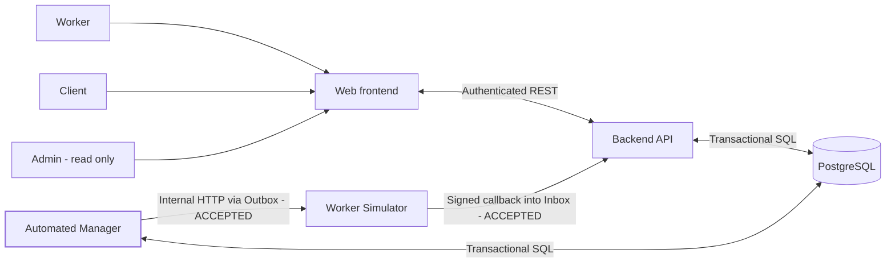
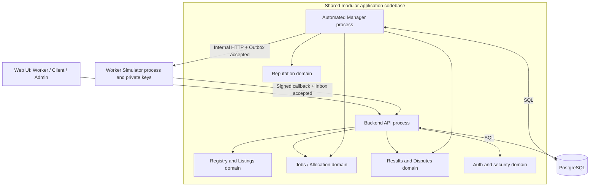

# GPU Resource Marketplace - System Architecture

**Version:** 0.11 - API decision status synchronized (2026-10-21)<br>
**Date:** 2026-10-21<br>
**Status:** Existing architecture boundaries and 14 drivers APPROVED; ADR-001..008 **ACCEPTED** as design decisions. Owner-approved API decisions `API-OPEN-01/02/06` are synchronized in API Contract v0.6. Additional Auth profile details are `NEEDS_OWNER_DECISION` before Authentication implementation; they do not block GPU-001 foundation when Auth is out of scope. Implementation and system tests remain `NOT_RUN`.<br>
**Owner:** GPU Resource Marketplace development team  
**Scope:** Simulation-only MVP

## 0. Document ownership and sources

This document explains *why* the system is structured as proposed and how its major components collaborate. It does not replace normative requirement statements or low-level schemas.

- [Main Software Requirements Specification](../requirements.md) (SRS; use the latest synchronized requirements baseline)
- [Functional Requirements](../functional-requirements.md) (21 P0 FRs across six business modules)
- [Non-functional Requirements](../non-functional-requirements.md) (33 NFRs)
- [Project Vision and Scope](../project-vision-and-scope.md)
- [FR/NFR consistency and readiness](../fr-nfr-consistency-and-architecture-readiness.md)
- [Quality attribute scenarios](quality-attributes.md) (testable architecture quality scenarios)

**Status convention:**
- **APPROVED:** Explicitly agreed project decision or existing SRS baseline.
- **PROPOSED:** Recommended architecture or measurement target, not yet approved as an ADR.
- **OPEN:** Must be resolved before freezing or implementing the affected detail; unrelated approved design work may continue.
- **VERIFIED:** Requires objective test evidence; nothing in this document is marked verified merely by design.

## 1. Architectural context

### 1.1. Purpose and system boundary

The GPU Resource Marketplace is a **web-based simulation prototype**, combining marketplace discovery with HPC-inspired job scheduling. Workers publish simulated GPU listings, Clients submit simulated jobs to a *chosen listing*, a software Manager schedules and finalizes execution, a Worker Simulator returns signed receipts, and Admins observe the system. No GPU computation, valuable tokens, actual payment, blockchain, or real provisioning is performed.

**Human actors:** Worker, Client, Admin (one fixed role per seeded account in the MVP; future multi-role remains possible). **Internal software:** API, Manager, Worker Simulator, PostgreSQL. The Manager is **not** a human actor.

**Functional scope (APPROVED):** Worker Registry & Listings, Job Lifecycle, Signed Result, Dispute Mock, Lifetime Reputation, role-scoped Dashboard; Authentication/RBAC are cross-cutting requirements.

**Key workflow (APPROVED):** Client chooses one listing -> submits a job -> strict FIFO queue per listing -> atomic allocation -> deterministic simulation -> Worker Ed25519 receipt -> Manager verifies signed receipt -> terminalize/release -> optional deterministic dispute -> idempotent reputation correction.

### 1.2. System context view



The internal HTTP dispatch and signed-result callback path, with PostgreSQL transactional Outbox/Inbox, is **APPROVED under ADR-003**. This is a design decision, not evidence of a working transport implementation.

### 1.3. Architectural invariants (mandatory)

1. `0 <= allocated_gpu_count <= total_gpu_count` for every listing at every committed state.
2. Each job belongs to one Client and uses **exactly one chosen GPU listing**.
3. Job transitions: `QUEUED -> RUNNING -> COMPLETED | FAILED`; `QUEUED -> CANCELLED`. Terminal states do not change.
4. Listing transitions: `ACTIVE <-> PAUSED`. A committed `PAUSED` state rejects new submissions and allocations; existing `RUNNING` jobs may finish.
5. Strict FIFO per listing: later jobs cannot pass a head-of-line job that lacks capacity; after allocating the head job, remaining capacity may serve subsequent jobs in order.
6. Client may cancel **only its own `QUEUED`** jobs; cancel/allocation races commit one consistent outcome.
7. At most one accepted final signed result and one effective lifetime reputation contribution per job; retries do not duplicate business effects.
8. A signature verifies key ownership and payload integrity, **not** actual GPU execution or truthful outcomes. Dispute checks against separately protected deterministic reference evidence.
9. Detailed history is eligible for cleanup `terminal_at + 23 days`; active jobs, managed listings, required signer metadata and lifetime reputation aggregates persist.
10. Production high availability, distributed trust and disaster recovery of lost PostgreSQL data are **out of scope**.

## 2. Architecture drivers - complete catalog

**Review status: APPROVED (2026-10-17).** All **14 architecture drivers** and their respective priorities have been reviewed and accepted as the architectural baseline: **7 Critical, 6 High, 1 Supporting**. This approval covers the driver register, priorities and their stated architectural implications; it **does not** automatically approve proposed technologies, transport designs, unmeasured targets or open decisions in later sections. Changes to this baseline should be recorded with rationale and impact on requirements and quality scenarios.

### 2.1. How drivers are identified

An architecture driver is an architecturally significant **functional capability**, **quality attribute**, or **constraint** that influences component boundaries, data ownership, processing mechanisms, deployment or test design. The system has **more than three** drivers. No important quality is discarded because an assignment asks for three highlighted examples.

The priority below is **architectural influence** (not FR priority):
- **Critical:** failure violates a core invariant or undermines the trust/business model.
- **High:** strongly shapes implementation, operability or architecture evolution.
- **Supporting:** should be addressed explicitly but is unlikely to determine the primary decomposition on its own.

**APPROVED prioritization:** These are qualitative severity categories accepted by the project reviewer on 2026-10-17, **not numerical risk scores or benchmark evidence**. Reprioritization requires an explicit architecture review/change record, for example after a proof-of-concept or benchmark.

### 2.2. Comprehensive driver register

| Driver | Category | Architectural motivation and source | Priority | Primary consequence |
|---|---|---|---|---|
| **AD-01 Marketplace & job orchestration** | Functional | Worker listing, chosen listing, submit/cancel, strict FIFO; FR-WR-01..04, FR-JL-01..06, UC-W01/W02/C03/C06 | **Critical** | Explicit registry, job domain, manager scheduler; separate API requests from asynchronous job work |
| **AD-02 Verified results, disputes & reputation** | Functional | Ed25519 receipt, automatic deterministic dispute, lifetime reputation; FR-SR-01..04, FR-DP-01..03, FR-RP-01..02 | **Critical** | Worker signature boundary, verification, protected oracle, immutable receipt, idempotent reputation effects |
| **AD-03 Modifiability** | Quality | Future scheduling strategies and policy changes, 18-hour CR response; NFR-M01, NFR-O01, SRS future extensions | **High** | Modular ownership, isolated policies/interfaces, documented decisions and regression tests |
| **AD-04 Concurrency safety & data integrity** | Quality | Capacity, cancel/allocate/pause races, exactly-once effects; NFR-R03..06, FR-JL-03/04 | **Critical** | PostgreSQL transactions, constraints, conditional updates/locks, idempotency keys |
| **AD-05 Reliability & recoverability** | Quality | Restart Manager/Worker without losing committed work; NFR-R01/R02/R04/R07/R08 | **Critical** | Durable job deadlines, recoverable dispatch, bounded retries, replay-safe finalization |
| **AD-06 Security & trust boundaries** | Quality | RBAC, ownership, private keys, correct receipt verification; NFR-S01..07, FR-SR-01..04 | **Critical** | Key isolation, authenticated internal calls, secure signed bytes, restrictive database permissions |
| **AD-07 Performance & latency** | Quality | 736 active virtual users; p95 read <=2s, submission <=3s, 5xx <1% proposed; NFR-P01..05 | **High** | Lightweight submit API, indexed reads, bounded polling, profiling and repeatable load testing |
| **AD-08 Scalability** | Quality | Worker/listing/job growth, backlog and process scaling; NFR-P01/P05, SRS future extensibility | **High** | Stateless HTTP tier where possible, separately scalable Manager/Simulator processes, avoid global in-memory state |
| **AD-09 Retention & long-lived reputation** | Quality/constraint | 23-day terminal history and evidence, retained lifetime counters; NFR-D01..08, SRS BL-02 | **Critical** | Transactional cleanup, explicit expiry, dependent evidence management and durable aggregates |
| **AD-10 Observability & traceability** | Quality | Troubleshoot jobs, result verification, dispute decisions, failed retries; NFR-S07, NFR-M02, FR-DB-01/02 | **High** | Correlation IDs, structured logs, metrics, audit events without exposing secrets |
| **AD-11 Testability & maintainability** | Quality | Five-person collaborative development, CI for invariants, deterministic simulation; NFR-M01..04 | **High** | Module-level tests, fake clock, seed fixtures, integration/contract tests, reproducible setup |
| **AD-12 Deployability & operational simplicity** | Constraint/quality | Fast simulation MVP with limited operational complexity; NFR-M03/M04, SRS scope exclusions | **High** | One repo, shared domain code, containerized separate processes; no mandatory broker/Kubernetes/GPU |
| **AD-13 Simulation-only & nonfinancial boundaries** | Hard constraint | No actual GPU compute, payments, valuable tokens or blockchain; SRS 2.2, FR section 6 | **Critical** | No GPU drivers/provisioning; synthetic executor and clearly labeled simulated results/costs |
| **AD-14 Change-response governance** | Organizational constraint | First substantive Change Request response <=18 elapsed hours; NFR-O01, SRS BL-03 | **Supporting** | Change traceability, review ownership and concise ADR/impact analysis; not an implementation deadline |

**Coverage rule:** AD-01/02 explain essential capabilities; AD-03..11 cover architecturally significant qualities; AD-12..14 capture implementation and organizational constraints. These drivers coexist. The project may highlight three for a report without treating those three as the whole architecture.

### 2.3. Impact and verification per driver

| Driver | Design decisions/tactics it drives | How it will be validated |
|---|---|---|
| AD-01 | Domain boundaries; FIFO and Freeze Pending Scheduling; user permission contracts | End-to-end chosen-listing job, FIFO, pause/resume/cancel acceptance tests |
| AD-02 | Receipt signing/versioning; result verification; independent dispute reference; reputation aggregate | Tamper/replay test; both UPHELD and REJECTED dispute; no duplicate contribution |
| AD-03 | Policy interfaces and backward-compatible domain contracts | Change exercise: add Priority policy without changing published API or FIFO behavior |
| AD-04 | Per-listing transactional locking and unique constraints | Simultaneous allocations/cancel/pause with invariant checks |
| AD-05 | Persist attempt state, deadlines, retry and recovery | Kill/restart Manager/Simulator at dispatch, callback and finalization boundaries |
| AD-06 | Split signing/verifying secrets, RBAC and object ownership | 401/403/ownership tests; payload tampering, wrong key, wrong attempt |
| AD-07 | Query/indexing and worker throughput budget | 736-VU documented traffic profile; p95, error rate, throughput, DB wait metrics |
| AD-08 | Avoid in-memory source-of-truth and cross-module circular dependencies | Increase seeded workers/jobs, assess bottlenecks and process-level scaling |
| AD-09 | Coordinated TTL cleanup, lifetime counters | Fake-clock boundary tests, unresolved-dispute exception and no orphaned evidence |
| AD-10 | Structured logs, metrics and correlation propagation | Trace a job and a dispute end-to-end without secrets or missing transitions |
| AD-11 | Test fixtures, CI, modular code review | Fresh checkout starts, CI covers core invariants; deterministic fixture replays |
| AD-12 | Compose-friendly topology, no production orchestration | One reproducible local setup including API, Manager, Simulator, DB and UI |
| AD-13 | Simulation-only execution and simulated economic values | Demo uses zero physical GPU compute, no payment rails or financial tokens |
| AD-14 | Recorded CR timestamps and owners | Tickets show first substantive assessment <=18 elapsed hours |

### 2.4. Priority rationale and interdependencies

- **Foundational correctness:** AD-04, AD-05 and AD-09 protect persistent business state. Without them, scheduling, signed results and reputation would be inconsistent.
- **Marketplace credibility:** AD-01, AD-02 and AD-06 are essential for a meaningful mock Worker/Client/Manager workflow. Verifying a signature does not certify an honest simulated outcome.
- **Evolution and delivery:** AD-03, AD-11, AD-12 and AD-14 limit change cost and complexity for a small team.
- **Operational load:** AD-07 and AD-08 must be measured independently of job-capacity rules: 736 users never implies 736 allocated GPU jobs.
- **Supporting evidence:** AD-10 makes it feasible to verify and debug the effects of every other driver.

No architectural driver should be silently treated as achieved merely because a document exists.

**Decision record — ADRIVER-2026-10-17:** Project review accepted the 14-driver register and all assigned priorities without additions/removals. The register informs architecture and verification; quality scenario *numerical measures* marked PROPOSED/OPEN in `quality-attributes.md` still require separate review.

## 3. Architecture style and approved boundaries

### 3.1. Approved style

**APPROVED:** A **Modular Monolith**, in one repository and one logical domain codebase, with **Backend API**, **Automated Manager**, and **Worker Simulator** as separate runtime processes. PostgreSQL is the durable application state. The **API and Manager directly access PostgreSQL** using shared domain/repository code. **Worker Simulator does not directly access the DB.**

This is not an independently deployed microservice ecosystem. Cross-module ownership rules remain mandatory despite a shared database.

### 3.2. Logical component view



This is a **logical** view, not a mandate for one Python package per drawn box. Shared domain operations should have a single owning implementation, not duplicate business logic in API and Manager.

### 3.3. Component responsibilities and exclusions

| Component | Owns | Must not own |
|---|---|---|
| **Web UI** | Role-specific views, inputs, client-side presentation | Authoritative job state, ownership checks, signing secrets or oracle |
| **Backend API** | Authentication/RBAC, listing commands, job creation and queued cancellation, dispute submission, dashboards, authenticated signed-result callback ingestion into durable Inbox | GPU allocation/finalization/reputation mutations outside Manager |
| **Manager** | FIFO, allocation, durable execution tracking, receipt verification, finalization, dispute resolution, lifetime reputation and cleanup | Worker private key, Client impersonation, public user interfaces |
| **Worker Simulator** | Deterministic mock execution and Ed25519 signing per Worker | Database mutations, Worker Registry public authority, dispute ground truth |
| **PostgreSQL** | Committed source of truth for persistent application state | Computing job outcomes or storing Worker private keys in public tables |

**Suggested domain modules (PROPOSED naming):** `identity`, `registry`, `jobs`, `scheduling`, `execution`, `results`, `disputes`, `reputation`, `reporting`, `retention`. They may be combined where that reduces needless boilerplate. Module boundaries matter more than folder count.

## 4. Runtime and communication view

### 4.1. Accepted communication and remaining design details

| Link | Status | Mechanism | Purpose |
|---|---|---|---|
| Browser <-> API | Baseline expectation | Authenticated HTTP/REST | Interactive user operations |
| API <-> PostgreSQL | **APPROVED** | Transactions via shared repository code | Listing, job, auth and dispute persistence |
| Manager <-> PostgreSQL | **APPROVED** | Transactions via shared repository code | Scheduling, finalization and retention |
| Manager -> Worker Simulator | **APPROVED (ADR-003)** | Internal HTTP with stable `attempt_id`; durable transactional `execution_outbox` | At-least-once job request delivery |
| Worker Simulator -> API | **APPROVED (ADR-003)** | Authenticated internal HTTP signed-result callback; durable `result_inbox` | At-least-once result ingress |
| API/Manager -> users | **PROPOSED** | Read/poll job and dashboard endpoints | Avoid real-time infrastructure for MVP |

The transport choice is **ACCEPTED in ADR-003** after explicit comparison with direct HTTP and an external message broker. **ADR-005 ACCEPTED** the exact retry intervals, hard execution deadline and scoped service-token authentication. Physical schema, SQL lock implementation, HTTP envelope contracts and measured performance remain OPEN. See [ADR-005](decisions/ADR-005-retry-timeout-internal-auth.md).

**ADR-005 accepted execution settings:** Manager due-work poll `2s`; fenced claim lease `30s`; internal HTTP connect/total timeout `2s/5s`; persisted retry backoff `2, 4, 8, 16, 30, 30, ...s`; missing-receipt repair probe `finish_due_at + 10s`; hard deadline `finish_due_at + 120s`. Manager retries the **same `attempt_id`**. A callback is on time only when its DB-trusted Inbox `received_at < hard_deadline_at`, recorded after locking the Job; an already committed on-time Inbox receipt takes precedence over a subsequent timeout fallback even when Manager processes it late. These are design-approved settings, **not measured SLAs**.

### 4.2. Accepted job execution communication sequence

```mermaid
sequenceDiagram
    participant C as Client
    participant API as Backend API
    participant DB as PostgreSQL
    participant M as Manager
    participant W as Worker Simulator
    C->>API: Submit job on chosen listing
    API->>DB: Validate+insert QUEUED (transaction)
    API-->>C: QUEUED + job_id
    M->>DB: Lock listing/head job; allocate + RUNNING + outbox (transaction)
    M->>DB: Claim pending outbox event
    M->>W: Execute job (attempt_id; internal auth)
    W-->>M: Accepted acknowledgment
    W->>W: Deterministic mock execution; sign receipt
    W->>API: Signed callback (result_id, attempt_id, signature)
    API->>DB: Durable inbox insert / deduplicate
    API-->>W: Accepted acknowledgment
    M->>DB: Claim inbox; verify public key and job context
    M->>DB: Finalize+release+reputation delta (transaction)
    C->>API: Read terminal result / optionally dispute
    API->>DB: Create dispute for retained eligible job
    M->>DB: Resolve via protected reference; update effective delta once
```

The diagram shows the **accepted ADR-003** outbox/inbox communication path of the approved business workflow. HTTP acknowledgment is **not** a final job outcome. Verification checks both cryptographic validity and expected worker/listing/attempt identity. Correctness of the signed claim is independently checked only by the mock dispute workflow.

### 4.3. Delivery semantics and idempotency

- **At-least-once messages, exactly-once persistent business effect**: duplicate dispatch/callback may occur; final state changes must not repeat.
- **Client -> API:** proposed per-Client idempotency key for job creation. Return the original job on a genuine retry.
- **Manager -> Simulator (ADR-005):** stable `attempt_id` on retry with persisted due instants and bounded backoff; sending a new random attempt ID for the same logical retry is incorrect. Dispatch `202` is not completion, and a missing callback after the probe instant triggers a same-attempt repair resend before the hard deadline.
- **Simulator -> API:** deduplicate same `result_id`/identical payload. Same `result_id` but differing payload is an integrity conflict, not an overwrite.
- **Manager -> DB:** unique accepted result per job and unique effective reputation contribution; terminal job and resource release committed once.
- **Honest limitation:** a Simulator that loses in-memory attempt records may perform synthetic work twice after restart. This does **not** violate exactly-once *persistent effects* when the Manager and DB are idempotent; do not claim exactly-once physical execution.

### 4.4. Failure and race cases

| Failure point | Required recovery invariant | Recovery mechanism |
|---|---|---|
| Manager stops after allocating but before dispatch | No stuck, forgotten committed job | Persist attempt/outbox atomically with allocation |
| HTTP request delivered; ACK lost | No second logical attempt or second finalization | Retry identical attempt ID |
| Simulator restarted mid-job | Preserve manager-owned committed allocation and bounded completion | Retry with deterministic reference + deadline |
| Result callback replayed | No double reputation/finish/release | Inbox dedup + finalization transaction |
| On-time callback already committed, Manager processes after deadline | No false `SYSTEM_FAULT` | Prefer durable Inbox `received_at < hard_deadline_at` before terminal fallback |
| Callback ingress races with fallback at deadline | Exactly one terminal decision/release | Lock Job in established order; winning committed transaction decides; `received_at == hard_deadline_at` is late |
| Manager crashes just before/after commit | Either all finalization side effects commit, or none do | One ACID transaction and uniqueness constraints |
| Cancel races with allocate | Either CANCELLED with no allocation or RUNNING with canceled request rejected | Conditional transition under consistent locks |
| Pause races with allocate | No allocation newly committed after PAUSED commit | Lock listing and commit ordered transition |
| DB temporarily unavailable | No in-memory success lies | Fail closed for mutations, retry and surface health status |

## 5. Data ownership and transaction view

### 5.1. Logical persistence entities (not final schema)

`users`, `roles`, `user_roles`, `workers`, `worker_public_keys`, `gpu_listings`, `jobs`, `allocations`, `simulation_references`, `signed_results`, `disputes`, `worker_reputation_aggregates`, `job_reputation_contributions`, `audit_events`.

**ADR-003 REQUIRED logical delivery entities:** `execution_outbox` and `result_inbox`; `execution_attempts` is a recommended logical record (its separate physical table is still OPEN). Their fields, indexes and constraints belong in `docs/design/database-design.md`, not in this architecture baseline.

### 5.2. Write ownership

| Data / operation | Single logical owner |
|---|---|
| User session and role checks | API (identity/auth domain) |
| Worker/listing create, edit, pause/resume | API (registry domain) |
| Job creation, queued cancellation | API (jobs domain) |
| Allocation, transition to RUNNING, simulation deadlines | Manager (scheduling/execution domain) |
| Receipt ingestion via approved callback | API accepts into durable inbox, does not finalize |
| Verified result and job terminalization | Manager (result/finalization domain) |
| Dispute creation | API validates owner and inserts OPEN |
| Dispute decision and effective classification | Manager (dispute domain) |
| Lifetime aggregates and contributions | Manager (reputation domain) |
| Historical cleanup | Manager (retention domain) |

Physical shared DB access must never be interpreted as universal permission to mutate every table from both processes. Prefer separate DB credentials/least-privilege grants if feasible (PROPOSED).

### 5.3. Required ACID units

- **TX-ALLOCATE:** Lock listing and eligible queued head; check `ACTIVE` and capacity; allocate; transition to `RUNNING`; persist attempt/deadline and the outbox command. All-or-nothing.
- **TX-CANCEL:** Check Client ownership and `QUEUED`, make conditional transition `QUEUED -> CANCELLED`; no allocation created.
- **TX-PAUSE:** Lock listing; mark `PAUSED`. Allocation and pause use consistent locking order; running work remains valid.
- **TX-FINALIZE (ADR-005 deadline rule):** Verify receipt/context *before* accepting; inside one transaction accept terminal outcome, release allocation, record one effective reputation contribution and mark the inbox entry as handled. An already-committed valid Inbox receipt received strictly before `hard_deadline_at` wins over a later fallback. If no eligible valid receipt exists at the hard deadline, one `FAILED/SYSTEM_FAULT` fallback releases the allocation with zero Worker reputation effect. Retry and fallback never rewrite a terminal Job.
- **TX-DISPUTE:** Compare protected reference; persist resolution; replace contribution via delta once; never mutate original signed bytes.
- **TX-CLEANUP:** Remove only expired and eligible detail with linked evidence; retain lifetime aggregates and active resources; record unresolved-dispute exception.

**Database protection:** row locks or conditional versioned writes, uniqueness for accepted result/job and contribution/job, and check constraints for non-negative capacity/counters. Exact lock SQL and indexes are lower-level design decisions.

## 6. Trust, security and signed-result architecture

1. **External actors are untrusted:** all role/ownership checks run on the server; UI cannot authorize itself.
2. **Signed-receipt authenticity:** Worker Simulator signs canonical serialized payload with Worker Ed25519 private key; Manager verifies against the registered `worker_id`/`key_id` public key. Required signed identifiers include `schema_version`, `result_id`, `job_id`, `attempt_id`, `worker_id`, `listing_id`, `outcome`, `failure_reason`, `result_digest`, `finished_at`, `key_id`.
3. **Separate logical signing boundary:** Worker Simulator possesses private keys; Manager must not. Private keys must not appear in Git, frontend, public registry responses or logs.
4. **Separate dispute oracle:** protected `simulation_references` are created reproducibly before result submission; Client and Worker cannot edit/read them. Manager can compare the signed claim to the oracle when resolving an eligible dispute.
5. **Signed but false is possible:** valid signature + false simulated claim is a meaningful dispute case. Bad signature is rejected and cannot directly penalize Worker.
6. **No real attestation:** these process boundaries on one host do not establish independent third-party verification or prove execution on a physical GPU.
7. **Internal channels (ADR-003 / ADR-005 ACCEPTED):** require independent Bearer service tokens for Manager -> Simulator (`MANAGER_DISPATCH_TOKEN`) and Simulator -> API (`SIMULATOR_CALLBACK_TOKEN`), each with at least 256 bits of securely generated randomness, injected from untracked secret configuration. Invalid/missing/opposite-direction tokens are rejected before dispatch or Inbox persistence; do not expose credentials or Worker private keys in repository, logs, payloads or frontend. This HTTP-with-Bearer profile assumes an **isolated trusted single-host MVP network**; it does not claim confidentiality on an untrusted network, where TLS/mTLS is needed. **ADR-004 ACCEPTED:** RFC 8785 JCS + Ed25519 over the exact versioned V1 prefix and 11-field canonical payload; lowercase UUIDv4 identifiers, microsecond UTC `finished_at`, SHA-256 canonical-output digest, unpadded Base64url signatures and the V1 JSON Schema/public signature vector are fixed by [ADR-004](decisions/ADR-004-signed-result.md). HTTP service authentication does not replace Ed25519 verification. See [ADR-005](decisions/ADR-005-retry-timeout-internal-auth.md). These are design contracts; production authentication and signer/verifier tests remain `NOT_RUN`.

## 7. Performance, scale and load model

- **Baseline:** 736 concurrent active virtual users in a replayable Client/Worker/Admin mix. This is not a count of concurrent GPU allocations.
- **Unmeasured NFR targets:** 10-minute steady load; read p95 <= 2 seconds; valid job submit p95 <= 3 seconds; unexpected 5xx <1%; Manager work recovery within 120 seconds of restart (DB available). These are **targets, not measured accomplishments**.
- Keep `submit job` short: validate, persist `QUEUED`, return without waiting for a simulator.
- Index listing state/owner and per-listing `(status, submitted_at, id)` queue access. Query optimization and batch size require measurement; do not optimize based on assumptions alone.
- Enforce bounded Manager polling, DB connection pools and API rate limits; evaluate their impact on latency and fairness.
- Scale API request handling and simulation dispatch separately if tests justify it. Beware of many Manager replicas polling the same queue; distributed claims require transactional locks/leases.
- Strict FIFO may create head-of-line blocking. Backfilling is not MVP; adding it must be an explicit future policy change and must preserve the accepted baseline until approved.
- Capture throughput, p95 latency, failure rates, DB lock waits, queue length/age and finalization delay during load tests.
- **ADR-007 ACCEPTED (2026-10-18):** use [reproducible k6 load-test configuration](decisions/ADR-007-load-test-configuration.md) with 736 VUs (552 Client/147 Worker/37 Admin), 120-second ramp + 600-second plateau, 5-second per-VU think time, 3 independent baseline runs and paired `SCA-1X`/`SCA-5X` comparison. Fix a separate 4-vCPU/8-GiB load host, dedicated 8-vCPU/16-GiB+SSD SUT, 2 API execution units, 1 Manager process, 1 Simulator process (128 concurrent in-flight simulated attempts), and one PostgreSQL instance. Exact binary/image revisions are pinned only at implementation; `LDCFG-01..09`, all performance/scalability checks and any p95 claim remain `NOT_RUN`.

## 8. Retention, evidence lifecycle and lifetime reputation

**APPROVED:** Terminal Job history and dependent detailed evidence become eligible at `terminal_at + 23 * 24 hours`. `QUEUED`/`RUNNING` jobs do not expire. User accounts, managed listings, necessary public-key metadata and Worker lifetime counts remain.

- Cleanup runs on a schedule; hourly frequency and completion within one hour of expiry are **proposed** goals in NFR-D02.
- Delete linked terminal-job details, signed results, simulation reference, settled disputes and per-job reputation contributions together, maintaining referential integrity.
- Audit events expire 23 days from *event creation* (not necessarily job terminal time).
- Reputation persists two aggregate counters: `successful_jobs`, `worker_fault_jobs`; when denominator is zero, display `N/A`. Job detail deletion does **not** decrement lifetime counts.
- If dispute is `UPHELD`, adjust the old contribution to the oracle-based effective classification exactly once while evidence exists; never rewrite the signed receipt.
- **APPROVED 2026-10-18:** A Dispute must be filed strictly before `terminal_at+7d`; normal Job evidence expires at `terminal_at+23d`. If a timely Dispute remains `OPEN` at expiry, create a durable evidence-hold exception and retain original signed receipt, verifier key, simulation reference and attribution until `RESOLVED` **without a hard maximum**. Issue an Admin-visible warning within 1h of exception detection, escalate to CRITICAL at 24h unresolved, and retry every 15m while Manager is healthy. When already expired evidence becomes resolved, clean it up within 1h under healthy conditions. Do not extend independent operational audit-log TTLs; never claim unconditional deletion of all evidence after exactly 23 days. See [ADR-006](decisions/ADR-006-dispute-retention.md).
- Limits: after detailed evidence is deleted, individual historic outcomes cannot be fully reconstructed; late disputes/replayed results must be rejected or deduplicated using surviving safe metadata and missing job checks.

## 9. Observability and verification view

- Assign a correlation ID to incoming API requests and propagate `job_id`, `attempt_id`, `result_id`, and `dispute_id` across relevant internal transitions.
- Record redacted structured event logs for claim/allocate, pause/cancel, receipt verification/rejection, finalization, dispute resolution, reputation effects, retries and cleanup exceptions.
- Candidate metrics: `jobs_queued`, `jobs_running`, `queue_age_seconds`, `gpu_allocated_by_listing`, `dispatch_retry_total`, `receipt_invalid_total`, `result_inbox_backlog`, `manager_recovery_seconds`, `disputes_open`, `reputation_adjustments_total`, `cleanup_lag_seconds`.
- Do not log Worker private keys, credentials or unredacted sensitive tokens.
- Dashboard reads role-filtered backend state; it is an observation view, **not** the source of truth.

## 10. Architectural trade-offs

| Trade-off | Tension | Chosen principle / mitigation | Verification |
|---|---|---|---|
| **Modifiability vs Performance** | Configurable scheduling policies add indirect calls/queries and can introduce inefficient queue scans | Isolate policy selection, keep allocation core compact/transactional; benchmark 736-VU profile | Policy-change regression + load p95/DB contention tests |
| **Modifiability vs Security** | Pluggable signing/simulation code broadens possible secret exposure | Interfaces at trust boundaries, no user-supplied executable plugins, separate key-owning Simulator | Key-access review, tampering and auth tests |
| **Reliability vs Latency** | Durable outbox/inbox and transaction commits add DB work | Accept asynchronous job start, keep submission fast; batch/poll bounded | End-to-end dispatch lag and commit correctness |
| **Strict FIFO vs Utilization** | Head-of-line blocking can leave GPUs idle | Preserve FIFO as MVP requirement; record queue utilization, evaluate backfilling only as future change | Known-capacity FIFO fixture |
| **Retention vs Auditability** | 23-day deletion removes detailed proof while lifetime aggregates persist | Keep minimal counters and disclose aggregate-only evidence limits; bound dispute window | Fake-clock cleanup and reconciliation tests |
| **Simplicity vs Independent Trust** | One repo/host lowers costs but Worker and Manager may share administrative control | Logical process/key separation, explicit non-attestation statement | Threat-model review, key exposure checks |
| **Scalability vs Consistency** | More concurrent Manager workers can contend on listing locks | Serialize only contested per-listing transitions, use short transactions and measured batching | Concurrency/load stress tests |

A trade-off does not, by itself, prove performance or security characteristics. It documents design consequences and the tests needed to establish them.

## 11. Quality scenarios and acceptance strategy

The project-wide [quality-attributes.md](quality-attributes.md) contains six-part scenarios (`Source -> Stimulus -> Environment -> Artifact -> Response -> Response Measure`) for **Modifiability, Reliability, Data Integrity, Security, Performance, Scalability, Retention, Observability, Testability and Deployability**. The Modifiability change scenario explicitly accounts for the 18-hour CR response, existing 736-VU load target and 23-day retention rule.

Core gates before MVP acceptance:

1. Contract/integration: strict FIFO, chosen listing, Pause/Resume and cancel races.
2. Receipt/security: Ed25519 valid/invalid context, tampered payload and replay.
3. Business integrity: one terminalization, one GPU release, one effective reputation contribution per job.
4. Dispute: both upheld and rejected, with immutable signed evidence.
5. Recovery: Manager killed and restarted at queued/running/dispatch/finalize points; DB durable.
6. Retention: fake-clock 23-day expiry with lifetime aggregates intact and unresolved-dispute handling.
7. Performance: documented 736-VU workload report with observed p95, errors and queue metrics.
8. Delivery: reproducible setup, CI and change request records with response timestamps.

## 12. Decision register and unresolved issues

| ID | Decision | Status | Next action |
|---|---|---|---|
| ADR-001 | Modular Monolith, separate API/Manager/Simulator runtime processes | **APPROVED** | Capture rationale as a formal ADR if ADR files are introduced |
| ADR-002 | API and Manager directly access PostgreSQL via shared domain/repository; Simulator cannot | **APPROVED** | Define schema roles, ownership and transaction protocols |
| ADR-003 | Internal HTTP + PostgreSQL transactional Outbox/Inbox | **ACCEPTED 2026-10-18** | [Decision and required verification](decisions/ADR-003-internal-communication.md); implementation `NOT_RUN` |
| ADR-004 | RFC 8785 JCS + Ed25519 + versioned prefix; V1 signed fields, enum combinations, wire encodings, JSON Schema and fixed public vector | **ACCEPTED 2026-10-18** | [Signed Result V1 contract](decisions/ADR-004-signed-result.md); implementation/verification tests `NOT_RUN` |
| ADR-005 | Persisted bounded retry/timeout/backoff, strict Inbox deadline ordering, scoped 256-bit service Bearer tokens | **ACCEPTED 2026-10-18** | [Approved decision and 18 deterministic test designs](decisions/ADR-005-retry-timeout-internal-auth.md); implementation `NOT_RUN` |
| ADR-006 | Seven-day Dispute filing; unresolved evidence hold, warning/retry/escalation, post-resolution cleanup | **APPROVED** | [ADR-006](decisions/ADR-006-dispute-retention.md); no universal hard-delete guarantee |
| ADR-007 | Reproducible k6 profile, fixed hardware, data 1x/5x, 128 in-flight Simulator attempts, nine config tests | **ACCEPTED 2026-10-18** | [Decision and verification](decisions/ADR-007-load-test-configuration.md); benchmark/tests `NOT_RUN` |
| ADR-008 | Python 3.12/FastAPI API + Manager + Simulator, React 19/TypeScript SPA, PostgreSQL 16, Compose v2 and test toolchain | **ACCEPTED 2026-10-18** | [Approved reference stack and ten test designs](decisions/ADR-008-technology-stack.md); implementation `NOT_STARTED`, tests `NOT_RUN` |

**No requirement to implement a real GPU, broker, blockchain or payment rail follows from any architecture driver.** Proposals become decisions only after explicit team review; revisions should update this register, related quality scenarios and affected SRS traces.

## 13. Review status and later roadmap (no implementation begun)

The recommended sequence minimizes design risk without creating documents solely for coursework:

1. Validate this architecture and linked quality scenarios against SRS/FR/NFR.
2. ADR-001..008 are accepted architecture decisions for design, including ADR-008 Option B; implementation/testing remain separately gated.
3. Preserve approved retry/deadline/authentication decisions in the existing Database and API Design documents; no implementation has begun.
4. Use the approved 18-table Database Design, transaction/lock-order rules and retention guards in `../design/database-design.md`.
5. Use the approved API Contract and Module/Test Design baselines in `../design/`; resolve bounded Auth and simulation-input details before coding.
6. Preserve the approved Test Design, deterministic fixtures, ADR verification cases and 736-VU performance-test methodology; all executable tests remain `NOT_RUN`.
7. **Only after separate coding authorization**, implement the smallest end-to-end vertical slice: listing -> job -> allocation -> signed result -> dispute -> lifetime reputation.

**Change management:** a new FR/NFR or a revised business behavior belongs in the owning requirements document; an implementation decision belongs in this architecture/ADR set. Do not silently promote a proposal to an approved baseline.
