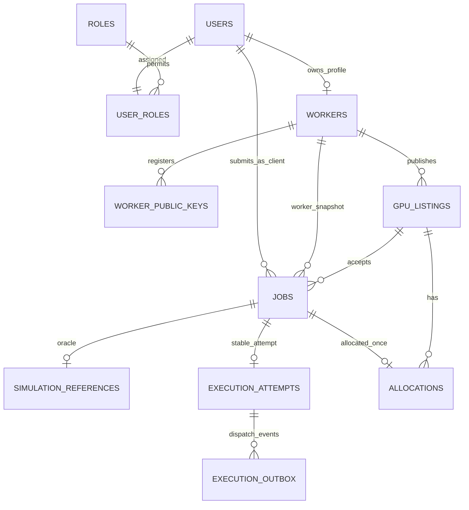
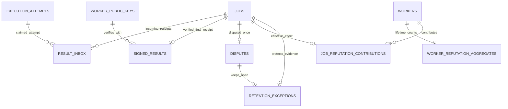

# GPU Resource Marketplace - Database Design

**Version:** 0.4 - DESIGN DOCUMENT ONLY; logical, physical and transaction designs APPROVED  
**Date:** 2026-10-18  
**Status:** 18-table logical model, physical schema and Transaction/Lock Order v0.3, including `DBTX-01..18` **APPROVED AS DESIGNS** (2026-10-18). No database acceptance test has been executed (`NOT_RUN`).  
**Scope boundary:** Markdown design only. **No SQL migrations, executable code, DB scripts, Docker or GitHub Actions are authorized or included** in this deliverable. Previous experimental code drafts are excluded; PostgreSQL execution stays `NOT_RUN`.  
**Location:** `docs/design/database-design.md`  
**Scope:** GPU Marketplace MVP; **not** the separate AD-090 assignment variant.

## 1. Goal, design workflow, and sources

**Goal:** obtain one enforceable PostgreSQL data model for the approved simulation-only GPU Marketplace, before writing API services or migrations. The design must preserve FIFO scheduling per Listing, atomic GPU allocation, once-only Job finalization/reputation effects, original Ed25519 evidence, deterministic Disputes and selective historical deletion.

**Review workflow:**

1. **APPROVED (v0.1):** the existing 18 logical entities, ownership, core relationships and invariant targets.
2. **APPROVED (v0.2):** physical PostgreSQL data types, FKs/constraints, index candidates, evidence-retention mechanics and FIFO `enqueue_seq`.
3. **APPROVED (v0.3):** transaction recipes, global Listing-before-Job lock ordering, timeout/cleanup guards and 18 deterministic DBTX test designs (not executed).
4. **CURRENT (v0.4, DOCUMENTATION ONLY):** consolidate approved design and its future verification checklist. Migration and application coding must wait for an explicit, separate instruction from the user.

Authoritative inputs:

- [SRS](../requirements.md): 21 P0 FRs, 33 NFRs, account roles, Job/Listing state machines, FIFO, lifetime Reputation and 23-day retention.
- [Functional Requirements](../functional-requirements.md) and [Non-functional Requirements](../non-functional-requirements.md).
- [System Architecture](../architecture/system-architecture.md): approved logical process/data ownership and required ACID units.
- [Quality Attribute Scenarios](../architecture/quality-attributes.md): particularly QA-INT-01, QA-REL-01, QA-SEC-01, QA-DAT-01, QA-OBS-01.
- [ADR-001](../architecture/decisions/ADR-001-modular-monolith.md), [ADR-002](../architecture/decisions/ADR-002-postgresql-access-boundaries.md), [ADR-003](../architecture/decisions/ADR-003-internal-communication.md), [ADR-004](../architecture/decisions/ADR-004-signed-result.md), [ADR-005](../architecture/decisions/ADR-005-retry-timeout-internal-auth.md), [ADR-006](../architecture/decisions/ADR-006-dispute-retention.md), [ADR-007](../architecture/decisions/ADR-007-load-test-configuration.md).

**Explicit exclusions:** do not silently change the accepted 736-user, 23-day, 7-day Dispute and 18-hour CR baseline. The AD-090 exercise (99 users, 28-day operational data, 22-hour response, personal-data deletion and third-party adapter) remains separate. No new payment, real GPU execution, external provider or privacy-erasure product feature is introduced here. ADR-008 technology selection is still PROPOSED, whereas PostgreSQL and the three-process architecture are already accepted.

## 2. Domain ownership and approved 18-entity catalog

These **18 logical entities and their physical column/constraint design in Section 9 are APPROVED** (2026-10-18); the transaction/lock-order **design** in Section 11 is **APPROVED**, while all executable verification remains `NOT_RUN`. UUIDv4 is the intended public ID format consistent with ADR-004. A static `roles` lookup plus a unique `user_roles.user_id` assignment implements exactly one active role per user in MVP without enabling multi-role behavior.

| No. | Approved logical table | Logical owner / writer | Minimum durable information | Core cardinality / constraint |
|---:|---|---|---|---|
| 1 | `users` | Identity / API | `id`, seeded login identifier, credential hash, status, created time | One account identity; no secrets in responses |
| 2 | `roles` | Identity / seed | Role code `CLIENT`, `WORKER` or `ADMIN` | Immutable three-role catalog for MVP |
| 3 | `user_roles` | Identity / API seed | `user_id`, `role_code` | One role per user (unique `user_id`) |
| 4 | `workers` | Registry / API | `id`, `user_id`, display name, timestamps | User has at most one Worker profile; role/owner validated |
| 5 | `worker_public_keys` | Registry / API provision | `key_id`, `worker_id`, Ed25519 public key, active/retired times | Many historical public keys per Worker; private key NEVER stored here |
| 6 | `gpu_listings` | Registry / API | `id`, `worker_id`, GPU model, VRAM, `total_gpu_count`, `allocated_gpu_count`, `ACTIVE/PAUSED`, optional mock price | Each Listing owned by exactly one Worker; `0 <= allocated <= total` |
| 7 | `jobs` | Jobs / API create or cancel; Manager transition | `id`, `client_id`, `listing_id`, immutable `worker_id` association, requested GPU/duration, `QUEUED/RUNNING/COMPLETED/FAILED/CANCELLED`, server timestamps and failure reason, correlation, submit idempotency data | Each Job selects exactly one Listing; terminal state immutable |
| 8 | `simulation_references` | Trusted simulation domain / API create, Manager read | `job_id`, deterministic oracle seed/version, expected outcome/failure reason, expected output digest | At most one immutable protected truth record per Job; NOT readable by Simulator or users |
| 9 | `execution_attempts` | Manager | `attempt_id`, `job_id`, trusted `started_at`, `finish_due_at`, `hard_deadline_at` | Proposed one stable logical attempt per Job in MVP; HTTP resend reuses same attempt |
| 10 | `allocations` | Manager | `id`, `job_id`, `listing_id`, `gpu_count`, active/released status, allocated/released timestamps | At most one allocation per Job; once released, never active again |
| 11 | `execution_outbox` | Manager | `event_id`, `attempt_id`, event type, stable dispatch payload/reference, delivery state, retry due, lease owner/version/expiry, attempt counter | Dispatch event stored in same commit as RUNNING + allocation; claims are fenced |
| 12 | `result_inbox` | API insert; Manager inspect/mark handled | `id`, untrusted `result_id` when parseable, claimed job/attempt, raw HTTP signed envelope, byte hash, trusted `received_at`, verification/processing state and rejection reason | `result_id` unique for parseable submissions; same ID with different bytes is conflict; reject invalid or late ingress |
| 13 | `signed_results` | Manager | `result_id`, `job_id`, `attempt_id`, `worker_id`, `key_id`, original signed payload/envelope bytes, signature bytes, verification time | At most one ACCEPTED verified result per Job; original evidence immutable; historical key remains available |
| 14 | `disputes` | API insert; Manager resolve | `id`, `job_id`, `client_id`, reason, `OPEN/RESOLVED`, `UPHELD/REJECTED`, trusted filing decision time, resolved time, explanation | At most one Dispute per Job, only for an eligible accepted result in `[terminal_at, terminal_at+7d)` |
| 15 | `worker_reputation_aggregates` | Manager | `worker_id`, lifetime `successful_jobs`, `worker_fault_jobs`, update time | One aggregate per Worker, nonnegative; preserved after 23-day Job purge |
| 16 | `job_reputation_contributions` | Manager | `job_id`, `worker_id`, initial and effective category (`SUCCESS/WORKER_FAULT/NONE`), correction delta/reference and applied time | At most one effective contribution per Job; `NONE` handles verified but excluded `JOB_FAULT` |
| 17 | `retention_exceptions` | Manager | `job_id`, `dispute_id`, reason, detection time, `WARNING/CRITICAL` flags/times, retry due time, resolution/closure status | At most one active exception per expired Job with OPEN Dispute; hold evidence until RESOLVED |
| 18 | `audit_events` | API and Manager (append), Manager cleanup | event ID, actor/service, safe correlation/subject references, event type/outcome, `created_at`, redacted metadata | Independent 23-day TTL from event creation; no essential per-Job evidence stored **only** here |

Logical business modules M1-M6 remain as in the SRS. Delivery tables and retention markers are infrastructure/domain-support records, not new user-facing modules. `users`, `roles`, `user_roles` are necessary cross-cutting authentication/RBAC data, not additional MVP actor types.

## 3. ERD - logical relationships

### 3.1. Identity, Listings and execution



The `jobs.worker_id` snapshot must match `gpu_listings.worker_id` and cannot be modified after submission. This is deliberate evidence/context denormalization; a proposed composite FK/unique key pair can enforce it in the physical schema. Listings do not transfer Worker ownership in MVP.

### 3.2. Result, Dispute, Reputation and retention



`audit_events` is intentionally outside the Job FK graph: operational log expiry is 23 days after **its own creation**, and must neither cascade-delete an active Job nor become the sole evidence required by a dispute. Essential Job evidence is reconstructed from retained normalized business records while available (QA-OBS-01). Any `result_inbox` rows that cannot be bound to an authorized Job remain operationally rejected and must not become accepted `signed_results`.

## 4. Unchangeable business rules the physical design MUST enforce

These rules are already approved upstream. The physical table/constraint design is approved; SQL transactions and enforcement implementations remain for review.

| Rule ID | Invariant / acceptance gate | Enforcing boundary |
|---|---|---|
| `DB-INV-01` | Listing `0 <= allocated_gpu_count <= total_gpu_count`; active allocations reconcile to allocated count after each transaction | `CHECK` + Listing row lock + all-or-nothing allocation/release transaction; a CHECK alone cannot sum child rows |
| `DB-INV-02` | Strict per-Listing FIFO by trusted acceptance order; v0.1 uses `submitted_at,id` as a deterministic tie-break but Section 9.2 specifies the **approved `enqueue_seq` physical refinement** to preserve actual order when timestamps tie; if head cannot fit, never bypass it | Manager ordered selection under Listing lock; submission must serialize with Listing acceptance |
| `DB-INV-03` | `PAUSED` blocks new Job submissions and new allocations after Pause commits; existing RUNNING Jobs finish | API and Manager lock Listing before changing/inserting relevant state |
| `DB-INV-04` | Client can cancel only own `QUEUED`; cancel vs allocation has exactly one winning legal transition | Guarded status update / row locks and ownership check in API transaction |
| `DB-INV-05` | `ALLOCATE + RUNNING + stable ATTEMPT + OUTBOX` commit together; no HTTP under Job/Listing DB locks | Manager PostgreSQL transaction; Outbox consumed after commit |
| `DB-INV-06` | `received_at` is a trusted DB clock reading **after** the Job lock. Only `received_at < hard_deadline_at` is eligible; `==` is late | Inbox ingress vs Manager fallback serializes on Listing/Job locks; do NOT trust Worker `finished_at` |
| `DB-INV-07` | At most one accepted signed result/Job; one terminal transition and one GPU release; retries do not duplicate contributions | Unique `signed_results.job_id`, `allocations.job_id`, contribution/Job; guarded transaction |
| `DB-INV-08` | Accept Ed25519 receipt only after ADR-004 canonical verification and Worker/Listing/Job/attempt/key binding; wrong result never modifies Job/Reputation | Manager verifier and persisted key/attempt ownership; immutable raw signed bytes |
| `DB-INV-09` | Filing admission time satisfies `terminal_at <= decision_at < terminal_at+7 days`; one dispute/Job and Client owns Job | Unique `disputes.job_id`, Job lock, trusted `clock_timestamp()` after acquiring lock |
| `DB-INV-10` | Dispute resolution never rewrites signed receipt; effective classification corrected exactly once with one aggregate delta | Manager locks Job/Dispute/Worker aggregate and unique per-Job contribution in same transaction |
| `DB-INV-11` | Terminal Job history eligible at `terminal_at+23 days`; lifetime aggregate never deleted/changed by history cleanup | Coordinated Job-linked evidence purge and lifetime aggregate exclusion |
| `DB-INV-12` | OPEN Dispute at expiry holds required evidence indefinitely until RESOLVED, with 1h warning, 24h CRITICAL, 15m retry, 1h post-resolution cleanup in healthy conditions | Persisted exception/retry records, guarded cleanup, separate Audit TTL |
| `DB-INV-13` | Account and service secrets never stored in public registry or logs; Simulator has no database access | No private-key column anywhere in business schema; DB credential/network boundary (ADR-002/005) |
| `DB-INV-14` | All mandatory domain chain evidence remains reconstructable without expired raw operational audit logs | Job+attempt+allocation+receipt+dispute+contribution domain records and correlation IDs |

**Do not substitute UI checks for database enforcement.** PostgreSQL CHECK/UNIQUE/FK only cover local row/identity rules; FIFO, cross-row capacity and races additionally require transactional locking and guarded writes. No single SQL CHECK constraint can enforce the sum of active allocation rows.

## 5. Proposed trusted timestamps, key fields and retention ownership

- Use PostgreSQL `timestamptz` with microsecond precision (UTC normalization at the application boundary) for durable timing; distinguish `jobs.terminal_at` (server-side authoritative) from ADR-004 signed Worker `payload.finished_at` (an untrusted claim). The public FR's "finished" semantics can be projected from the trusted terminal event; avoid two independent clocks for Job expiry.
- Previously considered FIFO key: `(listing_id, submitted_at, id)` as the v0.1 candidate; the approved v0.2 physical design uses monotonic `enqueue_seq` assigned under the Listing lock to disambiguate equal timestamps. `submitted_at` is still assigned by the trusted DB after Listing lock. Do not use a Client-supplied date, front-end order or UUID insertion order as the primary FIFO clock.
- Compute `finish_due_at = started_at + duration_seconds` and `hard_deadline_at = finish_due_at + 120 seconds` in initial allocation transaction; persist all values and keep stable `attempt_id` across dispatch retries (ADR-005).
- `result_inbox` should store exact received envelope bytes (or a lossless raw representation), stable `result_id` when parsable, content hash, and DB-trusted admission time. `signed_results` preserves original accepted signed evidence and verification attribution. PostgreSQL `jsonb` **alone** must not be treated as an exact archive of original signed wire bytes.
- Historical Ed25519 `worker_public_keys` rows remain available as long as any retained result/held dispute references the key. Public key bytes do not include the private signing key.
- `job_reputation_contributions` records the original signed classification and current effective classification so `UPHELD` can change counters exactly once; verified `JOB_FAULT` has an explicit `NONE` effect, while `SYSTEM_FAULT`, `CANCELLED`, invalid results and unfinished Jobs have no Worker fault penalty.
- Keep `audit_events` independent of Job retention: audit TTL is 23 days from the audit event's `created_at`. The Job-linked domain graph instead expires from `jobs.terminal_at+23 days` unless the OPEN-Dispute hold blocks cleanup. Job evidence and audit logs are not interchangeable.
- Proposed Job submit replay protection: unique `(client_id, idempotency_key)` and immutable request fingerprint **while the retained Job exists**. The post-purge replay-key retention/expiration policy is a separate physical-design review question, not silently assumed solved here.

## 6. Transactions and failure-sensitive read/write flows

| TX | Source -> tables | Atomic outcome (postcondition) | Concurrency obligation |
|---|---|---|---|
| `TX-SUBMIT` | API -> Listing, Job, protected simulation reference | One `QUEUED` Job on an `ACTIVE` Listing; protected oracle created/linked before any dispatch; repeated identical key returns existing Job | Lock Listing for PAUSE race; unique Client idempotency key while retained |
| `TX-ALLOCATE` | Manager -> Listing, Job, Allocation, Attempt, Outbox | Reserve GPU, `RUNNING`, deadline, one logical attempt and durable `EXECUTE_JOB` event together | Consistent Listing-before-Job lock order; FIFO head check |
| `TX-CANCEL` | API -> Job | Only own `QUEUED -> CANCELLED`, assign authoritative terminal time, no allocation | Lock affected Listing then Job; conditional status check |
| `TX-PAUSE/EDIT` | API -> Listing (+ read queued/running Job) | Listing edit obeys capacity and nonterminal restrictions; PAUSED prevents following submissions/allocations | Lock Listing; read/guard active/queued Jobs under same serialization boundary |
| `TX-INBOX-INGRESS` | API -> Listing, Job, Inbox | Authorized callback's on-time raw envelope persisted once, `202` only after commit | Consistent Listing-before-Job lock order; deadline clock after lock; duplicate result ID conflict |
| `TX-FINALIZE` | Manager -> Listing, Job, Allocation, Inbox, Signed Result, Contribution, Aggregate | Verify stored on-time candidate, finalize, release, contribution and Inbox processed in one commit | Candidate-vs-deadline fallback serialized; unique per-Job effects |
| `TX-DEADLINE-FALLBACK` | Manager -> Listing, Job, Allocation, Inbox | If no valid on-time candidate after verification, `FAILED/SYSTEM_FAULT` once; release once; no reputation effect | Do not race past committed, unprocessed on-time Inbox evidence |
| `TX-OPEN-DISPUTE` | API -> Job, Signed Result, Dispute | Insert exactly one OPEN Dispute if current trusted filing instant is in half-open 7-day window | Job lock acquired before `clock_timestamp()`; unique Job dispute guard |
| `TX-RESOLVE-DISPUTE` | Manager -> Dispute, Reference, Contribution, Aggregate | Immutable receipt retained; UPHELD/REJECTED decision and applicable correction committed once | Unique Dispute effect and Worker aggregate row lock |
| `TX-CLEANUP` | Manager -> Job-linked domain evidence, Exception | Purge only expired eligible terminal evidence; don't touch aggregates or active Job; OPEN Dispute holds all necessary records | Predicate rechecked under lock; restart-safe batch deletion |

`result_inbox` rejected/expired records may be retained for operational diagnostic scope where consistent with the 23-day log policy. If a rejected Inbox record is required to reconstruct a still-retained Job's important rejection/fallback decision, its relevant minimal business evidence must be retained in the Job-linked domain graph even after operational audit expires. The exact storage split is for next review.

## 7. Original logical-index candidates (superseded by approved Section 9.4 physical design)

| Candidate | Reason / fixed acceptance behavior |
|---|---|
| `jobs(listing_id, status, submitted_at, id)` | v0.1 logical candidate; Section 9.4 **proposes `enqueue_seq`** to avoid nondeterministic acceptance order if timestamps tie |
| `jobs(client_id, submitted_at DESC)` | Role-scoped Client history |
| `gpu_listings(worker_id, status)` | Worker-owned listings and state checks |
| Unique `jobs(client_id, idempotency_key)` where key is provided | Same logical request cannot create two retained Jobs |
| Unique `execution_attempts(job_id)`; `allocations(job_id)` | One logical attempt and one allocation per Job in MVP |
| Unique `signed_results(job_id)` and unique `signed_results(result_id)` | At most one accepted receipt per Job / unique original result |
| Unique `disputes(job_id)`; unique `job_reputation_contributions(job_id)` | One dispute and one effective contribution per Job |
| Unique `result_inbox(result_id)` for parseable IDs | Exact duplicate is idempotent, changed-body reuse conflicts |
| `execution_outbox(delivery_state, next_retry_at)` plus fenced claim version | Durable retry and fast due-work scans |
| `result_inbox(processing_state, received_at)` | Prioritize committed, on-time candidate before fallback |
| `disputes(status, next_retry_at)` and `retention_exceptions(critical_due_at)` | Persisted adjudication retry / escalation after restart |
| `jobs(terminal_at)` conditional on terminal status | Safe bounded batch cleanup of expired history |
| `audit_events(created_at)` | Independent 23-day raw event expiry |

Worker key retention should use FK restrictions and the cleanup protocol, not blindly cascading key deletion from Worker/Job. Real choice of SQL indexes, partial-index predicates and constraints needs migration tests and EXPLAIN measurements, not assumed p95 gains.

## 8. Test plan for the database design (all NOT_RUN)

These are database-specific verification **designs**, not executed tests. Upstream QA/ADR test IDs remain the authoritative acceptance baseline.

| Test | Fixed fixture/action | Exact proposed PASS oracle | Upstream trace |
|---|---|---|---|
| `DBD-01-OWNERSHIP` | Worker W1 Listing L1; Client C1 submits Job J1; attempt use wrong Worker/Listing binding | One consistent Job/Listing/Worker chain; mismatch rejected, no data mutation | FR-WR-02, FR-JL-01, QA-SEC-01 |
| `DBD-02-FIFO` | L1 total=4, allocate existing 2, queue J1 needs 3 before J2 needs 1 | Neither J1 nor J2 allocated until enough GPUs for J1; no leapfrogging | FR-JL-02, QA-INT-01 |
| `DBD-03-RACE` | Concurrent PAUSE, CANCEL and ALLOCATE for same Listing/Job in controlled order | One legal state wins; GPU count always in `[0,total]`, no canceled allocation | QA-INT-01 |
| `DBD-04-ATOMIC-OUTBOX` | Crash just before/after allocation commit | Before: none of RUNNING/Allocation/Attempt/Outbox; after: all present once | COM-01, RT-01 |
| `DBD-05-INBOX-DEADLINE` | Valid signed result commits at deadline-1 microsecond; second at exact deadline | Former eligible even when Manager delayed; exact-deadline request rejected; no double finalize | RT-08, RT-09, RT-11 |
| `DBD-06-REPUTATION` | W1 `(7,3)`, one signed false-SUCCESS Job with upheld Dispute | Effective contribution corrects once; lifetime `(7,3)->(6,4)`; signed bytes unchanged | QA-DAT-01 DAT-07, FR-RP-02 |
| `DBD-07-DISPUTE-CUTOFF` | Open at `terminal_at+7d-1us`, and again at `+7d`, independently | Before accepted once; at cutoff rejected; no extra dispute | DAT-10, DAT-11, DAT-14 |
| `DBD-08-HOLD` | Timely OPEN Dispute at `terminal_at+24d` then `+60d`; run cleanup | Job, receipt, reference, public key, attribution and hold survive; CRITICAL evidence visible | DAT-06, DAT-EX-06 |
| `DBD-09-PURGE` | Job expires at day 23, no OPEN Dispute; seeded aggregate and old/new audit | Eligible linked detail removed safely; lifetime counters stable; audit TTL independent; no orphans | DAT-02, DAT-05, DAT-09 |
| `DBD-10-REPLAY` | Re-ingest identical Signed Result, drop HTTP ACK, restart Manager | One accepted result, release and contribution; original bytes immutable | COM-03, COM-06, QA-REL-01 |

No `PASS` or deployment claim is made here. All database-specific test IDs are design proposals, and performance thresholds remain unmeasured.

## 9. Physical schema design — v0.2 APPROVED (not a migration)

### 9.1. Physical conventions and authoritative timestamps

The **same 18 logical tables** from the approved v0.1 model are retained. All definitions below are **approved PostgreSQL 16 physical designs**, not executed DDL. `PK` is `PRIMARY KEY`, `FK` is `FOREIGN KEY`, `UQ` is `UNIQUE`, and `NN` means `NOT NULL`. An `id`/`*_id` UUID requires UUIDv4 for public/cryptographic identifiers: `gen_random_uuid()` generates v4 for server-created IDs; raw inbound UUID values still require API validation or an explicit database version/variant `CHECK` before insertion (PostgreSQL's `uuid` type alone does **not** enforce v4). Role/enum values below are database-constrained text for a simple, migration-friendly MVP, not PostgreSQL native ENUM objects. Numeric timestamp precision is **microseconds** (`timestamptz`, PostgreSQL precision 6). All comparisons use absolute instants; clients may render local time separately.

| General rule | Exact proposal |
|---|---|
| PKs | `uuid NOT NULL DEFAULT gen_random_uuid()` unless a table states a different key; `roles.code` uses a text PK and 1:1 tables use a parent UUID PK. UUIDv4 applies to ADR-004's six signed identifiers. |
| Trusted server times | `timestamptz(6)` with PostgreSQL `clock_timestamp()` captured **after the required row lock** for submit-admission, result-ingress and Dispute-admission clocks. `DEFAULT clock_timestamp()` alone does not prove the lock ordering. |
| Signed worker time | Preserve the exact `finished_at` **string** in the immutable signed payload (`YYYY-MM-DDTHH:mm:ss.ffffffZ`); never use it for `jobs.terminal_at`, Dispute cutoff or cleanup. |
| Durations | `integer` whole seconds, positive; `finish_due_at=started_at+make_interval(secs => duration_seconds)` and `hard_deadline_at=finish_due_at+interval '120 seconds'` under `TX-ALLOCATE`. |
| Public key and signature | Ed25519 public key `bytea` exactly 32 bytes; signature `bytea` exactly 64 bytes. Worker **private** keys and internal Bearer tokens are absent from every table. |
| Original evidence | Store the original callback envelope/serialized bytes as `bytea` and its SHA-256 as 32-byte `bytea`; normalized `jsonb` is optional for querying, **never** the sole original evidence. |
| Text guards | Finite required codes and states use `CHECK (x IN (...))`; free-text fields have application-level validation and bounded maximum lengths. `CHECK` cannot validate foreign-row invariants. |
| Foreign-key retention | Child Job-history rows have guarded `ON DELETE CASCADE` semantics **only after an authorized, transactional Job cleanup**; Worker/user/listing/master rows use `RESTRICT`/`NO ACTION`. Cleanup guards must refuse active Jobs and Jobs with OPEN Disputes. |
| Audit and access | `audit_events` intentionally has no enforced FK to an expiring Job; no raw secrets, signing keys, ground truth or unredacted payload in log metadata. Simulator has no PostgreSQL user/connection. |
| Migration distinction | Table layout, helper constraints, indexes and triggers are a **design specification**. `CREATE TABLE`, Alembic migrations, role grants and real PostgreSQL test execution occur **after** physical design approval. |

**Approved logical schema ownership remains exclusive even when two processes connect to PostgreSQL:** Backend API owns user/listing/submission/cancellation/dispute creation/inbox ingress; Manager owns scheduling, allocations, attempts, outbox state, verification/finalization, reputation, adjudication and retention. API can read Manager-owned projections but must not write terminal/reputation results. The future implementation must set database grants or privileged repository functions accordingly.

### 9.2. Table-by-table column specifications (18 tables)

**01 — `users` (Identity; durable account, not subject to Job TTL)**

| Column | PostgreSQL type | Null / default | Constraint / purpose |
|---|---|---|---|
| `id` | `uuid` | NN; `gen_random_uuid()` | PK; UUIDv4 source |
| `login_name` | `varchar(128)` | NN | UQ; preseeded login, normalized at account provisioning |
| `password_hash` | `text` | NN | Password hash only; never plaintext / never echoed |
| `status` | `varchar(16)` | NN; `'ACTIVE'` | `CHECK IN ('ACTIVE','DISABLED')` |
| `created_at` | `timestamptz(6)` | NN; DB time | Seed/provisioning time |

`login_name` uniqueness is exact after normalization in the trusted account provisioning path; neither a password hash nor an authentication secret belongs in operational logs.

**02 — `roles` (Identity lookup)**

| Column | PostgreSQL type | Null / default | Constraint / purpose |
|---|---|---|---|
| `code` | `varchar(8)` | NN | PK, `CHECK IN ('CLIENT','WORKER','ADMIN')` |
| `description` | `varchar(100)` | NN | Human-readable role name |

Exactly three seeded rows. Application write roles are read-only at runtime; no Admin role for Manager (it is a service).

**03 — `user_roles` (one active role/account in MVP)**

| Column | PostgreSQL type | Null / default | Constraint / purpose |
|---|---|---|---|
| `user_id` | `uuid` | NN | PK; FK `users(id)` `ON DELETE RESTRICT` |
| `role_code` | `varchar(8)` | NN | FK `roles(code)` `ON DELETE RESTRICT` |
| `assigned_at` | `timestamptz(6)` | NN; DB time | Audit of provisioning |

Additional `UQ(user_id,role_code)` supports **composite role FKs** below; PK(`user_id`) prevents multi-role accounts in MVP. Seeded role changes require a privileged controlled operation, not an ordinary user endpoint.

**04 — `workers` (one profile for a WORKER user)**

| Column | PostgreSQL type | Null / default | Constraint / purpose |
|---|---|---|---|
| `id` | `uuid` | NN; `gen_random_uuid()` | PK; Worker ID |
| `user_id` | `uuid` | NN | UQ; one Worker profile per account |
| `role_code` | `varchar(8)` | NN; `'WORKER'` | `CHECK(role_code='WORKER')`; composite FK (`user_id`,`role_code`) -> `user_roles` |
| `display_name` | `varchar(160)` | NN | Worker display text |
| `created_at` | `timestamptz(6)` | NN; DB time | Provisioning time |

Do not put private signing keys here. `UQ(id,user_id)` not needed for lookup; stable `workers.id` is referenced by listings and keys.

**05 — `worker_public_keys` (versioned Ed25519 verifier material)**

| Column | PostgreSQL type | Null / default | Constraint / purpose |
|---|---|---|---|
| `key_id` | `uuid` | NN; `gen_random_uuid()` | PK; ADR-004 signed `key_id` |
| `worker_id` | `uuid` | NN | FK -> `workers(id)` `ON DELETE RESTRICT` |
| `public_key_raw` | `bytea` | NN | `CHECK(octet_length(public_key_raw)=32)` |
| `registered_at` | `timestamptz(6)` | NN; DB time | Key provisioning |
| `retired_at` | `timestamptz(6)` | nullable | `CHECK(retired_at IS NULL OR retired_at>=registered_at)` |

`UQ(worker_id,key_id)` is the target for signature-context FK. **Proposed policy:** unique partial index on `(worker_id)` WHERE `retired_at IS NULL` (at most one currently active key/Worker). Retired keys remain until **all** retained receipts/held Disputes referencing them can be safely cleaned; DB FK `RESTRICT` on key deletion protects this.

**06 — `gpu_listings` (Worker-owned simulated inventory)**

| Column | PostgreSQL type | Null / default | Constraint / purpose |
|---|---|---|---|
| `id` | `uuid` | NN; `gen_random_uuid()` | PK |
| `worker_id` | `uuid` | NN | FK -> `workers(id)` `ON DELETE RESTRICT` |
| `gpu_model` | `varchar(160)` | NN | Must be nonblank |
| `vram_gb` | `integer` | NN | `CHECK(vram_gb>0)` |
| `total_gpu_count` | `integer` | NN | `CHECK(total_gpu_count>0)` |
| `allocated_gpu_count` | `integer` | NN; `0` | `CHECK(allocated_gpu_count>=0 AND allocated_gpu_count<=total_gpu_count)` |
| `status` | `varchar(8)` | NN; `'ACTIVE'` | `CHECK IN ('ACTIVE','PAUSED')` |
| `mock_price_per_hour` | `numeric(12,2)` | nullable | Nonnegative when present; display metadata only, **no billing** |
| `created_at`, `updated_at` | `timestamptz(6)` each | NN; DB time | Metadata change tracking |

`UQ(id,worker_id)` allows `jobs(listing_id,worker_id)` to enforce immutable listing ownership. Listing capacity edits must also inspect greatest **queued** GPU request and any allocated GPU under a Listing lock (`FR-WR-03`); this cannot be achieved by one row `CHECK`.

**07 — `jobs` (authoritative lifecycle + FIFO ordering)**

| Column | PostgreSQL type | Null / default | Constraint / purpose |
|---|---|---|---|
| `id` | `uuid` | NN; `gen_random_uuid()` | PK |
| `client_id` | `uuid` | NN | Submitter account |
| `client_role` | `varchar(8)` | NN; `'CLIENT'` | `CHECK='CLIENT'`; composite FK (`client_id`,`client_role`) -> `user_roles` |
| `listing_id`, `worker_id` | `uuid`, `uuid` | NN | Composite FK (`listing_id`,`worker_id`) -> `gpu_listings(id,worker_id)` |
| `requested_gpu_count` | `integer` | NN | `CHECK>0`; compare to Listing total **in TX-SUBMIT** |
| `duration_seconds` | `integer` | NN | `CHECK>0`; mock execution duration |
| `status` | `varchar(12)` | NN; `'QUEUED'` | `CHECK IN ('QUEUED','RUNNING','COMPLETED','FAILED','CANCELLED')` |
| `submitted_at` | `timestamptz(6)` | NN | Captured by trusted DB clock after Listing lock |
| `enqueue_seq` | `bigint GENERATED ALWAYS AS IDENTITY` | NN | **APPROVED v0.2:** unique monotonic accepted-submit order, not a new table |
| `started_at` | `timestamptz(6)` | nullable | Set in same TX as attempt/Allocation |
| `terminal_at` | `timestamptz(6)` | nullable | Server-trusted terminal time; basis of both 7d and 23d windows |
| `failure_reason` | `varchar(16)` | nullable | `'WORKER_FAULT','JOB_FAULT','SYSTEM_FAULT'` only on FAILED |
| `idempotency_key` | `varchar(128)` | nullable | Client-scoped retry key **while Job retained** |
| `request_sha256` | `bytea` | nullable | 32-byte immutable request fingerprint when key present |
| `correlation_id` | `uuid` | NN | Audit/trace correlation, not FIFO order |

Required row-local `CHECK`s: `(status IN ('COMPLETED','FAILED','CANCELLED')) = (terminal_at IS NOT NULL)`; `status='FAILED'` iff `failure_reason IS NOT NULL`; `started_at IS NULL` for never-running QUEUED/CANCELLED; `(idempotency_key IS NULL) = (request_sha256 IS NULL)` and `octet_length(request_sha256)=32` when present. `UQ(enqueue_seq)`, `UQ(id,listing_id)`, `UQ(id,worker_id)`, `UQ(id,client_id)` and `UQ(id,listing_id,worker_id)` support referencing and integrity. Partial unique index on `(client_id,idempotency_key)` WHERE key not null. Never rewrite core Job identity/Listing/Worker/queue order after insert.

**Why `enqueue_seq` is approved:** PostgreSQL timestamps have microsecond precision; two submissions can otherwise receive equal timestamps and the v0.1 UUIDv4 tie-breaker is deterministic but **not actual acceptance order**. Allocate the sequence value while holding the Listing lock and sort queued Jobs by `enqueue_seq`; gaps from rolled-back inserts are harmless. `submitted_at` remains the trusted display/audit timestamp. This is an **approved physical-design decision**; it does not change FIFO semantics or add a table.

**08 — `simulation_references` (trusted deterministic ground truth)**

| Column | PostgreSQL type | Null / default | Constraint / purpose |
|---|---|---|---|
| `job_id` | `uuid` | NN | PK + FK -> `jobs(id)` guarded `ON DELETE CASCADE` |
| `seed_value` | `bigint` | NN | Reproducible fixture/algorithm seed |
| `algorithm_version` | `varchar(32)` | NN | Pinned oracle generator version |
| `expected_outcome` | `varchar(8)` | NN | `CHECK IN ('SUCCESS','FAILED')` |
| `expected_failure_reason` | `varchar(16)` | nullable | `null` iff success; else `WORKER_FAULT` or `JOB_FAULT` |
| `expected_digest` | `varchar(71)` | NN | Exact `'sha256:'` + 64 lowercase hexadecimal characters |
| `created_at` | `timestamptz(6)` | NN; DB time | Immutable truth record |

`CHECK` enforces valid outcome/reason combinations; regex validates digest syntax. This table is accessible only to trusted domain/Manager; neither Simulator nor Client can select it. `TX-SUBMIT` creates it atomically with the Job, even though the simple FK only guarantees *at most* one reference without an existence trigger.

**09 — `execution_attempts` (one stable logical attempt per Job)**

| Column | PostgreSQL type | Null / default | Constraint / purpose |
|---|---|---|---|
| `attempt_id` | `uuid` | NN; `gen_random_uuid()` | PK; same ID reused for HTTP retry |
| `job_id` | `uuid` | NN | UQ, FK -> `jobs(id)` guarded `ON DELETE CASCADE` |
| `started_at` | `timestamptz(6)` | NN | Manager trusted start |
| `finish_due_at` | `timestamptz(6)` | NN | Expected finish time |
| `hard_deadline_at` | `timestamptz(6)` | NN | `finish_due_at+120 seconds` (ADR-005) |
| `created_at` | `timestamptz(6)` | NN; DB time | Attempt record time |

`UQ(job_id,attempt_id)` permits composite FKs from normalized result evidence. `CHECK(finish_due_at>started_at AND hard_deadline_at=finish_due_at+interval '120 seconds')`. `started_at` and Job duration must be consistent in `TX-ALLOCATE`, beyond what a `CHECK` on this row can establish.

**10 — `allocations` (once-only GPU reservation and release)**

| Column | PostgreSQL type | Null / default | Constraint / purpose |
|---|---|---|---|
| `id` | `uuid` | NN; `gen_random_uuid()` | PK |
| `job_id`, `listing_id` | `uuid`, `uuid` | NN | UQ(`job_id`); composite FK -> `jobs(id,listing_id)` |
| `gpu_count` | `integer` | NN | `CHECK>0` |
| `state` | `varchar(8)` | NN; `'ACTIVE'` | `CHECK IN ('ACTIVE','RELEASED')` |
| `allocated_at` | `timestamptz(6)` | NN | Manager trusted reservation time |
| `released_at` | `timestamptz(6)` | nullable | Set once; NN iff state=`RELEASED` |

The `gpu_listings.allocated_gpu_count` cache is a transaction-maintained counter; `CHECK` protects its range but **not** reconciliation to child `allocations`. Must lock Listing and update reservation/counter/status together; serializable/fenced retry safety belongs to the next transaction-design review.

**11 — `execution_outbox` (durable one-event dispatch and repair)**

| Column | PostgreSQL type | Null / default | Constraint / purpose |
|---|---|---|---|
| `event_id` | `uuid` | NN; `gen_random_uuid()` | PK |
| `attempt_id` | `uuid` | NN | FK -> `execution_attempts(attempt_id)` guarded CASCADE |
| `event_type` | `varchar(16)` | NN; `'EXECUTE_JOB'` | `CHECK(event_type='EXECUTE_JOB')` |
| `dispatch_payload` | `jsonb` | NN | Stable dispatch data derived at allocation; not a signed receipt |
| `state` | `varchar(12)` | NN; `'PENDING'` | `CHECK IN ('PENDING','CLAIMED','ACKED','EXHAUSTED')` |
| `delivery_attempts` | `integer` | NN; `0` | `CHECK>=0` |
| `next_retry_at` | `timestamptz(6)` | NN | Durable backoff/repair due time |
| `lease_owner` | `varchar(128)` | nullable | Current dispatcher claim |
| `lease_until` | `timestamptz(6)` | nullable | Expire after ADR-005 30-second lease |
| `lease_version` | `bigint` | NN; `0` | Monotonic fencing token; `CHECK>=0` |
| `acked_at`, `created_at`, `updated_at` | `timestamptz(6)` | `acked_at` nullable; others NN | Separate ACK time from completion |

`UQ(attempt_id,event_type)` fixes one logical dispatch event per Job. `ACKED` **is not** a terminal Job result. The same outbox event can be scheduled for a repair after `finish_due_at+10s` using the *same `attempt_id`*; exact transition/backoff logic is the later transaction review. Claim updates require `lease_version` fencing; retries occur no later than `hard_deadline_at`.

**12 — `result_inbox` (untrusted raw callback, API-ingress durability)**

| Column | PostgreSQL type | Null / default | Constraint / purpose |
|---|---|---|---|
| `id` | `uuid` | NN; `gen_random_uuid()` | PK, internal inbox identity |
| `result_id` | `uuid` | nullable | Untrusted parseable claimed ID; **unique when non-NULL** |
| `claimed_job_id`, `claimed_attempt_id` | `uuid`, `uuid` | nullable | Untrusted parsed claims, **not FK-enforced** |
| `bound_job_id`, `bound_attempt_id` | `uuid`, `uuid` | nullable | Trusted matched pair; composite FK (`bound_job_id`,`bound_attempt_id`) -> `execution_attempts(job_id,attempt_id)` |
| `original_envelope_raw` | `bytea` | NN | Exact received authenticated callback body, immutable evidence while retained |
| `envelope_sha256` | `bytea` | NN | `CHECK(octet_length=32)` |
| `received_at` | `timestamptz(6)` | NN | DB clock captured **after Job lock** on bound ingress |
| `state` | `varchar(12)` | NN; `'PENDING'` | `CHECK IN ('PENDING','ACCEPTED','REJECTED')` |
| `rejection_code` | `varchar(64)` | nullable | Structured redacted code; never raw secrets |
| `processed_at` | `timestamptz(6)` | nullable | Manager consumption timestamp |

`CHECK((bound_job_id IS NULL)=(bound_attempt_id IS NULL))`, `CHECK(state<>'PENDING' OR bound_job_id IS NOT NULL)` and `CHECK((state='PENDING')=(processed_at IS NULL))` proposed. Valid parseable duplicate `result_id` with **identical** bytes returns the existing inbox receipt; same ID with changed bytes is conflict. Invalid/unauthorized service-token callbacks must be refused **before** creating Inbox rows. Authenticated but unbindable input may be rejected immediately and logged minimally; it must **never** be treated as an on-time candidate. Normal job-linked Inbox rows purge with Job history; unbound rejected rows can be purged on an independent 23-day operational retention schedule. Raw envelope is separate from accepted verified `signed_results`.

**13 — `signed_results` (immutable accepted V1 Worker evidence)**

| Column | PostgreSQL type | Null / default | Constraint / purpose |
|---|---|---|---|
| `result_id` | `uuid` | NN | PK; accepted signed `result_id` |
| `job_id`, `attempt_id` | `uuid`, `uuid` | NN | `UQ(job_id)`; composite FK -> `execution_attempts(job_id,attempt_id)` |
| `worker_id`, `listing_id` | `uuid`, `uuid` | NN | Composite FK (`job_id`,`listing_id`,`worker_id`) -> `jobs(id,listing_id,worker_id)` |
| `key_id` | `uuid` | NN | Composite FK (`worker_id`,`key_id`) -> `worker_public_keys(worker_id,key_id)` `ON DELETE RESTRICT` |
| `schema_version` | `varchar(4)` | NN | `CHECK='1'` (MVP only) |
| `outcome` | `varchar(8)` | NN | `CHECK IN ('SUCCESS','FAILED')` |
| `failure_reason` | `varchar(16)` | nullable | `null` iff success; else `WORKER_FAULT/JOB_FAULT` |
| `result_digest` | `varchar(71)` | NN | ADR-004 exact `sha256:` + 64 lowercase hex |
| `finished_at_wire` | `varchar(27)` | NN | Worker-signed UTC time **string**, never trusted for retention |
| `payload_jcs_raw` | `bytea` | NN | Canonical 11-field payload, exact signed bytes after prefix |
| `original_envelope_raw` | `bytea` | NN | Exact callback envelope as originally received |
| `signature_raw` | `bytea` | NN | `CHECK(octet_length(signature_raw)=64)` |
| `verified_at`, `accepted_at` | `timestamptz(6)` | NN | Trusted verification/acceptance times |

`UQ(job_id,result_id)` supports enforcing Dispute link. All accepted bytes/signing-context fields are **immutable** until guarded history purge; provide Manager an **INSERT** path and only restricted cleanup DELETE, no business UPDATE. A trigger or write permission boundary should enforce the immutability of these rows; a valid signature alone does not prove truthful `outcome`. V1 schema and encoding must pass ADR-004 test vectors before receipt acceptance.

**14 — `disputes` (one Client filing per eligible signed Job)**

| Column | PostgreSQL type | Null / default | Constraint / purpose |
|---|---|---|---|
| `id` | `uuid` | NN; `gen_random_uuid()` | PK |
| `job_id` | `uuid` | NN | UQ; FK -> `jobs(id)` guarded CASCADE |
| `signed_result_id` | `uuid` | NN | Composite FK (`job_id`,`signed_result_id`) -> `signed_results(job_id,result_id)` |
| `client_id` | `uuid` | NN | Composite FK (`job_id`,`client_id`) -> `jobs(id,client_id)` guarantees ownership |
| `reason` | `text` | NN | User-provided dispute reason; size/input constrained by API |
| `status` | `varchar(8)` | NN; `'OPEN'` | `CHECK IN ('OPEN','RESOLVED')` |
| `decision` | `varchar(8)` | nullable | `UPHELD/REJECTED` iff RESOLVED |
| `filed_at` | `timestamptz(6)` | NN | Trusted DB clock **after Job lock**, in `[terminal_at,terminal_at+7d)` |
| `resolved_at` | `timestamptz(6)` | nullable | NN iff RESOLVED |
| `decision_reason` | `text` | nullable | Trusted deterministic adjudication explanation |
| `next_retry_at` | `timestamptz(6)` | nullable | **Sole authoritative** 15-minute adjudication retry due time |
| `resolution_attempts` | `integer` | NN; `0` | Nonnegative number of processing attempts |

The temporal eligibility against **another** row (`jobs.terminal_at`), receipt admission and filing window must be enforced by an authorized DB transaction/service function that takes the Job lock **before** `clock_timestamp()` (a same-row `CHECK` cannot read `jobs`). Proposed row `CHECK`: `OPEN` iff `decision IS NULL AND resolved_at IS NULL`; `RESOLVED` iff decision present and resolved time set. A unique `job_id` prevents concurrent duplicate Disputes.

**15 — `worker_reputation_aggregates` (indefinite lifetime counters)**

| Column | PostgreSQL type | Null / default | Constraint / purpose |
|---|---|---|---|
| `worker_id` | `uuid` | NN | PK, FK -> `workers(id)` `ON DELETE RESTRICT` |
| `successful_jobs` | `bigint` | NN; `0` | `CHECK>=0` |
| `worker_fault_jobs` | `bigint` | NN; `0` | `CHECK>=0` |
| `updated_at` | `timestamptz(6)` | NN; DB time | Aggregate change time |

This row **never** cascades from Job history deletion. `success_rate` is a computed projection of these counters, `N/A` if both zero; it does not need a stored column. Dispute correction delta requires a locked transaction with the effective contribution row.

**16 — `job_reputation_contributions` (one effective signed-Job attribution)**

| Column | PostgreSQL type | Null / default | Constraint / purpose |
|---|---|---|---|
| `job_id` | `uuid` | NN | PK; FK -> `jobs(id)` guarded CASCADE |
| `worker_id` | `uuid` | NN | Composite FK (`job_id`,`worker_id`) -> `jobs(id,worker_id)` |
| `initial_category` | `varchar(12)` | NN | `CHECK IN ('SUCCESS','WORKER_FAULT','NONE')` |
| `effective_category` | `varchar(12)` | NN | Same enum; corrected only on resolved UPHELD |
| `corrected_by_dispute_id` | `uuid` | nullable | Composite FK (`job_id`,`corrected_by_dispute_id`) -> `disputes(job_id,id)`; NULL before correction |
| `correction_version` | `smallint` | NN; `0` | `CHECK IN (0,1)` for max one Dispute/job |
| `applied_at`, `updated_at` | `timestamptz(6)` | NN | Trusted effect timeline |

`CHECK((correction_version=0 AND corrected_by_dispute_id IS NULL AND effective_category=initial_category) OR (correction_version=1 AND corrected_by_dispute_id IS NOT NULL))`. Corrected claim **does not** mutate signed_results. A `NONE` contribution represents a valid signed `FAILED/JOB_FAULT`; Manager-owned `SYSTEM_FAULT`, `CANCELLED` and invalid receipts produce **no** contribution row. The aggregate and contribution update form one transaction; retry must not increment the version twice.

**17 — `retention_exceptions` (durable OPEN-Dispute hold record)**

| Column | PostgreSQL type | Null / default | Constraint / purpose |
|---|---|---|---|
| `job_id` | `uuid` | NN | PK; FK -> `jobs(id)` guarded CASCADE |
| `dispute_id` | `uuid` | NN | UQ; composite FK (`job_id`,`dispute_id`) -> `disputes(job_id,id)` |
| `status` | `varchar(8)` | NN; `'OPEN'` | `CHECK IN ('OPEN','CLOSED')` |
| `reason_code` | `varchar(48)` | NN | `'UNRESOLVED_DISPUTE'` for MVP |
| `detected_at` | `timestamptz(6)` | NN | Clock of exception detection |
| `warning_due_at` | `timestamptz(6)` | NN | `detected_at+3600s` |
| `warning_raised_at` | `timestamptz(6)` | nullable | Warning must be recorded by due time when healthy |
| `critical_due_at` | `timestamptz(6)` | NN | `detected_at+86400s` |
| `critical_raised_at` | `timestamptz(6)` | nullable | Recorded when still OPEN at CRITICAL due evaluation |
| `last_retry_at` | `timestamptz(6)` | nullable | Observational only; due time **lives in disputes.next_retry_at** |
| `resolved_at`, `closed_at` | `timestamptz(6)` | nullable | Unblock cleanup after adjudication, record release of hold |

`CHECK(warning_due_at=detected_at+interval '1 hour' AND critical_due_at=detected_at+interval '24 hours')`. `CHECK(status='OPEN' OR closed_at IS NOT NULL)`. **No hard maximum retention timestamp.** A still-OPEN Dispute blocks Job cleanup even if exception marker is missing; Manager must repair the marker. The 15-minute adjudication retry schedule is stored in `disputes.next_retry_at` to avoid two conflicting retry clocks.

**18 — `audit_events` (operational logs with own 23-day TTL)**

| Column | PostgreSQL type | Null / default | Constraint / purpose |
|---|---|---|---|
| `id` | `uuid` | NN; `gen_random_uuid()` | PK |
| `created_at` | `timestamptz(6)` | NN; DB time | Independent log expiry instant |
| `actor_kind` | `varchar(12)` | NN | `CHECK IN ('USER','SERVICE')` |
| `actor_ref` | `varchar(128)` | NN | Safe actor identifier (not secret/token) |
| `correlation_id` | `uuid` | NN | Cross-component tracing |
| `subject_type` | `varchar(32)` | nullable | `JOB`,`LISTING`,`DISPUTE`, etc. |
| `subject_id` | `uuid` | nullable | **No FK to Job**; detached operational reference |
| `event_type` | `varchar(64)` | NN | Stable event taxonomy |
| `outcome` | `varchar(12)` | NN | `CHECK IN ('SUCCESS','REJECTED','ERROR')` |
| `metadata_redacted` | `jsonb` | NN; `'{}'::jsonb` | `CHECK(jsonb_typeof(metadata_redacted)='object')` |

Insert-only operational log until expiry. `created_at + interval '23 days'` is **not** derived from Job `terminal_at`; do not keep unrelated raw audit data merely because a Dispute is OPEN. Required evidence for an OPEN Dispute remains in its domain tables.

### 9.3. Database FK directions and cleanup actions

| FK child -> parent | Proposed action | Justification |
|---|---|---|
| `user_roles -> users/roles`, `workers -> user_roles`, `worker_public_keys -> workers`, `gpu_listings -> workers` | `RESTRICT`/`NO ACTION` | Preserve accounts/active inventory/signing key history |
| `jobs(client_id,client_role) -> user_roles`, `jobs(listing_id,worker_id) -> gpu_listings` | `RESTRICT`/`NO ACTION` | Hard ownership and role binding |
| `simulation_references`, `execution_attempts`, `allocations`, `disputes`, `job_reputation_contributions`, `retention_exceptions` -> `jobs` | **Guarded** `ON DELETE CASCADE` as part of approved history purge | Delete whole expired Job evidence graph without orphans |
| `execution_outbox -> execution_attempts`, `result_inbox(bound_job_id,bound_attempt_id) -> execution_attempts`, `signed_results(job_id,attempt_id) -> execution_attempts` | `ON DELETE CASCADE` for Job-linked evidence | Retry messages/accepted claims are Job-linked records |
| `signed_results(worker_id,key_id) -> worker_public_keys` | `RESTRICT`/`NO ACTION` | Prevent historical verifier key deletion before receipt purge |
| `disputes(job_id,signed_result_id) -> signed_results(job_id,result_id)` | Guarded cascade in same expiry transaction | Only valid accepted result can be disputed |
| `job_reputation_contributions(job_id,corrected_by_dispute_id) -> disputes(job_id,id)` | `NO ACTION`, controlled cleanup order | Correction attribution cannot disappear while contribution is retained |
| `worker_reputation_aggregates.worker_id -> workers` | `RESTRICT`/`NO ACTION` | Never cascade lifetime counters from Job-history expiry |
| `audit_events.subject_id` | **No FK** | Independent TTL and possible historical reference after Job purge |

**Required DB safety barrier before enabling CASCADE:** PostgreSQL must reject an unprivileged `DELETE FROM jobs` and the authorized cleanup path must refuse Jobs with nonterminal state, age `<23d`, or any `disputes.status='OPEN'` before deleting. Because a privileged raw deletion could otherwise erase a whole evidence graph, prefer a tightly scoped cleanup database role / guarded function plus a DB trigger as defense in depth. The 23-day window and exception are invariants, not suggestions. Review of exact SQL/privilege plan is deferred to the next transaction/migration iteration.

### 9.4. Approved index designs and uniqueness (besides PK and FK prerequisites)

| Physical index / uniqueness | Workload / evidence |
|---|---|
| `UQ(user_roles.user_id,role_code)` and `UQ(worker_public_keys.worker_id,key_id)` | Role and signer composite FK binding |
| `UQ(gpu_listings.id,worker_id)`; `UQ(jobs.id,listing_id)`; `UQ(jobs.id,worker_id)`; `UQ(jobs.id,client_id)`; `UQ(jobs.id,listing_id,worker_id)` | Prevent cross-Worker/Listing job evidence and allocation mismatch |
| `UQ(execution_attempts.job_id)`; `UQ(execution_attempts.job_id,attempt_id)` | Stable single Job attempt, consistent bound receipts |
| `UQ(allocations.job_id)`; `UQ(execution_outbox.attempt_id,event_type)` | Once-only allocation and logical dispatch |
| `UQ(result_inbox.result_id)` **WHERE** `result_id IS NOT NULL` | Deduplicate parsed result IDs (null IDs permitted for rejected input) |
| `UQ(signed_results.job_id)`; `UQ(signed_results.job_id,result_id)`; `UQ(disputes.job_id)`; `UQ(disputes.job_id,id)` | At most one accepted receipt/Dispute and integrity of linked evidence |
| `UQ(job_reputation_contributions.job_id)`; `UQ(retention_exceptions.job_id/dispute_id)` | At most one current attribution/hold per Job |
| `UQ(jobs.enqueue_seq)`; `IDX jobs(listing_id,enqueue_seq) WHERE status='QUEUED'` | Proposed true acceptance FIFO without microsecond tie ambiguity |
| `IDX jobs(client_id,submitted_at DESC,id DESC)` | Role-scoped Client history |
| `IDX gpu_listings(worker_id,status)` | Worker dashboard/listing access |
| `IDX jobs(terminal_at,id) WHERE status IN ('COMPLETED','FAILED','CANCELLED')` | Bounded periodic 23-day cleanup |
| `IDX execution_outbox(next_retry_at,event_id) WHERE state IN ('PENDING','CLAIMED','ACKED')` | Due dispatch, lease recovery and lost-ACK repair; filter due predicates in query |
| `IDX result_inbox(bound_job_id,received_at,id) WHERE state='PENDING'` | Verify on-time candidates before deadline fallback |
| `IDX disputes(next_retry_at,id) WHERE status='OPEN'` | Persisted adjudication retry (15-minute cadence) |
| `IDX retention_exceptions(critical_due_at,job_id) WHERE status='OPEN'` | Visible unresolved/CRITICAL escalation |
| `IDX audit_events(created_at,id)` | Independent log TTL and time-sliced audit reads |

`UNIQUE` and `CHECK` provide exact integrity guarantees; index **performance** is still unmeasured and must be checked with `EXPLAIN (ANALYZE, BUFFERS)` on ADR-007 `SCA-1X`/`SCA-5X` fixtures once PostgreSQL exists. Avoid speculative extra indexes for unmeasured queries.

### 9.5. Physical state/retention rules that cannot be one SQL CHECK

1. **FIFO:** Client submit gets a Listing lock first, then immutable `enqueue_seq` and `submitted_at`; Manager locks Listing, selects smallest `enqueue_seq` among QUEUED Jobs, and never skips an unfittable head. A UUID tie-break is not a substitute for acceptance order.
2. **Inventory reconciliation:** `CHECK` bounds listing counters; Manager transaction locks Listing and updates `allocations`, `jobs`, `gpu_listings.allocated_gpu_count` together. Capacity reduction also checks the largest QUEUED job. No SQL CHECK can sum child rows.
3. **Signed callback ingress:** API validates service token first; for a bound RUNNING attempt it locks Listing then Job, captures `received_at=clock_timestamp()` **after lock**, commits exact raw bytes, and only then acknowledges. Manager verifies signature/context; a pending on-time candidate at deadline is processed before fallback.
4. **Dispute:** API locks Job before DB-trusted `filed_at`, checks owner, accepted receipt, terminal state and **half-open** `[terminal_at,terminal_at+7 days)`, inserts once. DB uniqueness defeats concurrent duplicate filing; parent-row predicates require a trusted transaction or trigger.
5. **Reputation:** Single Manager transaction updates Job finalization, allocation release, accepted receipt, contribution and Worker aggregate. On UPHELD, atomically subtract prior effective category and add corrected category once; original receipt stays immutable.
6. **Retention:** Cleanup checks `terminal_at+23d`, OPEN Dispute and exception marker under locks. Job history/evidence can cascade-delete only after the guard passes. Audit log deletes use `audit_events.created_at+23d` independently. Historical signer key remains until no retained receipt references it; Worker lifetime aggregate never deleted with a Job.
7. **Retries and exceptional holds:** Outbox `lease_version` fences stale dispatchers; Dispute `next_retry_at` is the retry schedule; retention marker stores warning/critical clocks. With an OPEN Dispute, no fixed maximum evidence hold is permitted.
8. **Field immutability:** Service roles lack direct UPDATE rights for immutable Signed Result, Simulation Reference and Job identity fields. Use guarded application operations/DB triggers for state transitions and history deletion; an ORM validation alone is insufficient.

### 9.6. Physical-schema verification design (all `NOT_RUN`)

Existing approved `DB-INV-01..14`, `DBD-01..10`, QA and ADR checks remain mandatory. These new cases describe the **approved physical representation**; verification designs are documented but **not executed** or proven by approval alone.

| Test | Deterministic setup and operation | PASS oracle |
|---|---|---|
| `DBP-01-COMPOSITE-WORKER` | Create Listing L1 for W1; attempt Job with L1 and W2 | FK rejects mismatch, no Job inserted |
| `DBP-02-ROLE` | Create Client C1 and Worker W1; attempt Worker profile on C1 and Job with W1 as Client | Composite role FKs reject both |
| `DBP-03-FIFO-TIE` | Freeze clock; submit J1 then J2 to same locked Listing with identical `submitted_at` | `enqueue_seq(J1)<enqueue_seq(J2)`; Manager selects J1; no UUID-order leapfrog |
| `DBP-04-LISTING-CHECK` | Listing total=4; attempt `allocated=-1` and `allocated=5` | CHECK rejects both, stored total/allocated unchanged |
| `DBP-05-ONCE-ONLY` | Concurrent inserts with same Job into allocations/accepted results/disputes/contributions | At most one committed row per table/job, duplicate fails UNIQUE |
| `DBP-06-EVIDENCE-BYTES` | Insert valid Signed Result; try changing original bytes or deleting retained key | UPDATE blocked and key deletion blocked; original SHA-256 unchanged |
| `DBP-07-DEADLINE-RACE` | Valid bound callback acquires Job lock just before vs at deadline in separate fixtures | Receipt `received_at<Tdeadline` eligible after delayed Manager; equality late, no duplicate terminal effect |
| `DBP-08-DISPUTE-RACE` | Valid terminal Job; file at day 7 minus 1 microsecond vs exact cutoff | First fixture accepted once; exact cutoff rejected; forged client time ineffective |
| `DBP-09-RETENTION-GUARD` | Attempt raw/cleanup deletion of RUNNING Job, expired Job with OPEN Dispute, and 23-day expired RESOLVED Job | First two rejected; third deletes only eligible linked history, keeps Worker aggregate/key if referenced elsewhere |
| `DBP-10-AUDIT-TTL` | Job with held Dispute, two audit events on either side of their own 23-day boundary | Old audit removed even while evidence held; retained domain evidence remains independently sufficient |
| `DBP-11-KEY-ROTATION` | W1 has K1 archived result; rotate to K2; verify old signed evidence | K1 remains FK protected, old evidence verifies; future receipt binds registered K2 |
| `DBP-12-REPLAY-CONFLICT` | Ingest same `result_id` with identical envelope then altered envelope after ACK loss | Same payload idempotent; altered-body reuse conflicts; exactly one result acceptance and effect |

Each future test record must capture the Git SHA, PostgreSQL version/schema migration, seed, transactions/lock barrier, persisted row snapshots, before/after counters and `PASS/FAIL/BLOCKED/NOT_RUN` outcome; do not claim production performance from documentation review.

### 9.7. Design handoff and implementation prerequisites (not new MVP features)

- **TX lock-order SQL:** addressed as an **approved design** in Section 11; actual SQL/migrations and deadlock-free execution remain `NOT_RUN`.
- **Job-submit idempotency after cleanup:** `(client_id,idempotency_key)` prevents duplicates only while its Job exists. Do **not** promise indefinite replay deduplication after authorized 23-day purging. Decide whether the existing 23-day history boundary defines the submit-key lifetime or whether a different minimal tombstone mechanism is justified before API Contract; do not silently add a 19th table here.
- **Bound vs rejected Inbox evidence:** addressed in approved-design Section 11: only trusted Job-linked Inbox data participates in Dispute holds; rejected unbound operational messages follow bounded retention. Actual DB grants/triggers and delete ordering require migration verification.
- **Physical FK and trigger validation:** composite role/Job/Worker binding is a design proposal. Generated migrations must validate FK target unique indexes, referenced-key retention and coordinated cascade under PostgreSQL, not rely on a diagram alone.
- **Performance:** indexes, `SCA-1X`/`SCA-5X` data, 736-VU p95/error targets, and Manager recovery are **untested**. Database Design only specifies how to measure them later.

## 10. Review outcome for physical design v0.2

**DB-PHY-01 — APPROVED (2026-10-18, user review).** The 18-table physical **design** in Section 9 is accepted: PostgreSQL types and nullable fields, PK/FK/composite ownership bindings, UNIQUE/CHECK/index candidates, canonical signed-byte storage, retained verifier keys and immutable `jobs.enqueue_seq`. `enqueue_seq` is assigned **while the Listing row lock is held**, making same-Listing acceptance order unambiguous even if timestamps tie. It is not allocated from a Client-provided timestamp. No new business modules or tables are authorized by this decision. The `DBP-01..12` cases remain **test specifications**, not evidence of working DDL.

The acceptance of a physical *design* does **not** mean migrations or PostgreSQL instances have been created, FK cascade combinations or triggers validated, indexes benchmarked, or any acceptance tests run (`NOT_RUN`). Section 11 has since been **approved as a transaction design** only; no SQL implementation or PostgreSQL test verification is asserted.

## 11. Transaction Design and Lock Order — v0.3 APPROVED DESIGN (`NOT_RUN`)

### 11.1. Goal, isolation and global lock discipline

**Goal:** ensure durable linearizable decisions *per contested Listing/Job*, FIFO ordering, valid state transitions, once-only business effects and non-destructive retention, using the **approved 18 tables** without adding tables or user-facing features.

**Proposed transaction baseline:** PostgreSQL `READ COMMITTED`; explicit `SELECT ... FOR UPDATE`/conditional `UPDATE ... RETURNING` for domain writes; short transactions; database-generated trusted times sampled *after* admission locks. A statement that reads the Inbox **after obtaining Listing/Job locks** receives a fresh committed snapshot under `READ COMMITTED`. Never re-use an earlier candidate snapshot to justify finalization, a deadline fallback or deletion. Error code `40P01` (deadlock) or `40001` (serialization failure, if a stronger isolation level is later used) means rollback and retry the **entire** logical DB unit with the same logical identifiers; never continue a half-completed transaction.

**Global domain lock order** (acquire only the rows actually needed):

1. `gpu_listings` **Listing**, exact `id` ascending when more than one is involved (MVP operations ordinarily touch one).
2. `jobs` **Job**, then `execution_attempts`/`allocations` for that Job; if more than one row, stable PK order.
3. `result_inbox` candidate rows, ordered `(received_at, id)`; `disputes` row if relevant.
4. `job_reputation_contributions`, then `worker_reputation_aggregates` (Worker ID ascending if more than one).
5. `retention_exceptions` associated with the already-locked Job; Job-linked audit inserts do not determine business state.

A transaction may **skip levels it does not need**; it must not acquire an earlier-level *domain* row after a later-level row. For dispute/cleanup operations, a preliminary **unlocked locator read** of immutable `job_id -> listing_id` (or `dispute_id -> job_id`) is allowed, but all conditions must be rechecked after acquiring Listing then Job. Never lock the Dispute, Job, Inbox or Allocation as the first lock and subsequently wait for its Listing.

**Separate, short infrastructure-only transactions:** `TX-OUTBOX-CLAIM/ACK/RETRY` lock/update **only** `execution_outbox` rows using an expiring lease and compare-and-swap fencing. They may do a **nonlocking** Job status lookup for best-effort suppression, but must never hold an Outbox row lock while waiting for Listing/Job. HTTP calls, Ed25519 signing by Simulator, remote waits and user input are **never performed under Listing/Job locks**. A rare stale transport resend is permitted by at-least-once delivery; it cannot create a second business effect. After Job terminalization, outstanding dispatch work is marked exhausted/suppressed by a **separate Outbox-only fenced write** (or repaired by the Outbox poller after restart), not by taking an Outbox row lock in a Job transaction. `TX-AUDIT-PURGE` touches only operational audit rows.

**`SKIP LOCKED` rule:** permitted only to distribute **Listing** claims across schedulers and **Outbox** claims across dispatchers. **Never use `SKIP LOCKED` on queued Jobs** when finding a Listing's FIFO head: a locked head is still the head, not permission to schedule a later Job.

**Enforcement boundary:** `CHECK` protects row-local capacity range; PK/FK/UNIQUE protect identity and cardinality; trusted DB transactions, constrained DB grants/controlled write functions and (where appropriate) lifecycle/delete triggers must enforce cross-row conditions. App/UI validation alone is insufficient. Exact PostgreSQL roles/trigger bodies are for migration design, not claimed implemented here.

### 11.2. Transaction ownership, protected decision and lock set

| Logical unit | Writer and required locks | Decision within ONE DB commit | Failure/losing path |
|---|---|---|---|
| `TX-SUBMIT` | API: Listing row; insert Job + protected Reference | Check `ACTIVE`, requested GPUs `<= total`; resolve `(client_id,idempotency_key)` against request hash while records exist; assign `enqueue_seq` and trusted `submitted_at` under Listing lock; commit `QUEUED` + one `simulation_references` | PAUSED or oversize: reject without Job; conflicting key/body: conflict; any insert/reference fault rolls back both |
| `TX-PAUSE-EDIT` | API: Listing row | Change Listing only if valid; reducing `total_gpu_count` must fit current allocated count **and every still-QUEUED Job**; pause blocks later submit/allocation; running Jobs continue | Guard failure: no state/capacity change |
| `TX-CANCEL` | API: Listing -> Job | Validate Client ownership and `status='QUEUED'`; set `CANCELLED` and trusted `terminal_at`, no Allocation | If allocation won first, `RUNNING` observed and cancel rejected; never release GPU for unallocated Job |
| `TX-ALLOCATE` | Manager: Listing -> **actual FIFO-head Job** | Require `ACTIVE`, head `QUEUED` and enough free GPUs; atomically increment Listing allocated count, set Job `RUNNING`, insert **one** Allocation, stable Execution Attempt and `EXECUTE_JOB` Outbox with trusted deadline | Head cannot fit: **leave later Jobs unallocated**; any failure rolls back all four linked effects |
| `TX-OUTBOX-CLAIM/ACK/RETRY` | Manager dispatcher: Outbox **only** | Fenced 30-second claim, due timestamp, attempts, ACK/retry schedule per ADR-005; same `attempt_id` and stable `event_id` on retransmit | Lease/version mismatch: 0 rows updated, stale worker discarded; `202` ACK is never a terminal Job result |
| `TX-INBOX-INGRESS` | API after service auth: Listing -> Job; insert Inbox | Validate bound `RUNNING` Job/Attempt, copy original raw bytes, read trusted `received_at` **after Job lock**; admit new candidate iff `< hard_deadline_at`; duplicate `result_id`+identical original bytes is no-op | Changed bytes under same `result_id`: conflict; wrong auth, terminal Job or new receipt at/after deadline: reject; never backdate |
| `TX-FINALIZE` | Manager: Listing -> Job -> Allocation -> Inbox candidate -> Contribution -> Aggregate | On a previously committed, on-time candidate, verify V1 signature/context; once-only accepted receipt, `COMPLETED` or signed `FAILED`, allocation release, Listing decrement, contribution/aggregate effect and Inbox processed state in one commit | Invalid candidate: mark Inbox REJECTED with reason but **do not** fail Job immediately; terminal/replay: no new effects |
| `TX-DEADLINE-FALLBACK` | Manager: Listing -> Job -> Allocation -> Inbox candidates | At `now >= hard_deadline_at`, process **all committed, unprocessed, on-time Inbox candidates in deterministic order** before fallback; only if none valid, atomically write `FAILED/SYSTEM_FAULT`, release GPU once, create **no** contribution | If valid on-time candidate exists, finalize it even when Manager resumed after deadline; fallback cannot override it |
| `TX-OPEN-DISPUTE` | API: Listing -> Job, then insert Dispute | After Job lock sample trusted `decision_at`; check Client owner, terminal with accepted Signed Result, retained evidence, `terminal_at <= decision_at < terminal_at+7d`; insert one `OPEN` Dispute | Exact cutoff, wrong owner, no signed result, CANCELLED, duplicate: reject with 0 additional Disputes |
| `TX-RESOLVE-DISPUTE` | Manager: Listing -> Job -> Dispute -> Contribution -> Aggregate -> Exception if held | Compare immutable signed evidence to protected reference; commit `UPHELD`/`REJECTED` and explanation once; if upheld, move effective classification and apply the **single net aggregate delta** without editing receipt | Oracle unavailable/DB failure: leave OPEN and retry after 15 minutes; no fabricated decision or duplicate delta |
| `TX-RETENTION-MONITOR/CLEANUP` | Manager: unlocked candidate read -> Listing -> Job -> Dispute/Exception -> dependent children | At `terminal_at+23d`, hold evidence of OPEN dispute, repair exception marker, WARN/CRITICAL on due clocks; otherwise delete **only** eligible expired Job-linked detail as one guarded transaction | Not terminal/not expired/OPEN dispute: delete 0 Job detail; rollback on any child-delete or FK failure |
| `TX-AUDIT-PURGE` | Manager: `audit_events` only | Bounded delete where `created_at+23d <= DB now`, independent of Job hold | Does not delete domain evidence or lifetime aggregates |
| `TX-UNBOUND-INBOX-PURGE` | Manager: rejected, unbound `result_inbox` rows only | Independently remove operational-only rejected Inbox rows past their 23-day `received_at` retention | Never purge `bound_job_id IS NOT NULL` rows except with their guarded Job evidence |

**Important difference between decision clocks:** `jobs.submitted_at`, `jobs.started_at`, `result_inbox.received_at`, `jobs.terminal_at` and `disputes.filed_at` are independent trusted instants captured at their respective authorized events. Worker-signed `finished_at` is a **claim**, never an authority for deadline, Dispute or retention.

### 11.3. Precise lock-and-commit recipes (implementation-oriented pseudocode; NOT executed SQL)

All fragments below are **pseudocode** and use `:named_parameters`/control flow; they are **not runnable migrations**. `db_now()` denotes a PostgreSQL-trusted clock read **at the stated position** (e.g., `SELECT clock_timestamp()`, or a test-only trusted clock function in integration tests). Preconditions are revalidated under the appropriate locks. Each `BEGIN ... COMMIT` denotes a single ACID unit; all exceptional paths `ROLLBACK`.

**A. TX-SUBMIT and TX-ALLOCATE — serialization of admission and FIFO**

```text
TX-SUBMIT:
  BEGIN READ COMMITTED
  LOCK gpu_listings[L] FOR UPDATE
  RECHECK L.status == ACTIVE and 0 < requested_gpu_count <= L.total_gpu_count
  RESOLVE existing retained (client_id,idempotency_key) in jobs, if provided:
      same immutable request_sha256 -> return existing Job, no insertion
      different request_sha256   -> ROLLBACK + IDEMPOTENCY_CONFLICT
  t = db_now()                       # AFTER Listing lock
  INSERT jobs(J, QUEUED, submitted_at=t, enqueue_seq=DB_IDENTITY_NEXT, ...)
  INSERT simulation_references(job_id=J, deterministic protected oracle, ...)
  COMMIT
  # Concurrent same-key insertion on another Listing: UNIQUE collision ->
  #   ROLLBACK; new transaction reads existing key and compares request hash.

TX-ALLOCATE:
  BEGIN READ COMMITTED
  LOCK gpu_listings[L] FOR UPDATE    # scheduler may SKIP a locked LISTING
  REQUIRE L.status == ACTIVE
  SELECT first jobs WHERE listing_id=L AND status=QUEUED
      ORDER BY enqueue_seq LIMIT 1 FOR UPDATE  # NEVER SKIP LOCKED
  IF no head: COMMIT no-op
  IF L.total_gpu_count - L.allocated_gpu_count < head.requested_gpu_count:
      COMMIT no-op                 # NEVER bypass head to a smaller Job
  t = db_now()                    # AFTER Listing and head locks
  UPDATE L SET allocated_gpu_count += head.requested_gpu_count
      WHERE allocated_gpu_count + head.requested_gpu_count <= total_gpu_count
  UPDATE head SET status=RUNNING, started_at=t WHERE status=QUEUED
  INSERT allocations(ONE active row for head, GPU count, allocated_at=t)
  INSERT execution_attempts(stable A, started_at=t,
      finish_due_at=t+head.duration_seconds,
      hard_deadline_at=t+head.duration_seconds+120 seconds)
  INSERT execution_outbox(ONE EXECUTE_JOB event for A; retry due=t, lease_version=0)
  COMMIT                            # No internal HTTP until AFTER COMMIT
```

The sequence/identity can contain gaps after rollback; gaps do not violate FIFO. Different Listings may interleave. Any concurrent submission on the *same* Listing waits behind its Listing lock and receives its `enqueue_seq` in actual serialized admission order. Initial `simulation_references` is protected evidence, never included as an untrusted Simulator input.

**B. TX-INBOX-INGRESS, TX-FINALIZE and TX-DEADLINE-FALLBACK — race at deadline**

```text
TX-INBOX-INGRESS (after authenticating scoped Simulator token):
  Parse bounded envelope and claimed Job/Attempt; NEVER trust its finished_at.
  BEGIN READ COMMITTED
  Read immutable J.listing_id as an UNLOCKED locator
  LOCK gpu_listings[J.listing_id], then LOCK jobs[J] FOR UPDATE
  Find exact existing result_inbox.result_id, if present:
      same full original_envelope_raw -> return original receipt ACK, no new row
      different bytes -> ROLLBACK + RESULT_ID_CONFLICT
  RECHECK J == RUNNING and execution_attempts(job_id=J,attempt_id=A)
  t = db_now()                         # AFTER Job lock; cannot be backdated
  IF t >= A.hard_deadline_at: ROLLBACK + LATE_RECEIPT
  INSERT result_inbox(..., original_envelope_raw, hash, bound_job_id=J,
                      bound_attempt_id=A, received_at=t, state=PENDING)
  COMMIT; return HTTP 202               # ACK = durable Inbox only

TX-FINALIZE / TX-DEADLINE-FALLBACK:
  BEGIN READ COMMITTED
  Read immutable J.listing_id as UNLOCKED locator
  LOCK Listing -> Job -> active Allocation; RECHECK J.status == RUNNING
  Fresh-query pending Inbox for this bound Job, WHERE received_at < deadline,
      ORDER BY received_at,id; lock candidate rows only AFTER Job lock.
  For each candidate (bounded payload, no network I/O):
      verify exact ADR-004 bytes, key_id/public key, Job/Listing/Worker/Attempt,
      schema, signature and outcome/failure_reason;
      INVALID -> Inbox=REJECTED and continue to next candidate;
      VALID -> INSERT immutable signed_results; Job -> terminal;
          Allocation ACTIVE -> RELEASED; Listing counter -= allocated GPU;
          INSERT one contribution for SUCCESS/WORKER_FAULT/NONE;
          increment matching lifetime aggregate only for eligible category;
          Inbox=ACCEPTED; COMMIT once, never finalize again.
  IF no valid on-time candidate AND db_now() < hard_deadline_at:
      COMMIT rejected-inbox processing only; keep Job RUNNING.
  ELSE IF no valid on-time candidate AND db_now() >= hard_deadline_at:
      Job -> FAILED/SYSTEM_FAULT; Allocation -> RELEASED;
      Listing counter -= gpu_count; no signed_result/contribution/reputation;
      COMMIT fallback once.
```

**Invariant proof for boundary races:** callback and fallback both acquire **Listing then Job**. Callback-first can commit an Inbox with `received_at < deadline`; the subsequent Manager statement, executed **after its locks under READ COMMITTED**, sees and evaluates that candidate even if Manager's clock has passed the deadline. Fallback-first at/after deadline commits a terminal Job; a waiting callback acquires the Job lock only afterward and cannot admit a new eligible Inbox row. `received_at == hard_deadline_at` is always late. An invalid on-time Inbox row must be rejected **before** fallback; it is not permission to ignore a different valid row.

**C. TX-OPEN-DISPUTE and TX-RESOLVE-DISPUTE — signed evidence vs effective Reputation**

```text
TX-OPEN-DISPUTE:
  BEGIN READ COMMITTED
  Read J.listing_id without lock; LOCK Listing -> Job
  t = db_now()                          # AFTER Job lock
  REQUIRE requester == J.client_id; J is COMPLETED or signed FAILED;
          signed_results(job_id=J) exists; evidence still retained;
          J.terminal_at <= t < J.terminal_at + 7 days
  INSERT disputes(job_id=J, signed_result_id=accepted_result,
                  client_id=requester, status=OPEN, filed_at=t,
                  next_retry_at=t)
  COMMIT                                # UNIQUE(disputes.job_id) decisive

TX-RESOLVE-DISPUTE:
  BEGIN READ COMMITTED
  Read dispute/job/listing IDs without row locks; LOCK Listing -> Job -> Dispute
  IF dispute already RESOLVED: COMMIT no-op
  Read retained immutable signed_results + protected simulation_references
  REQUIRE reference verifiable; otherwise ROLLBACK, then record the 15-minute
      retry due in a NEW short authorized transaction (Listing -> Job -> Dispute)
  expected_category = category(ground_truth)
  signed_category   = category(signed_result)
  verdict = UPHELD iff protected outcome/digest differs from signed claim;
            otherwise REJECTED
  IF verdict == UPHELD:
      LOCK contribution row, then worker_reputation_aggregates row
      REQUIRE contribution.correction_version == 0
      DELTA = -count(signed_category) + count(expected_category)
      UPDATE contribution SET effective_category=expected_category,
                              correction_version=1,
                              corrected_by_dispute_id=dispute.id
      APPLY DELTA once to aggregate counters (nonnegative CHECK holds)
  UPDATE dispute OPEN -> RESOLVED, decision=verdict, explanation, resolved_at
  CLOSE existing retention_exception for this dispute if present
  COMMIT                                # original signed bytes unchanged
```

`category(SUCCESS)=SUCCESS`, `category(FAILED/WORKER_FAULT)=WORKER_FAULT`, `category(FAILED/JOB_FAULT)=NONE`; `SYSTEM_FAULT` is **not** a signed category and produces no contribution. An `UPHELD` verdict requires a proven discrepancy in the retained deterministic reference; it cannot be set merely because a Client asserted the outcome was wrong. If a discrepancy affects the output digest while the classification stays unchanged, the verdict can be `UPHELD` with a **zero aggregate delta**; the original receipt is still preserved. No manual Admin arbitration is added.

**D. TX-RETENTION-MONITOR/CLEANUP — never purge a still-open Dispute**

```text
TX-RETENTION-CHECK for one candidate expired Job J:
  SELECT J.id,J.listing_id without locks, as an approximate due-work locator
  BEGIN READ COMMITTED
  LOCK Listing -> Job; RECHECK J.terminal_at IS NOT NULL and
       db_now() >= J.terminal_at + 23 days
  IF J.status is nonterminal OR not expired: COMMIT no-op
  LOCK the Job's dispute row if present
  IF dispute.status == OPEN:
      UPSERT/repair retention_exceptions(J, dispute, detected_at,
          warning_due_at=detected_at+1h, critical_due_at=detected_at+24h)
      UPDATE warning/critical raised_at when due; preserve required evidence;
      schedule adjudication on disputes.next_retry_at (15-minute retry rule)
      COMMIT without Job deletion
  ELSE:
      REQUIRE any existing hold CLOSED/resolved; delete eligible children
      in dependency-safe order (Inbox, Contribution, Exception, Dispute,
      Signed Result, Outbox, Allocation, Simulation Reference, Attempt);
      DELETE jobs[J] last via authorized cleanup function/role
      COMMIT (lifetime worker_reputation_aggregates unchanged)

TX-AUDIT-PURGE: separate bounded transaction: DELETE expired audit_events
    by audit_events.created_at + 23 days, regardless of Job dispute state.
TX-UNBOUND-INBOX-PURGE: bounded independent transaction; delete only
    result_inbox(state=REJECTED, bound_job_id IS NULL) after received_at+23d.
    Never delete Job-bound Inbox records outside guarded Job cleanup.
```

Deleting in dependency order is a safe implementation alternative to using guarded cascades; **actual FK/cascade/trigger compatibility must be validated on PostgreSQL migrations**. The Manager may scan candidates without row locks, but **never `FOR UPDATE SKIP LOCKED` a Job first and then acquire its Listing lock**. Jobs with missing exception markers are still protected by the **OPEN Dispute predicate**; the marker is repaired, not used as the sole guard. In a healthy Manager, warning is visible no later than one hour after exception detection, CRITICAL at 24 hours if still OPEN, retries at each 15-minute due instant, and expired evidence is purged within one hour after a resolution; simulated-time tests must check the precise due-time comparison.

### 11.4. Restart, ownership and business-effect matrix

| Failure/race | Database-visible PASS result after retry/restart |
|---|---|
| Crash before `TX-ALLOCATE` commit | Job stays `QUEUED`; no attempt, active allocation or outbox for that attempt; no capacity reserved |
| Crash immediately after `TX-ALLOCATE` commit | All `RUNNING`/allocation/attempt/outbox persisted; dispatcher finds due event; no second reservation |
| HTTP request received twice / `202` lost | One stable `attempt_id`/Outbox event, at-least-once transport but no extra accepted result or Reputation update |
| Outbox dispatcher lease expires while first sender is delayed | Higher `lease_version` wins; old `(owner,version)` update affects 0 rows; no stale ACK overwrite |
| Manager crashes after Inbox receipt commit, before signature verification | Durable `PENDING` raw bytes remain; Manager replays verifier after restart; on-time candidate not lost |
| Manager resumes after hard deadline, with valid earlier Inbox | Verifies the earlier candidate and finalizes once; does not substitute `SYSTEM_FAULT` |
| Manager falls back before a new callback acquires Job lock | Callback observes terminal or late Job and is rejected; no second release/effect |
| Two concurrent Dispute filings | One committed `OPEN` Dispute, the loser has a deterministic duplicate error; no double correction |
| Dispute resolution crashes before/after commit | Before: OPEN and aggregate unchanged; after: RESOLVED and one net delta; retry does not apply delta again |
| Cleanup transaction crashes midway | Rollback keeps entire dependent evidence graph; retry later deletes eligible graph once, with lifetime counters unchanged |
| Expired Job still has OPEN Dispute | Hold survives arbitrary days, and required signer/reference/contribution evidence remains; audit TTL stays independent |

### 11.5. Remaining implementation-level decisions — no scope expansion

- **DB privileges and safe deletes:** physical migration must implement separate service grants or narrow privileged DB functions, plus a guard for direct Job deletes. No regular API/Manager table UPDATE/DELETE grant should permit bypassing immutable receipt or Job lifecycle rules. This section does **not** create working grants/triggers yet.
- **`result_inbox` raw bytes and deduplication:** compare the full archived envelope bytes for an identical `result_id`, not merely a claimed field; unchanged duplicates preserve the **original** `received_at`. Unbound invalid callbacks are rejected before becoming `PENDING`; any retained rejected operational record has its own bounded TTL.
- **One source of truth for active GPU count:** all reservation/release and Listing capacity changes use the Listing lock; reconcile `allocated_gpu_count == SUM(active allocations.gpu_count)` after each transaction in tests, not just `0 <= allocated <= total`.
- **Submit-key scope:** `UNIQUE(client_id,idempotency_key)` guarantees deduplication **only while the Job row exists**. Following authorized 23-day history cleanup, the same key is not guaranteed to be recognized. Indefinite post-purge idempotency requires a separate, explicitly reviewed data policy; **no 19th table** is introduced here.
- **Dispatcher and receiver semantics:** HTTP errors/backoff, two independent service tokens, lease 30s, check poll 2s, connection/total timeouts 2/5s, missing-receipt probe at `finish_due_at+10s`, hard deadline `finish_due_at+120s` are unchanged from **ADR-005**. Outbox ACK is not Job completion.
- **Runtime/benchmark status:** All transaction/clock/locking patterns are designed for a future PostgreSQL integration test with controlled concurrency and a trusted test clock; `READ COMMITTED` is the approved implementation-design choice, not proof of serializability or measured performance. The accepted 736-VU load profile and indexes require execution evidence.

## 12. Deterministic transaction test designs (APPROVED DESIGNS; all `NOT_RUN`)

Every test must run on a **real PostgreSQL** test database after migration, with two or more independent connections where races matter, explicit concurrency barriers, a trusted test-only fake database clock for boundary tests, deterministic UUIDv4 fixtures, and row snapshots committed before/after. `PASS` requires **all** stated conditions; skipped/blocked runs are not PASS.

| Test ID | Fixture and controlled ordering | Exact PASS oracle |
|---|---|---|
| `DBTX-01-SUBMIT-ORDER` | Same Listing L1 ACTIVE; freeze DB clock; T1 acquires Listing lock for J1, T2 requests J2 and waits | After commits `submitted_at(J1)=submitted_at(J2)` permitted, **`enqueue_seq(J1)<enqueue_seq(J2)`**; first QUEUED head J1; no UUID-order fallback |
| `DBTX-02-PAUSE-SERIALIZE` | Case A Pause commits before submit/allocation; case B allocation commits before Pause | A: no new Job/Allocation after PAUSED commit; B: existing RUNNING Job continues, no subsequent allocation while PAUSED |
| `DBTX-03-FIFO-HOL` | L1 total=4 allocated=2; earlier J1 needs 3, later J2 needs 1 | Both remain QUEUED while J1 cannot fit; after 1+ GPU released J1 is first allocated, never J2 first |
| `DBTX-04-CAPACITY-RACE` | Two Manager workers contend for L1 with total=4, each prospective Job requiring 3 | At most one 3-GPU allocation; Listing allocated in `[0,4]` and equals sum of active allocations after commit |
| `DBTX-05-CANCEL-ALLOCATE` | Barrier A cancel locks Listing first; barrier B allocate locks Listing first | A: J1 CANCELLED, 0 allocations. B: J1 RUNNING, cancel rejected, exactly one active allocation |
| `DBTX-06-ATOMIC-COMMIT` | Inject crash immediately before and immediately after `TX-ALLOCATE` COMMIT | Before: zero attempt/allocation/outbox and unchanged Job/counter. After: exactly one matching attempt/allocation/outbox and RUNNING/counter reserved |
| `DBTX-07-OUTBOX-FENCE` | Dispatcher A claims version 1; lease expires; B claims version 2; A attempts ACK update | A affects 0 rows; B's version 2 retained; at most one current lease owner; same logical attempt throughout |
| `DBTX-08-INBOX-REPLAY` | Callback A1/result R1 raw bytes X; repeat X; then same R1 raw bytes Y | First insert 1 row; identical retry adds 0 and preserves original `received_at`; altered bytes conflict; no accepted result yet from mere Inbox ACK |
| `DBTX-09-ON-TIME-DELAY` | Job hard deadline T; valid callback commits at T-1µs; Manager resumes at T+10s | Job COMPLETED once, result accepted once, GPU released once, success counter +1; SYSTEM_FAULT never chosen |
| `DBTX-10-EXACT-DEADLINE` | Fresh Job; callback obtains locks at T; separate case Manager fallback obtains locks first at T | `received_at==T` never admitted; fallback FAILED/SYSTEM_FAULT once, 0 contribution; later receipt cannot overwrite |
| `DBTX-11-INVALID-PENDING` | Two on-time Inbox rows: first invalid signature, second valid; separate case only invalid until T | With valid second: first REJECTED, second ACCEPTED and Job terminal once. Invalid-only: at T fallback SYSTEM_FAULT, Reputation unchanged |
| `DBTX-12-REPUTATION-REPLAY` | Replay finalization event twice for signed `SUCCESS` J1; trigger Manager restart | `signed_results(J1)` count=1, contribution count=1, allocation released once, Worker successful_jobs delta=+1 exactly |
| `DBTX-13-DISPUTE-7D` | Separate fixtures file at `terminal_at+7d-1µs`, exactly `+7d`, `+7d+1µs`; spoof Client timestamp | Only first admitted once; equality/later/spoof rejected; no second dispute |
| `DBTX-14-DISPUTE-DUPLICATE` | Two concurrent authentic Client requests for same signed Job, distinct keys | Exactly one `disputes(job_id)` persists; loser receives duplicate conflict, zero duplicate aggregate effect |
| `DBTX-15-DISPUTE-CORRECTION` | W1 aggregate `(7 success,3 fault)`; accepted signed SUCCESS disagrees with protected FAILED/WORKER_FAULT oracle; file Dispute at day 6; resolve at day 8; replay | One UPHELD, aggregate becomes `(6,4)` and remains `(6,4)` after replay; original signed bytes identical |
| `DBTX-16-EXCEPTION-HOLD` | OPEN Dispute on expired Job at day 24; advance to day 60; run cleanup/monitor | Original Job, signed evidence, public key, reference and contribution all remain; exception marker exists; warning by +1h, CRITICAL when still OPEN at +24h from detection; 15m retry due recorded |
| `DBTX-17-RELEASE-AND-CLEANUP` | Resolve held Dispute at day 24; crash cleanup before commit, then retry; independently expire an audit row and an unbound rejected Inbox row | Net Reputation delta applied once; before cleanup commit no partial orphan deletion; by resolution+1h eligible Job graph gone; Worker aggregates stable; audit and unbound rejected Inbox deleted on their own 23-day clocks |
| `DBTX-18-TRUSTED-CLOCK` | Forged Worker `finished_at` and Client filing time; introduce lock wait crossing hard/7-day cutoff | Trusted DB clock after Job lock determines eligibility; forged values have no effect; no late acceptance or erased hold |

**Test-to-requirement mapping:** `DBTX-01..05` => QA-INT-01/FR-JL; `06..12` => ADR-003/004/005, QA-REL/SEC; `13..17` => QA-DAT-01/ADR-006/Reputation; `18` => security, retention and deadline invariants. These **18 test specifications are approved as designs** (2026-10-18). No PostgreSQL migration or system acceptance test has been run.

## 13. Review gate — Transaction/Locking decision

**DB-TX-01 (APPROVED DESIGN, 2026-10-18):** `READ COMMITTED` with authoritative Listing-before-Job row locks, FIFO head **without** Job-level `SKIP LOCKED`, atomic Job/Allocation/Attempt/Outbox creation, fence-only Outbox claim transactions, durable Inbox-before-fallback ordering, once-only Signed Result/Reputation effects, protected 7-day dispute admission and guarded 23-day cleanup with unlimited OPEN-dispute evidence hold. Approve the above **18 deterministic DBTX test designs** as the verification plan (all execution statuses remain `NOT_RUN`).

**Present scope restriction:** Do **not** proceed to PostgreSQL migration/constraint/privilege implementation, test code, API Contract or application code without a new explicit user instruction. This document records approved design and planned verification only; it adds no tables or product features.


## 14. Documentation-only completion checklist and future gates

**This section is a design-review checklist, not an instruction to implement.**

| Deliverable in `docs/design/database-design.md` | Design status | Verification status |
|---|---|---|
| 18 entities, ownership and two ERDs | APPROVED | Documentation review only |
| PostgreSQL physical table/column/key/FK/CHECK/index specifications | APPROVED | `NOT_RUN` on PostgreSQL |
| FIFO `enqueue_seq`, capacity and state-change transaction contracts | APPROVED | `NOT_RUN` |
| Outbox/Inbox delivery, received-at/deadline and reputation idempotency | APPROVED | `NOT_RUN` |
| Dispute seven-day admission and 23-day Job/audit retention, evidence holds | APPROVED | `NOT_RUN` |
| DBP-01..12 and DBTX-01..18 verification cases | APPROVED FOR DESIGN | `NOT_RUN` |
| PostgreSQL migration execution, SQL/Python tests or benchmark evidence | OUTSIDE CURRENT SCOPE | `NOT_RUN` |

**Future gate (not started):** only after the user explicitly authorizes coding, create migrations and tests from this Markdown baseline, run them against actual PostgreSQL, and document per-test evidence with Git SHA and command output. The AD-090 assignment variant remains separate from the approved product data model.
