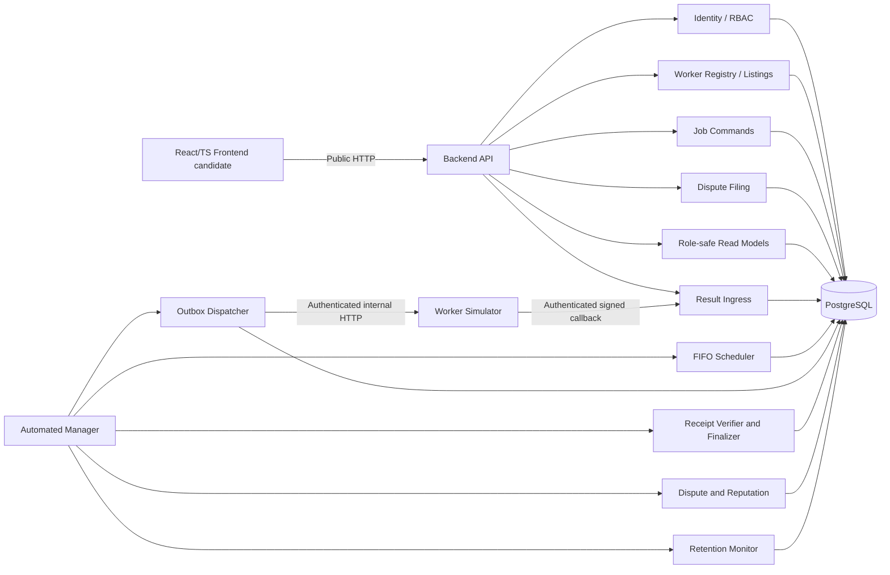
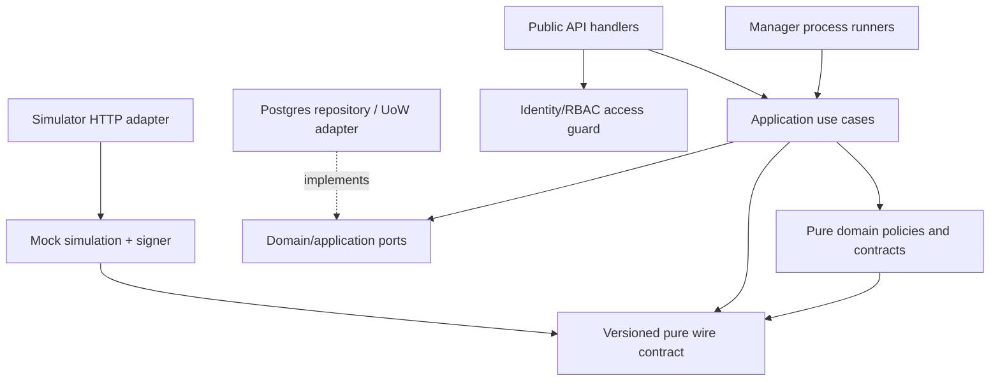
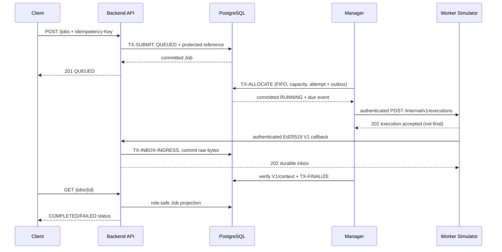

# GPU Resource Marketplace — Module Design

**Version:** v0.2 — approved module and responsibility design baseline (Markdown only)  
**Date:** 2026-10-18  
**Status:** **APPROVED_DESIGN** by user review on 2026-10-18 for the logical module responsibilities, dependencies and eight `MODOWN` test designs. All ADR-001..008 boundaries remain binding; module/interface names are design labels, not implemented packages. ADR-008 Option B is **ACCEPTED** (2026-10-18). No application code, migration or test runner exists (`NOT_STARTED` / `NOT_RUN`).  
**Target path:** `docs/design/module-design.md`  
**Scope:** the real simulation-only GPU Marketplace MVP (736 VU test target, 23-day history, 7-day Dispute filing, 18-hour CR response). The separate AD-090 assignment variant is out of scope.

## 1. Goal and documentation workflow

**Goal:** turn already approved Requirements, ADRs, Database Design and [API Contract](api-contract.md) into a clear **module ownership and dependency map** that five developers can implement without duplicating business rules or creating extra services.

**Workflow:** (1) freeze accepted process/DB trust boundaries; (2) allocate responsibility for the six P0 business modules and cross-cutting concerns; (3) map each API/Manager operation to one owner and transaction; (4) define interface directions and sensitive-data rules; (5) specify failure ownership and future review tests. This document adds **no MVP feature** and **does not implement the interfaces**.

Normative sources: [SRS](../requirements.md), [FR](../functional-requirements.md), [NFR](../non-functional-requirements.md), [System Architecture](../architecture/system-architecture.md), [Quality Scenarios](../architecture/quality-attributes.md), [Database Design](database-design.md), [API Contract](api-contract.md), [ADR-001](../architecture/decisions/ADR-001-modular-monolith.md), [ADR-002](../architecture/decisions/ADR-002-postgresql-access-boundaries.md), [ADR-003](../architecture/decisions/ADR-003-internal-communication.md), [ADR-004](../architecture/decisions/ADR-004-signed-result.md), [ADR-005](../architecture/decisions/ADR-005-retry-timeout-internal-auth.md), [ADR-006](../architecture/decisions/ADR-006-dispute-retention.md), [ADR-007](../architecture/decisions/ADR-007-load-test-configuration.md). [ADR-008](../architecture/decisions/ADR-008-technology-stack.md) is **ACCEPTED**; application package naming remains flexible under its approved boundaries.

## 2. Frozen runtime boundaries (APPROVED by existing ADRs)

1. **One logical modular-monolith backend codebase** with reusable domain/DB abstractions, **three independently running processes**: Backend API, Automated Manager and Worker Simulator. Frontend + PostgreSQL are supporting components, not extra business agents. This does not imply microservices or cross-module networks.
2. **Backend API** owns user authentication/RBAC, Worker Listing commands, Client Job submission/cancel, Client Dispute creation, role-scoped reads, and durable Result Inbox ingress. It **does not** choose Job execution order, accept a Worker result as final, modify reputation aggregates or arbitrate Disputes.
3. **Manager** owns scheduling, GPU allocation/release, execution attempts, Outbox dispatch, Inbox processing + Ed25519 verification, Job finalization/`SYSTEM_FAULT`, reputation and automated Dispute adjudication/retention.
4. **Worker Simulator** owns deterministic mock workload execution and access to Worker **private** signing keys. It has **no PostgreSQL direct connection, application DB credential, private oracle, Client authentication context or browser-facing endpoint**. It only receives authenticated internal dispatch and sends authenticated signed callbacks.
5. PostgreSQL is the **state authority**. HTTP requests and process memory are not success/commit evidence. Internal dispatch and results use ADR-003 Outbox/Inbox; retry timings and Bearer service tokens follow ADR-005; signatures follow ADR-004. No external queue broker or payment processor is introduced.

Arrows in this picture indicate allowed runtime interactions, **not** source-code imports. `UI`/framework families are accepted in ADR-008; the diagram still represents logical dependencies rather than implemented package imports. PostgreSQL/three-process access rights are binding.

## 3. Module catalog: responsibility, data, API and invariants

The original **six business modules** remain **M1 Worker Registry & Listings, M2 Job Lifecycle & Scheduling, M3 Signed Result, M4 Dispute Mock, M5 Reputation, M6 Dashboard**. Additional items below are *internal logical parts* or cross-cutting capabilities, **not** new business modules or new database tables. Package names are **proposed** identifiers, not immutable filesystem paths.

| Proposed logical module / owner | Single responsibility and owned rules | Authoritative data and access | Public/internal contracts |
|---|---|---|---|
| `identity` (API, cross-cutting) | Authenticate preseeded user, resolve unique role and active status; guard routes; 900s stateless token policy | `users`, `roles`, `user_roles`; read or controlled seed only | Login/Me/Logout; end-user Bearer; audit redaction |
| `registry` (M1, API) | Provisioned Worker read model, create/edit/pause/resume Listings, guard hardware/capacity and Worker ownership | `workers`, `worker_public_keys` public verification metadata, `gpu_listings`; API writes Listings | `GET/POST/PATCH /gpu-listings`, pause/resume; Worker reputation projection |
| `jobs` (M2 command boundary, API) | Validate Client submit; immutable Job identity; idempotency during retained Job life; QUEUED-only owner cancellation | `jobs`, paired protected `simulation_references` created in `TX-SUBMIT`; API may only write submit/cancel state | `POST/GET /jobs`, cancel; no `RUNNING` command |
| `scheduling` (M2 Manager) | Strict FIFO head selection (`enqueue_seq`), no head bypass, serialized capacity allocation, Pause-aware selection | `gpu_listings`, `jobs`, `allocations`, `execution_attempts`, `execution_outbox` | Manager-only scheduler boundary and `TX-ALLOCATE` |
| `execution_delivery` (M2 support, Manager) | Durable Outbox leasing, same-attempt dispatch, timeout/repair retry; 202 ACK not terminal | `execution_outbox`, `execution_attempts`, guarded Job reads; **Outbox-only lease transactions** | Internal dispatch HTTP; ADR-005 backoff/lease |
| `simulator` (isolated runtime) | Deterministic mock work, sign immutable ADR-004 V1 result using injected Worker private key; resend signed bytes when ACK lost | No DB access, no protected reference; private key only in Simulator runtime | `POST /internal/v1/executions`; callback |
| `result_ingress` (M3 boundary, API) | Authenticate callback service; bind to current persisted Job/Attempt and timestamp; store raw envelope durably **without claiming valid signature** | API INSERT `result_inbox`; Listing/Job read+guard via TX-INBOX-INGRESS | `POST /internal/v1/results/callback` |
| `result_verification` (M3 Manager) | Verify exact JCS + Ed25519 V1 with historical public key and context; accept once or reject candidate | Read `worker_public_keys`, `result_inbox`, Job context; INSERT immutable `signed_results` via Manager | Inbox consumer; read-only Signed Result projection via API |
| `finalization` (M2/M3 Manager) | Terminal Job write, single GPU release, one contribution and related Inbox status in **one transaction**; Manager-only SYSTEM_FAULT fallback | `jobs`, `allocations`, `gpu_listings`, `job_reputation_contributions`, aggregates | TX-FINALIZE / TX-DEADLINE-FALLBACK; no public mutation |
| `disputes` (M4 split API/Manager) | API filing eligibility and strict 7d cutoff; Manager automatic oracle comparison and one-time decision | API INSERT `disputes` under Job lock; Manager UPDATE resolution; read protected `simulation_references` | Client POST/GET Dispute; Manager TX-RESOLVE; **no Admin ruling** |
| `reputation` (M5, Manager write; API read) | Aggregate eligible signed results; one-time UPHELD correction, no effects for SYSTEM/invalid/CANCELLED | Manager writes `job_reputation_contributions`, `worker_reputation_aggregates`; API reads projections | Worker reputation GET; no public update route |
| `reporting` (M6, API read) | Role-scoped Client/Worker/Admin dashboards; safe Listing/Job/reputation snapshots | Read-only role-filtered projections from approved tables; no trusted writes | `/dashboard/*`, no WebSocket need |
| `retention` (cross-cutting Manager) | Guard 23d evidence cleanup, hold OPEN Disputes, alert/retry cadence, separate audit TTL | Manager writes `retention_exceptions`, authorized deletions; `audit_events` 23d independent | Scheduler/monitor only; Admin read alerts |
| `audit_observability` (cross-cutting) | Request correlation and redacted audit events; diagnose retry/rejection without secrets | Append `audit_events`, separate lifecycle | `X-Request-ID`; internal diagnostics |

**Single owner rule:** an interface may **read** data owned by another module through a safe query/projection, but it cannot independently **reimplement or mutate** that module's business transition. The API and Manager can share repository/domain source while preserving the command ownership above.

## 4. Source dependency direction and business-policy enforcement (APPROVED_DESIGN)

### 4.1. Small dependency rule set

- **Transport/adapters (outer layer)** parse input, resolve authenticated principal, validate DTO and invoke one authorized application operation. No FIFO, Dispute-clock, signature-oracle comparison or reputation delta calculation lives in controllers.
- **Application/use-case orchestration (middle layer)** selects its domain policy and explicitly named transaction port; it does not build ORM queries inside unrelated controllers. Domain rules are independent of the web framework.
- **Domain/policies (inner layer)** own state machines, FIFO eligibility, Signed Result canonical-validation semantics and contribution categories, without importing API framework, HTTP clients, UI or PostgreSQL driver.
- **Database/infrastructure adapters (outer layer)** implement transaction boundaries and optimistic/row-lock protections. Dependency inversion is **logical**; code may remain in one repository and one deployable API/Manager domain codebase.
- **Simulator** shares **wire schemas and pure deterministic simulated-input definitions** only. It must not import the PostgreSQL repository or trusted Manager oracle logic, and must not receive `simulation_references.seed_value`/expected outcome/digest.

*Diagram arrows point from caller/importer to required abstraction; dashed edge is dependency-inversion implementation. The proposed names are not proof that packages exist.*

### 4.2. Minimal proposed ports/interfaces (contract responsibilities, no code)

| Port/interface name (conceptual) | Inputs / outputs (types conceptual) | Owner and invariant |
|---|---|---|
| `AuthenticatedPrincipal` | Trusted `(user_id, role, active)` + source identity type | Identity guard; never accept UI-declared roles |
| `ListingCommandPort` | Create/Edit/Pause/Resume command -> Listing projection or typed error | Registry; Listing locked; no cross-owner changes |
| `JobCommandPort` | Submit `(client, listing, gpu, duration, idemKey)` -> QUEUED; Cancel `(client, job)` -> CANCELLED | Jobs; serialized with Manager by Listing/Job lock |
| `FIFOSelectionPolicy` | Locked Listing state + immutable queued ordering -> head-only eligibility | Scheduling; never `SKIP LOCKED` on a Job head |
| `ExecutionOutboxPort` | Stable event/attempt + retry due/lease version -> fenced dispatch | Manager Delivery; no DB lock over HTTP |
| `ResultIngressPort` | Authenticated raw signed envelope + DB-trusted ingress time -> durable inbox or rejection | API; **no cryptographic acceptance** |
| `ReceiptVerificationPort` | Exact raw JCS bytes, registered public key, expected Job context -> valid/invalid reason | Manager; follows ADR-004 and historic key binding |
| `FinalizePort` | Valid on-time Inbox candidate or due timeout -> atomic terminal/release/contribution or no-op | Manager; one business effect |
| `DisputeFilingPort` | Client + Job + reason + DB clock -> one OPEN or error | API; `<7 days` strict cutoff |
| `DisputeAdjudicationPort` | OPEN + immutable signed evidence + protected reference -> RESOLVED + one net delta | Manager; no manual decision/receipt edits |
| `RetentionPolicyPort` | Trusted now + terminal/dispute/exception state -> HOLD or guarded PURGE | Manager; never purge OPEN evidence |
| `RoleScopedQueryPort` | Principal + scope/filter -> safe projections | API Reporting; SQL-enforced tenant/role scope |

**Do not** introduce an externally reachable “adapter for a third-party privacy erasure service”: that is an **AD-090 assignment scenario**, not an approved marketplace MVP capability.

## 5. Data write ownership and required atomic transactions

| Data or change | API | Manager | Simulator | DB enforcement required |
|---|---|---|---|---|
| `users`, `roles`, `user_roles` | Seed/auth read (controlled provisioning only) | No role changes | None | Exactly one role/user; active status checked |
| Worker Registry, key metadata | Controlled setup / Listings | Read public keys for verify | Private signing key injected, not DB | Worker-key FK, key retention |
| Listing metadata/status | **Authoritative write** | Read Listing status; authoritative allocated count | None | Listing lock; `0<=allocated<=total` and queued max guard |
| Job submit / QUEUED cancel | **Authoritative write** | No API-originated cancel | None | Listing-before-Job lock, legal state transitions |
| Job RUNNING/terminal, Allocation, Attempt | Read | **Authoritative write** | None | FIFO, one allocation/job, once-only release |
| `simulation_references` | Protected insert on submit | Protected read for Dispute | **No access** | Immutable reference; same-commit with Job |
| `execution_outbox` | No writer | **Authoritative writer** | HTTP receiver only | Fenced lease / stable attempt |
| `result_inbox` | **Authenticated insert** | Update processing status | Callback sender only | Before-deadline lock/commit, unique result ID |
| `signed_results` | Read safe public projection | **Insert accepted evidence** | Sends signed claim | Immutable bytes; one accepted result/job |
| Dispute filing | **Insert OPEN** | **Resolve only** | None | `<7d`, unique Job, owner + receipt FK |
| Reputation contribution and aggregate | Read | **Authoritative write** | None | One contribution/correction/job, nonnegative counters |
| Retention exceptions / cleanup | Read safe Admin summary | **Authoritative write** | None | Guarded hold/purge; separate audit TTL |
| Audit events | Append redacted | Append/purge | Minimal redacted HTTP errors | 23d audit TTL; zero secrets |

**SQL privilege warning:** This is a **logical** write-right map. The physical database grants/triggers/functions must implement it after coding approval. Do not equate a table column's presence with permission for every DB-connected service to UPDATE it.

### 5.1. Transaction map (references approved `database-design.md` §11)

| Command/callback owner | Transaction(s) | Lock / outcome invariant |
|---|---|---|
| Client submit | `TX-SUBMIT` | Listing locked, immutable FIFO `enqueue_seq`, Job+reference atomic |
| Worker metadata/Pause/Resume | `TX-PAUSE-EDIT` | Listing lock, no forbidden hardware edit/capacity shrink |
| Client cancel | `TX-CANCEL` | Listing then Job, only QUEUED -> CANCELLED |
| Manager scheduler | `TX-ALLOCATE` | Listing then **true FIFO-head** Job, atomic RUNNING+allocation+attempt+outbox |
| Manager dispatcher | `TX-OUTBOX-CLAIM/ACK/RETRY` | **Outbox-only** short fenced lease transaction; HTTP outside DB transaction |
| Simulator callback | `TX-INBOX-INGRESS` | Service auth then Listing -> Job; DB `received_at < hard_deadline_at`; 202 after commit |
| Manager verifier/finalizer | `TX-FINALIZE` or `TX-DEADLINE-FALLBACK` | Listing -> Job -> Allocation -> Inbox -> Contribution -> Aggregate, one terminal effect |
| Client dispute filing | `TX-OPEN-DISPUTE` | Listing -> Job, DB trusted half-open 7d filing window |
| Manager dispute resolver | `TX-RESOLVE-DISPUTE` | Listing -> Job -> Dispute -> Contribution -> Aggregate -> Exception |
| Manager retention | `TX-RETENTION-MONITOR/CLEANUP`, `TX-AUDIT-PURGE`, `TX-UNBOUND-INBOX-PURGE` | Eligible Job expires at 23d; open Dispute holds; audit on own TTL |

**Non-negotiable locking rule:** when interacting with domain rows, Listing before Job; only lock later row levels afterward; never hold domain locks over an HTTP call. `SKIP LOCKED` may distribute **Listing** or **Outbox** claims, but not bypass an unfit FIFO head Job. PostgreSQL `READ COMMITTED` with fresh predicates **after locks** is the approved design, not a proven implementation result.

## 6. Runtime sequences and failure ownership

### 6.1. Normal Job life

If Worker signs a **valid but false** claim, keep original accepted receipt. Only a later eligible Client Dispute triggers independent trusted oracle comparison and **one** effective aggregate correction.

### 6.2. Failure path and recovery responsibilities

| Injected failure | Owner of recovery | Persisted oracle after recovery |
|---|---|---|
| Manager crashes just after allocation commit | Manager Outbox dispatcher | Same `attempt_id` dispatched after restart; no lost committed Job |
| Dispatch ACK lost or Simulator restarts | Dispatcher + Simulator deterministic mock | At-least-once HTTP, stable attempt, at most one terminal business effect |
| Callback HTTP ACK lost | Simulator retries same signed bytes / result_id | Inbox duplicate no-op; no second accepted result |
| Manager down after Inbox commit | Manager Inbox consumer | On-time receipt verified after restart even past hard deadline |
| Invalid Ed25519 receipt | Manager Receipt Verifier | Inbox REJECTED; Job remains RUNNING until valid candidate/deadline; no penalty by invalid input |
| Callback at hard deadline | API ingress + Manager deadline fallback | New receipt rejected at equality; eligible earlier Inbox processed first |
| DB outage during mutation | Owning API/Manager operation | No fabricated commit/202, safely retried once DB healthy |
| Dispute resolver offline on day 23 | Manager Retention + Adjudication | OPEN evidence hold; WARNING within 1h, CRITICAL 24h, retry 15m; no purge |
| Cleanup process interrupted | Manager Retention | Guarded transaction rollback or idempotent re-run, lifetime aggregate intact |

**Trusted clocks:** `submitted_at`, `started_at`, Inbox `received_at`, Job `terminal_at`, Dispute `filed_at` are separate database-trusted instants. Worker signed `finished_at` never controls acceptance, 7d filing or 23d cleanup. ADR-005 transport budgets are fixed (2s poll, 30s lease, 2/5s connect/total timeout, 2/4/8/16/30s backoff, grace 120s), but none has been benchmarked.

## 7. Observability, security and maintainability

- Every external request and internal delivery gets a redacted `correlation_id`/request ID; use stable `job_id`, `attempt_id`, outbox event and inbox/result IDs to reconstruct a retained Job's signed verification and dispute decision **without storing secrets**. Use immutable domain evidence for hold; operational `audit_events` expires 23d from **event creation** even if a Job hold persists.
- Direct DB writes to source-of-truth fields are disabled for unauthorized service roles; frontend route guards are only UX, never ownership enforcement.
- Treat signed Worker result as **authenticated claim**, not ground truth. No Manager private Worker signing keys; no Simulator public DB role/connection; no Oracle leakage.
- Design for change locality: a different scheduling rule affects `scheduling` policy and tests, not HTTP controller, signature verifier, finance (not in MVP) or immutable signed byte format. FIFO is still the shipped default.
- **Code smell prevention:** controllers may route/validate only, not combine identity, DB locks, Scheduler, signature handling, retention and HTTP retries. No claim is made that an oversized controller currently exists: **there is no production source code yet**.
- Signed Result V1 API/serializer is versioned and frozen by ADR-004. An experimental V2 change belongs to future QA-MOD-02 exercise, not MVP P0 code.

## 8. Module design verification gates (documentation-design only)

| ID | Design / future test assertion | Required PASS evidence after implementation |
|---|---|---|
| `MODOWN-01` | API cannot issue `RUNNING`/terminal/reputation commands | API handler/service map and DB-role enforcement show 0 direct violations |
| `MODOWN-02` | Simulator has no application DB access | Compose/service credentials and network probe; direct access fails |
| `MODOWN-03` | No trusted oracle data in Simulator dispatch or public DTOs | Wire DTO allowlist scan and negative contract assertions |
| `MODOWN-04` | FIFO policy enforced in one authoritative Scheduler path | Queue seed `A3,B2,C1` on L4 yields A only and one allocation |
| `MODOWN-05` | Finalization and reputation once only | Replays/crash boundaries leave 1 accepted result, 1 release, max 1 contribution |
| `MODOWN-06` | Dispute + retention policies have one Manager owner | At day23 OPEN dispute evidence held; after resolve cleanup safe, aggregate persists |
| `MODOWN-07` | Controller/service responsibilities stay cohesive | Module import/ownership map; no business policy duplicated across route handlers |
| `MODOWN-08` | Worker/Client/Admin read projections do not cross tenants | API role matrix and object-level authorization tests pass |

**Status:** all `MODOWN-01..08` are **APPROVED_DESIGN**, `NOT_RUN`. See [Test Design](test-design.md) for priorities, fixtures and proof obligations. Architectural test IDs approved earlier (COM/RT/SEC/INT/DAT/DBTX) are authoritative; these checks only provide cross-boundary traceability, not substitute for their assertions.

## 9. Implementation handoff and decisions requiring review

| Item | Design state | Next reviewer action |
|---|---|---|
| Three-process modular monolith; API+Manager DB, Simulator no DB | **ACCEPTED ADR-001/002** | Preserve as hard boundary |
| Durable Outbox/Inbox and retry/auth | **ACCEPTED ADR-003/005** | Preserve as hard boundary |
| V1 Ed25519 result and retained evidence | **ACCEPTED ADR-004/006** | Preserve as hard boundary |
| 18-table data model and lock order | **APPROVED DESIGN**, tests `NOT_RUN` | No physical schema changes without review |
| Logical module responsibilities, dependency directions and interface boundaries | **APPROVED_DESIGN** | Preserve single policy owner; package names can evolve with explicit review |
| Documented API route/DTO design | **APPROVED_DESIGN** with bounded Auth/internal payload choices OPEN | Resolve open details in [API Contract](api-contract.md) before coding |
| Concrete Python/FastAPI+React toolchain | **ADR-008 ACCEPTED (2026-10-18)** | Pin compatible dependency/image digests at implementation; no coding before separate authorization |
| Production code, migration, automated tests, DB benchmark | **NOT_STARTED / NOT_RUN** | **Do not implement without explicit user authorization** |

The final assignment AD-090 may later cite real implementation commits, but its separate privacy-deletion variant **must not contaminate** the MVP module graph or data-retention policies before a real project change request is approved.
