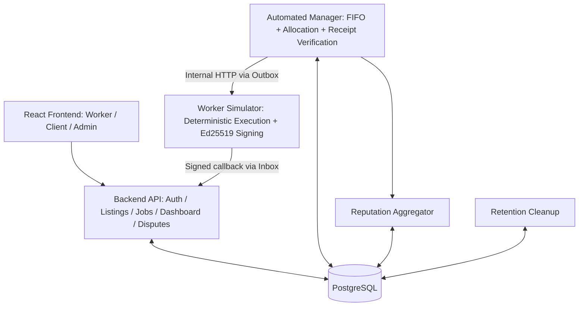

# GPU Resource Marketplace - FR/NFR Consistency and Architecture Readiness

**Date:** 2026-10-18  
**FR baseline:** `docs/functional-requirements.md` v1.2 (21 P0 FRs).  
**NFR baseline:** `docs/non-functional-requirements.md` v1.2.  
**Purpose:** protect consistency before detailed architecture, database, and API contracts.

## 1. Traceability matrix

| Functional module / FR | Relevant NFRs | Required design consequences |
|---|---|---|
| M1 Worker Registry (FR-WR-01..04) | S01-S04, D01, D03, M01 | Authorize per Worker; keep public keys/key ID for extant signed results; persist active listings independent of job TTL. |
| M2 Job Lifecycle (FR-JL-01..06) | P01-P05, R01-R04, R06-R08, D02, M02 | DB-transactional allocation; strict FIFO per listing; persisted deadlines; terminal time starts TTL; robust cancel/pause races. |
| M3 Signed Result (FR-SR-01..04) | S03-S07, R04, R07, D03 | Worker Simulator owns private keys; Manager verifies canonical signed payload and contextual IDs; unique receipt acceptance. |
| M4 Dispute Mock (FR-DP-01..03) | S02, S06, R05, D03, D06, D08 | One dispute/job; deterministic hidden reference; immutable signed evidence; bound dispute to retention; idempotent settlement. |
| M5 Reputation (FR-RP-01..02) | D01, D05-D07, R05 | Lifetime per-Worker counters, atomic contribution corrections; do not recompute lifetime reputation solely from expiring job history. |
| M6 Dashboard (FR-DB-01..02) | P01-P04, S01-S02, D01, M01 | Role-filtered read endpoints; safe polling; show aggregate lifetime score + sample size without exposed expired job data. |
| Project/change workflow | O01, M02-M04 | Log initial assessment within 18h, document setup, CI for correctness-critical cases. |

## 2. Required FR clarifications (non-scope-expanding addendum)

### FR-RP-01 - use lifetime aggregates

**Clarify:** For each verified and eligible job, persist an idempotent per-job contribution during its 23-day lifetime AND atomically update durable per-Worker lifetime counts `successful_jobs` and `worker_fault_jobs`. Display score from aggregate counts. The original wording 'calculate from job history' must not imply that all historical job details remain forever.

### FR-RP-02 - disputes change effective classification

**Clarify:** When a dispute is `UPHELD`, determine the effective outcome from the protected simulation reference; atomically replace the old per-job contribution and apply only the corresponding counter delta. Preserve the original signed receipt. Repeated resolution must not alter counts twice. Per-job before/after detail is retained only within the 23-day window.

### FR-DP-01 / FR-DP-03 - dispute lifetime

**Clarify:** Only jobs with accepted signed receipts, retained evidence, and eligible terminal states may be disputed. The Manager normally resolves disputes deterministically without human arbitration. A dispute cannot be opened after evidence deletion. The Client filing deadline is `[terminal_at,terminal_at+7d)`. A timely Dispute still OPEN at 23-day expiry causes a durable evidence hold until RESOLVED with no hard maximum; Admin warning <=1h after exception detection, CRITICAL at 24h OPEN, Manager retry every 15m when healthy, and cleanup of already-expired evidence <=1h after resolution. No silent deletion of unresolved evidence.

### FR-JL-05 / FR-SR-04 - invalid result behavior

**Clarify:** Reject cryptographically invalid results without immediately attributing fault to the Worker. Retry and, after a configured timeout, terminalize `FAILED/SYSTEM_FAULT`, then release GPU once. A signed but semantically false result can still be accepted as a receipt and later be overturned by a dispute; signature verification and correctness of reported outcome are different checks.

### FR-WR-01 / FR-SR-01 - key lifetime

**Clarify:** Persist `key_id` and public-key material for any still-retained signed result, even if a Worker changes keys. Key rotation UI is out of MVP; no private keys in Worker Registry APIs or the repository.

## 3. Cross-cutting invariants

```text
0 <= listing.allocated_gpu <= listing.total_gpu
Job: QUEUED -> RUNNING -> (COMPLETED | FAILED)
Job: QUEUED -> CANCELLED
Listing: ACTIVE <-> PAUSED
PAUSED means no new submissions or allocations; existing RUNNING jobs finish
one accepted signed final result at most per job
one dispute at most per eligible job
one effective reputation contribution at most per job
history expiration = job.terminal_at + 23 days
Worker lifetime counters outlive expired job histories
```

## 4. Approved architecture boundaries and transport



**Approved:** one repository Modular Monolith; Backend API, Manager and Worker Simulator are separate processes; API and Manager directly use PostgreSQL via shared modules; Simulator has no application DB access. **Accepted (ADR-003, 2026-10-18):** internal HTTP Manager -> Simulator and signed callback Simulator -> API with PostgreSQL Outbox/Inbox. **Suggested framework stack (not yet approved):** React/TypeScript, FastAPI, Docker Compose. No Redis, Celery, Kubernetes or real GPUs required for MVP.

**Why this split:** Worker Simulator holds signing keys; Manager verifies instead of signing its own Worker receipts. PostgreSQL is shared durable coordination state; Manager can resume jobs using stored deadlines. A distinct process is a demonstration trust boundary, NOT a production security guarantee if all services run on the same host under the same administrator.

## 5. Minimal initial data model (not final schema)

```text
users, roles, user_roles
workers, worker_public_keys, gpu_listings
jobs, allocations, simulation_references
signed_results, disputes
job_reputation_contributions, worker_reputation_aggregates
audit_events
```

**Important constraints:**

- `signed_results.job_id` unique for an accepted result; `result_id` unique; persistent uniqueness prevents replay side effects.
- `disputes.job_id` unique; Client ownership check in API.
- `job_reputation_contributions.job_id` unique and updates within the same transaction as `worker_reputation_aggregates`.
- `allocations` and `gpu_listings` modified with row locks/conditional updates; `allocated_gpu <= total_gpu` protected at the database boundary.
- `simulation_references` created before receiving a result and readable only by trusted internal components.
- Terminal histories are deleted together; Worker-level aggregates remain.

## 6. Recommended implementation sequence

1. Repository skeleton, Compose, database migrations, CI and pre-seeded accounts.
2. Worker Registry and Listing APIs, ownership and Pause/Resume.
3. Job submit/cancel, strict per-listing FIFO and atomic allocation.
4. Persisted deterministic simulation timeline and Manager recovery.
5. Ed25519 signed receipt and verification/replay tests.
6. Deterministic mock dispute and idempotent reputation deltas.
7. Role dashboards, 23-day cleanup with fake-clock tests, load test with 736 VUs.

## 7. Architecture Decision status (2026-10-18)

- **ADR-001 ACCEPTED:** Modular Monolith with separate API, Manager and Worker Simulator processes.
- **ADR-002 ACCEPTED:** API/Manager access PostgreSQL directly; Worker Simulator never accesses the application DB.
- **ADR-003 ACCEPTED:** internal HTTP with PostgreSQL transactional Outbox/Inbox; see `architecture/decisions/ADR-003-internal-communication.md`.
- **ADR-004 ACCEPTED:** RFC 8785 JCS + Ed25519 V1 signing bytes, 11-field schema, `key_id` policy and public signature vector; `architecture/decisions/ADR-004-signed-result.md`.
- **ADR-005 ACCEPTED:** directional service Bearer authentication, persisted retry/lease, deadline and backoff; `architecture/decisions/ADR-005-retry-timeout-internal-auth.md`.
- **ADR-006 ACCEPTED:** 7-day Dispute filing and unresolved evidence held until RESOLVED (no fixed maximum), including warning/CRITICAL/retry/cleanup; see `architecture/decisions/ADR-006-dispute-retention.md`.
- **ADR-007 ACCEPTED:** 736-VU k6 profile, 1x/5x fixed data, specified reference hardware and 128 in-flight Simulator attempts; implementation benchmark still `NOT_RUN`.
- **ADR-008 ACCEPTED (2026-10-18):** Option B Python 3.12/FastAPI, React 19/TypeScript, PostgreSQL 16 and Compose v2 reference stack and ten `STACK-01..10` test designs approved; actual tests `NOT_RUN`. See `architecture/decisions/ADR-008-technology-stack.md`.

**Test designs:** all 11 QA scenarios reviewed, execution `NOT_RUN`; six newly proposed `DAT-EX-01..06` monitoring tests need separate test-design review. See `architecture/quality-attributes.md` v0.12.

Do not begin an elaborate multi-service cluster before these decisions; prioritize one end-to-end job-to-signed-result-to-dispute path.
